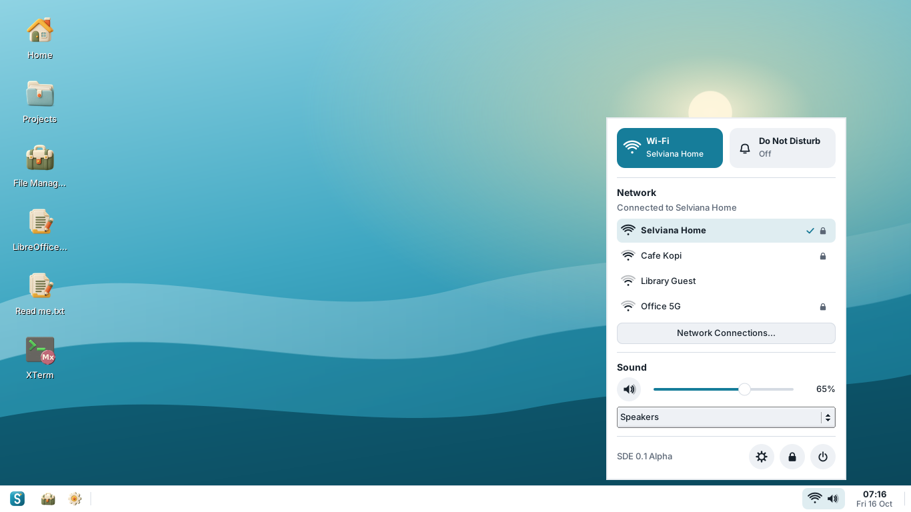
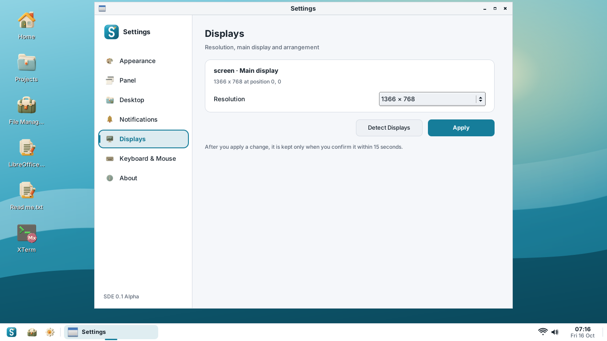

# Selviana Desktop Environment (SDE)

**A small, fast and modern desktop environment for Debian and Ubuntu.**

Development version **0.1 Alpha 3** (`0.1.0~alpha3`) · October 2026 · GPL-3.0-or-later



SDE combines a **Rust core** for configuration and XDG autostart with a **C++17**
interface using **FLTK**, **cairo**, **Xlib** and **libdbus**, and **Openbox** as its
window manager. It is the successor of the EDE idea: small and quick. Migration
to Rust is underway; the panel, desktop and settings interface remain C++.
The earlier alpha2 session measured about **22 MB of private memory**; alpha3
has not yet been profiled. See the [Rust migration guide](docs/RUST.md).

> **Alpha software.** 0.1 is the first series of SDE builds. It is meant for testing
> and development, not for daily use yet. See the [roadmap](docs/ROADMAP.md).

## Components

| Program | What it does |
| --- | --- |
| `startsde` | Session entry point used by display managers (`/usr/share/xsessions/sde.desktop`) |
| `sde-session` | Session manager: starts Openbox, desktop, panel, notifications, polkit agent and XDG autostart; restarts crashed parts; shows a rescue dialog instead of a black screen; `--check` finds missing packages |
| `sde-autostart` | Native Rust XDG autostart launcher; `--dry-run` explains which entries would start or be skipped |
| `sde-panel` | Panel at the bottom or top: searchable application menu, pinned apps (right-click to pin, drag to reorder), taskbar, XEmbed and StatusNotifierItem/AppIndicator tray, quick settings, calendar, auto-hide |
| `sde-notifyd` | Desktop notifications (`org.freedesktop.Notifications`) with action buttons and Do Not Disturb |
| `sde-desktop` | Wallpaper and desktop icons, right-click menu (View, Sort by, Refresh, New, terminal, file manager) and keyboard shortcuts |
| `sde-settings` | Appearance (light/dark, accent, interface size 100-200 %), panel, desktop, notifications, displays, keyboard & mouse, about |
| `sde-run` | Run Command dialog (Alt+F2) |
| `sde-logout` | Lock, suspend, log out, restart, shut down |

**Quick settings** use the services the system already has: NetworkManager (`nmcli`)
for Wi-Fi and Ethernet, PulseAudio or PipeWire (`pactl`) for volume, mute and the
output device, systemd-logind for screen brightness and the kernel for the battery.

## Screenshots

| | |
| --- | --- |
|  |  |
|  |  |
|  |  |
|  |  |
|  |  |

Taken with `tools/screenshot.sh` on Ubuntu 24.04 with the Eduka-Icons theme. The Wi-Fi
networks shown are sample data from a stand-in for `nmcli` (the test machine has no
Wi-Fi).

## Install

Supported: **Debian 12 (bookworm), Debian 13 (trixie), Ubuntu 22.04 and 24.04** (amd64).

Download the package for your distribution from the
[GitHub releases](https://github.com/hugomonizdorego/SDE-Desktop/releases), check it
and install it with `apt`, which also installs the dependencies:

```sh
sha256sum -c SHA256SUMS --ignore-missing
sudo apt install ./sde_0.1.0-alpha2_ubuntu24.04_amd64.deb
```

Log out, choose **SDE** at the login screen and log in. From a text console you can
use `startx /usr/bin/startsde`.

`release/` holds the older alpha2 Ubuntu 24.04 build. Build from source below to
test the alpha3 Rust changes; a new binary release is not included here.

> **Do not install with `dpkg -i` alone** (for example in a Cubic chroot) without
> running `sudo apt install --fix-broken` afterwards: without its libraries the panel
> cannot start. SDE now shows a rescue dialog in that case; see
> [troubleshooting](docs/TROUBLESHOOTING.md).

## Build from source

```sh
sudo tools/install-deps.sh      # Rust/Cargo, C++ compiler, CMake and desktop libraries
tools/build-deb.sh              # writes dist/sde_0.1.0~alpha3_<arch>.deb
```

Or a plain CMake build for development:

```sh
cmake -S . -B build -DCMAKE_INSTALL_PREFIX=/usr
cmake --build build -j"$(nproc)"
ctest --test-dir build          # unit tests, including WCAG contrast checks
sudo cmake --install build
```

See [docs/BUILD.md](docs/BUILD.md) for the full dependency list, screenshots and
releases.

## Keyboard shortcuts

| Keys | Action |
| --- | --- |
| Super, Alt+F1 | Application menu |
| Super+A | Quick settings |
| Super+C | Calendar |
| Alt+F2 | Run Command |
| Ctrl+Alt+T | Terminal |
| Super+E | File manager |
| Super+D | Show desktop |
| Super+Left / Right | Tile window to the left / right half |
| Super+Up / Down | Maximize / restore |
| Alt+Tab | Switch windows |
| Alt+Shift | Switch keyboard layout (when a second layout is set) |
| Ctrl+Alt+Delete | Log out dialog |

On the desktop: **F5** refresh, **F2** rename, **Delete** move to trash,
**Ctrl+Shift+N** new folder, **Enter** open, **Menu** or **Shift+F10** context menu,
arrow keys to select.

## Configuration

System defaults live in `/etc/xdg/sde/sde.conf`; per-user settings in
`~/.config/sde/sde.conf` (written by `sde-settings`). The Openbox configuration is
copied to `~/.config/sde/openbox/rc.xml` on first login. Session messages go to
`~/.local/state/sde/session.log`.

## Documentation

- [Programming language choice](docs/LANGUAGE.md)
- [Rust architecture, tests and migration plan](docs/RUST.md)
- [Building, dependencies and releases](docs/BUILD.md)
- [Troubleshooting (black screen, missing packages)](docs/TROUBLESHOOTING.md)
- [Roadmap from 0.1 Alpha to 1.0](docs/ROADMAP.md)
- [Translating SDE](po/README.md)
- [Changelog](CHANGELOG.md)

`bootstrap/` holds a pinned manifest and a fetch script for the original EDE
(Equinox Desktop Environment) sources. They are kept for reference only; SDE does
not build or ship EDE code.

## License

SDE is free software under the GNU General Public License, version 3 or later.
See [LICENSE](LICENSE).
