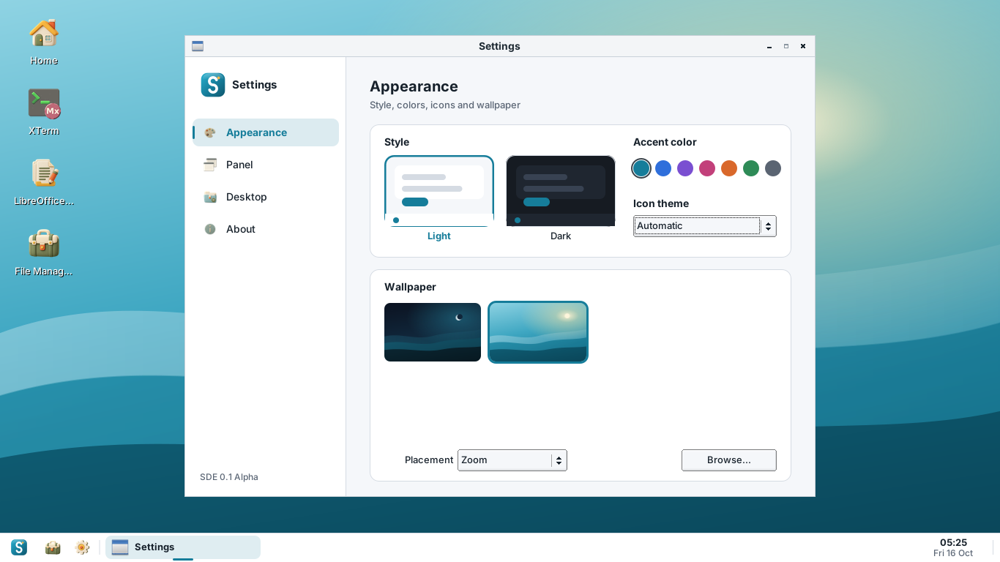
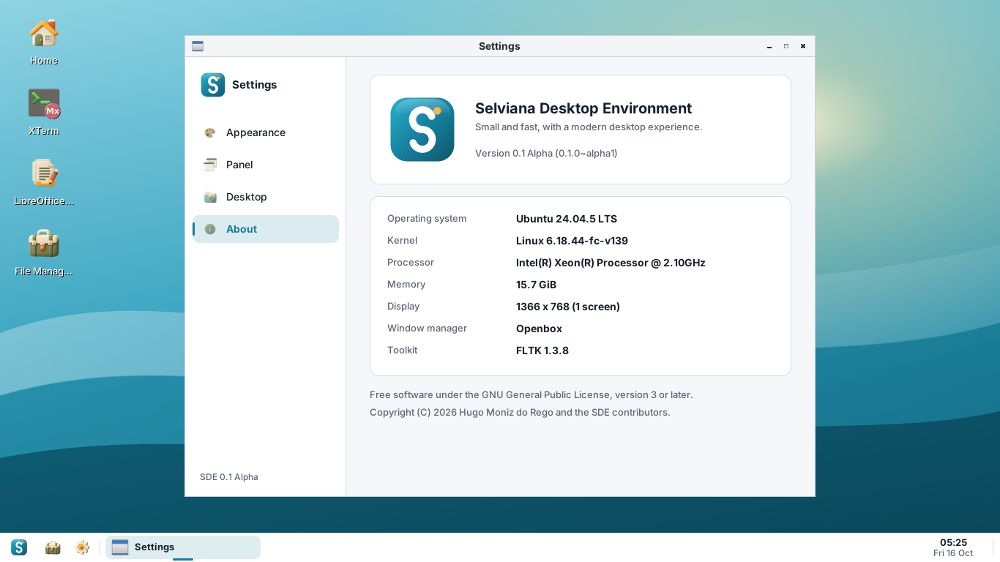
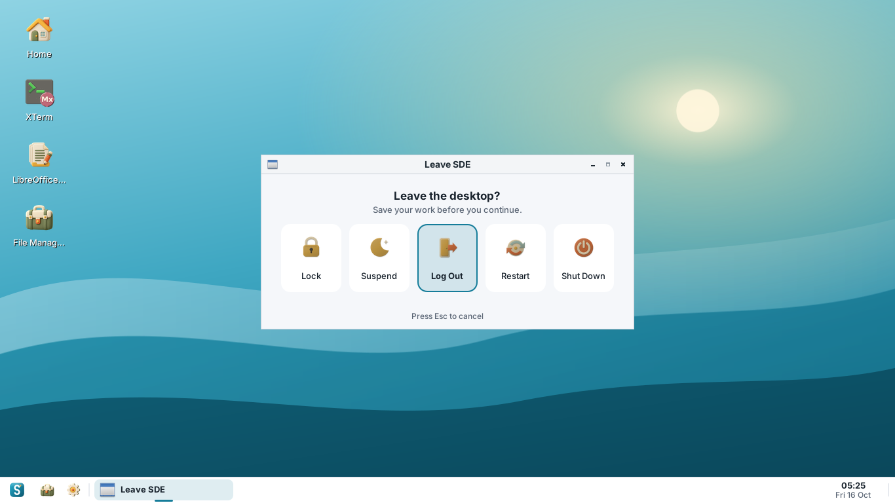
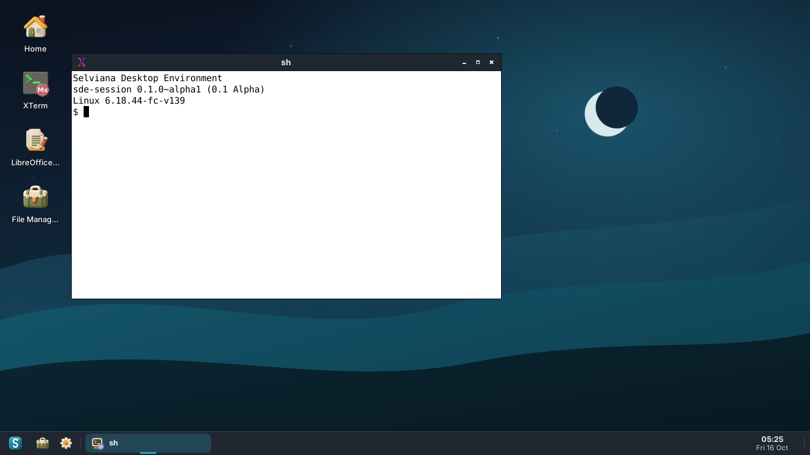
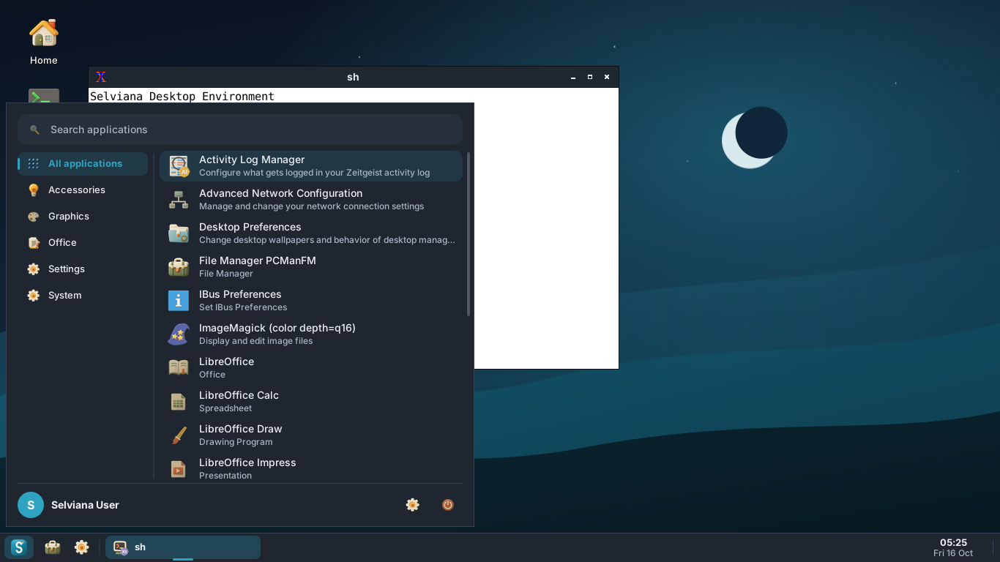

# Selviana Desktop Environment (SDE)

**A small, fast and modern desktop environment for Debian and Ubuntu.**

Version **0.1 Alpha** (`0.1.0~alpha1`) · October 2026 · GPL-3.0-or-later



SDE is written from scratch in **C++17** with **FLTK**, **cairo** and **Xlib**, and uses
**Openbox** as its window manager. It aims for low memory use, quick startup and a
clean interface with light and dark themes.

> **Alpha software.** 0.1 is the first build of SDE. It is meant for testing and
> development, not for daily use yet. See the [roadmap](docs/ROADMAP.md).

## Components

| Program | What it does |
| --- | --- |
| `startsde` | Session entry point used by display managers (`/usr/share/xsessions/sde.desktop`) |
| `sde-session` | Session manager: starts Openbox, desktop, panel, polkit agent and XDG autostart; restarts crashed parts |
| `sde-panel` | Bottom panel: searchable application menu, pinned apps, taskbar, system tray, battery, clock |
| `sde-desktop` | Wallpaper and desktop icons (Home, Trash, `~/Desktop`) |
| `sde-settings` | Light/dark theme, accent color, icon theme, wallpaper, panel and desktop options, system info |
| `sde-run` | Run Command dialog (Alt+F2) |
| `sde-logout` | Lock, suspend, log out, restart, shut down |

Data: Openbox configuration, `SDE` and `SDE-Dark` window themes, Selviana light and
dark wallpapers, the SDE logo, desktop entries and man pages.

## Screenshots

| | |
| --- | --- |
|  |  |
|  |  |
|  |  |

Screenshots were taken with `tools/screenshot.sh` on Ubuntu 24.04 with the
Eduka-Icons theme.

## Install the package

Supported: **Debian 12 (bookworm), Debian 13 (trixie), Ubuntu 22.04 and 24.04** (amd64).

```sh
sudo apt install ./release/sde_0.1.0~alpha1_amd64.deb
```

`apt` pulls in the dependencies (Openbox, librsvg, D-Bus, xdg-utils, fonts, FLTK and
cairo runtime libraries). Log out, choose **SDE** in your display manager and log in.
From a text console you can use `startx /usr/bin/startsde`.

The prebuilt package in `release/` was built on Ubuntu 24.04. On Debian 12 or
Ubuntu 22.04, build the package yourself (below) so it links against that
release's libraries; CI builds packages for all four releases.

## Build from source

```sh
sudo tools/install-deps.sh      # compiler, CMake, FLTK, cairo, librsvg, Xlib, debhelper
tools/build-deb.sh              # writes dist/sde_0.1.0~alpha1_<arch>.deb
```

Or a plain CMake build for development:

```sh
cmake -S . -B build -DCMAKE_INSTALL_PREFIX=/usr
cmake --build build -j"$(nproc)"
sudo cmake --install build
```

See [docs/BUILD.md](docs/BUILD.md) for the full dependency list and how to
take screenshots.

## Keyboard shortcuts

| Keys | Action |
| --- | --- |
| Super, Alt+F1 | Application menu |
| Alt+F2 | Run Command |
| Ctrl+Alt+T | Terminal |
| Super+E | File manager |
| Super+D | Show desktop |
| Super+Left / Right | Tile window to the left / right half |
| Super+Up / Down | Maximize / restore |
| Alt+Tab | Switch windows |
| Ctrl+Alt+Delete | Log out dialog |

## Configuration

System defaults live in `/etc/xdg/sde/sde.conf`; per-user settings in
`~/.config/sde/sde.conf` (written by `sde-settings`). The Openbox configuration is
copied to `~/.config/sde/openbox/rc.xml` on first login.

## Documentation

- [Programming language choice](docs/LANGUAGE.md)
- [Building and dependencies](docs/BUILD.md)
- [Roadmap from 0.1 Alpha to 1.0](docs/ROADMAP.md)
- [Changelog](CHANGELOG.md)

`bootstrap/` holds a pinned manifest and a fetch script for the original EDE
(Equinox Desktop Environment) sources. They are kept for reference only; SDE does
not build or ship EDE code.

## License

SDE is free software under the GNU General Public License, version 3 or later.
See [LICENSE](LICENSE).
