# Selviana Desktop Environment (SDE)

**A lightweight desktop and integrated application suite for DebION GNU/Linux, based on Debian testing.**

Development version **0.1 Alpha 50** (`0.1.0~alpha50`) · October 2026 · GPL-3.0-or-later (shell); suite components retain their licenses

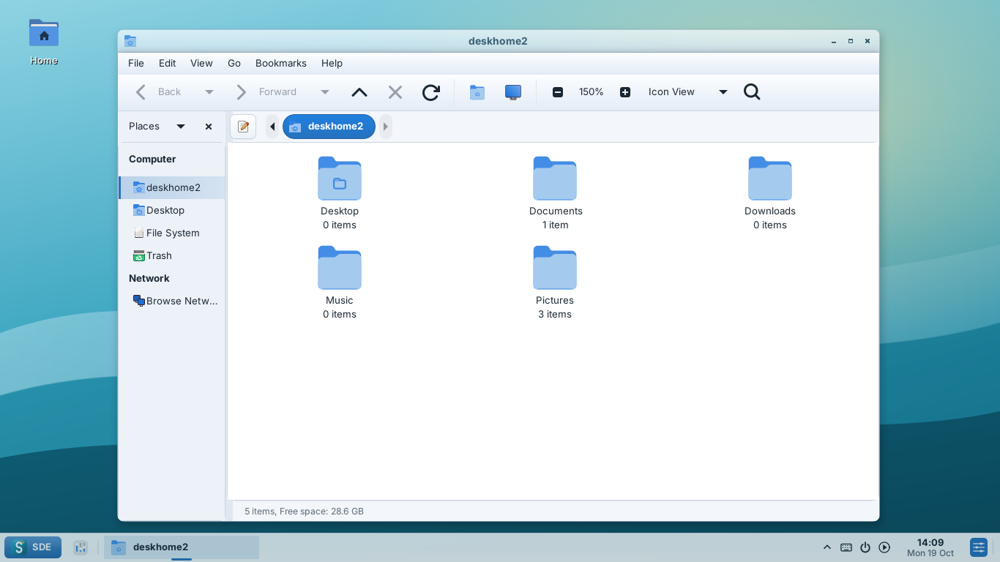

**New in Alpha 50:** [a panel-focused patch](docs/ALPHA50.md) — network LED
(red/yellow/green) with Wi‑Fi and LAN switches, Eject for removable drives, one
keyboard indicator, a touchpad indicator, weather behind the Action Center clock,
Night Light, a new native Calculator, drawing in Photo, albums in Gallery, Liria
Quick Access pins, big window buttons on the right, adjustable transparency, a
fix for "connected but no internet" on Debian standard installs, and Linux Mint
ideas (Welcome, Driver Manager, System Reports).

**Alpha 16:** [new themes and a uniform look](docs/ALPHA16.md) — SDE Graphite
(default, macOS-like), SDE Fluent (Windows-like) and SDE Glass with accent colours,
themed menus everywhere, redesigned Taca, Xanara, Niny and Start Menu, search in the
panel, and no more MATE: Liria re-forked, native SDE Power and Screen Lock.

**Alpha 15:** [native apps by the DebION Dev-Team](docs/ALPHA15.md) —
Niny, Xanara (PDF editing), Taca (rar/7z/zip…), Photo and SDE System Monitor written
from scratch — plus a slimmer Start Menu, alarms and agenda in the panel, a wallpaper
gallery, reliable USB copies in Liria and a smoother desktop.

**Alpha 14:** [Gallery is back](docs/ALPHA14.md) as a new app, tray icons open
their own flyouts, a redesigned Action Center (with calendar, compact/expanded), a new
Start Menu, a complete SDE Update, a modern Liria, SDE-FLTK, and sde-xsettingsd and
sde-polkit-agent written from scratch by the DebION Dev-Team.

**Alpha 13:** [fixes the panel crash after login](docs/ALPHA13.md), new tray
icons that follow the hardware (USB drives, Bluetooth, battery…), an Action Center
button in the panel corner, and SDE's own builds of FLTK, xsettingsd and the polkit agent.

**Alpha 12:** [fixes the black screen after login](docs/ALPHA12.md) in
virtual machines (automatic XRender, black-screen detection, Alt+Shift+F12) and adds
**debion-desktop-base**, the DebION artwork for Debian's desktop-base (wallpaper, login,
lock screen, GRUB, logos and boot splash).

**Alpha 11:** [four themes](docs/ALPHA11.md) — SDE Light, SDE Dark, SDE Aero and
SDE Liquid Glass (GTK 3/4, in `/usr/share/themes`) — a working Start Menu search with a
right-click Arrange menu and animations, Eduka-Desktop's effects, compositor, drives and
power-mode features, and SDE Tools for Liria.

**Alpha 10:** the [SDE Aero](docs/ALPHA10.md) theme with adjustable glass
transparency, a tidier Action Center without duplicate tray icons, **Photo** with
live filters and effects, more Niny plugins, and the **SDE-Desktop** login session.
Latest packages: [alpha-latest pre-release](https://github.com/hugomonizdorego/SDE-Desktop/releases/tag/alpha-latest) ·
[latest screenshots](docs/screenshots/latest/README.md) · [recommendations](docs/ALPHA10.md#recommendations-what-to-fix-and-what-to-add-next)

SDE combines a **Rust core** for configuration and XDG autostart with a **C++17**
interface using **FLTK**, **cairo**, **Xlib** and **libdbus**, and source-built **SDE WM** (Openbox) with **SDE Compositor** (picom). It is the successor of the EDE idea: small and quick. Migration
to Rust is underway; the panel, desktop and settings interface remain C++.
The earlier alpha2 session measured about **22 MB of private memory**; alpha3
and the complete native suite have not yet been profiled. See the [Rust migration guide](docs/RUST.md).

> **Alpha software.** 0.1 is the first series of SDE builds. It is meant for testing
> and development, not for daily use yet. See the [roadmap](docs/ROADMAP.md).

## Components

| Program | What it does |
| --- | --- |
| `startsde` | Session entry point used by display managers (`/usr/share/xsessions/sde.desktop`) |
| `sde-session` | Session manager: starts Openbox, desktop, panel, notifications, polkit agent and XDG autostart; restarts crashed parts; shows a rescue dialog instead of a black screen; `--check` finds missing packages |
| `sde-autostart` | Native Rust XDG autostart launcher; `--dry-run` explains which entries would start or be skipped |
| `sde-panel` | Full, floating or short panel at the bottom or top: searchable application menu, pinned apps (right-click to pin, drag to reorder), taskbar, XEmbed and StatusNotifierItem/AppIndicator tray, Action Center, calendar, auto-hide |
| `sde-notifyd` | Desktop notifications (`org.freedesktop.Notifications`) with action buttons and Do Not Disturb |
| `sde-desktop` | Wallpaper and desktop icons, right-click menu (View, Sort by, Refresh, New, terminal, file manager) and keyboard shortcuts |
| `sde-settings` | Overview with settings cards; grouped Personalization/System navigation; appearance, panel previews, Action Center, desktop, notifications, displays, keyboard & mouse, about |
| `sde-display-settings` | Native monitor arrangement, EDID, modes, rotation, profiles and scale |
| `sde-run` | Run Command dialog (Alt+F2) |
| `sde-logout` | Lock, suspend, log out, restart, shut down |
| `sde-suite` | Rust suite diagnostics, source/copyright links and optional dispatch |
| `sde-update` | Software Updater: critical, security, main and Flatpak updates with check boxes, history, sources and maintenance; PackageKit/APT and Flatpak transactions with progress and background notifications |

**Quick settings** use the services the system already has: NetworkManager (`nmcli`)
for Wi-Fi and Ethernet, PulseAudio or PipeWire (`pactl`) for volume, mute and the
output device, systemd-logind for screen brightness and the kernel for the battery.

## DebION application suite

The full-edge square panel is now the default. SDE includes **Niny**, **Liria**,
**Xanara**, **Taca**, **Photo** (formerly SDE View), **SDE System Monitor**, **SDE Power Manager**
and **Software Updater** (formerly SDE Update). Settings → Applications provides short clickable source links
and complete installed copyright notices. GTK suite launches follow SDE's
light/dark preference, with an option to keep the system theme.

Alpha6 builds the GTK applications from pinned source as native SDE forks.
`niny`, `liria`, `xanara`, `taca` and the other suite executables are included in
one `sde` package with their resources and preserved copyrights. The original
MATE application packages are not installed. Shared GTK/MATE libraries remain
normal dependencies. Software Updater has a native interface, an attributed Mint Update
model and Debian PackageKit transactions. See the [suite guide](docs/SUITE.md)
and [source credits](docs/THIRD-PARTY.md). CI also uploads native application captures.

`sudo apt install sde-desktop` is the single entry point when the SDE packages
are available in the DebION repository. The metapackage installs the session,
suite, Xorg, login, network, sound and media services. No DebION repository is
created by this project.

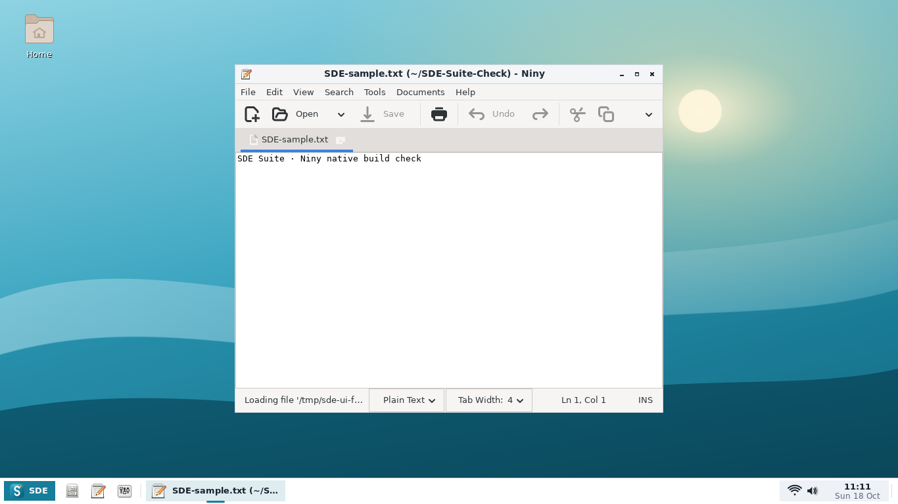

## Eduka-inspired interface

Alpha4 adapts selected design patterns from [Eduka-Desktop](https://github.com/hugomonizdorego/Eduka-Desktop):
three panel shapes, a grouped status area, a clock card and quick-control grid in
the Action Center, and a categorized settings center. The panel clock and Super+A
open the Action Center; Super+C opens the calendar directly. See [the design
notes](docs/EDUKA-DESIGN.md) for the source reference, screenshots and settings.

## Alpha4 screenshots

| Settings overview | Panel styles |
| --- | --- |
| 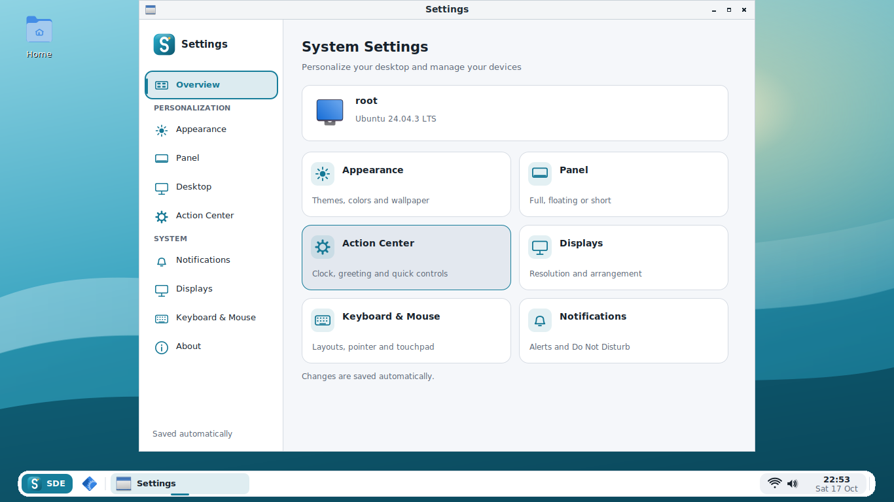 | 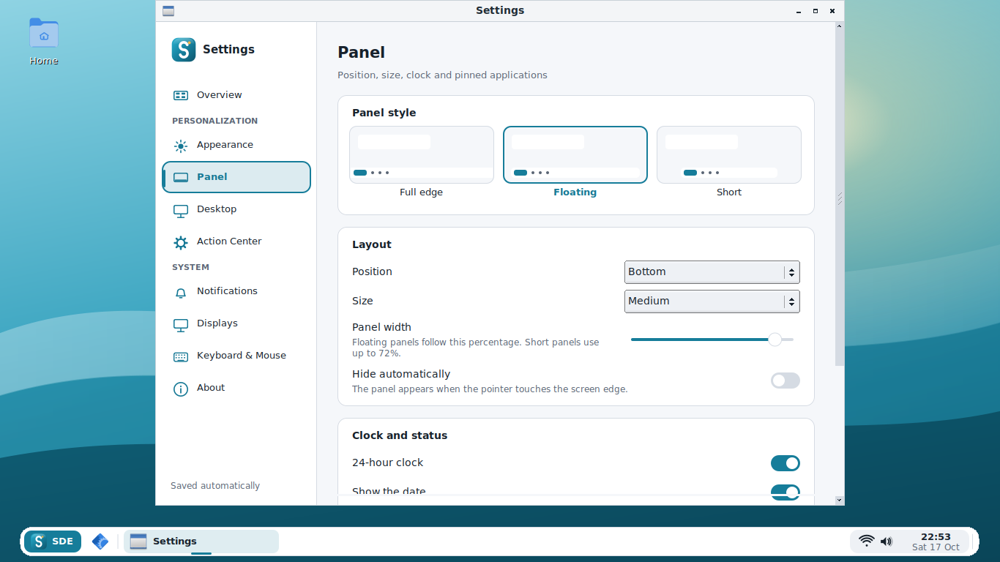 |

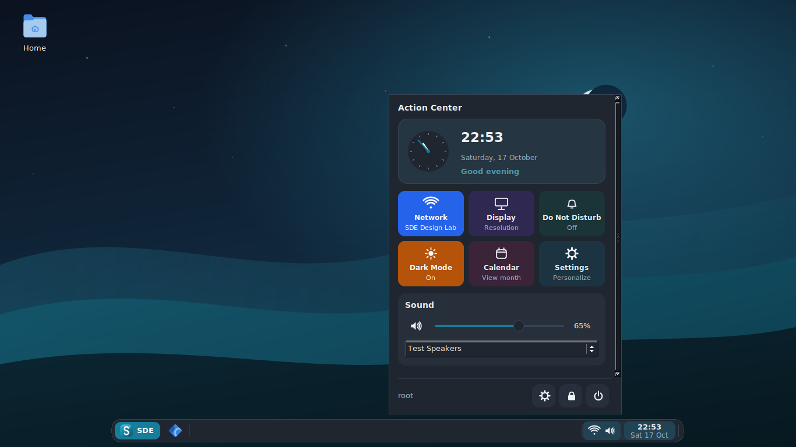

Captured from the native programs on a virtual X11 display. Wi-Fi names and
sound output/volume are explicit test fixtures. No real hardware connection is
implied. `tools/ui-smoke.py` reproduces these views and exercises the controls.

## Earlier alpha2 screenshots

| | |
| --- | --- |
| 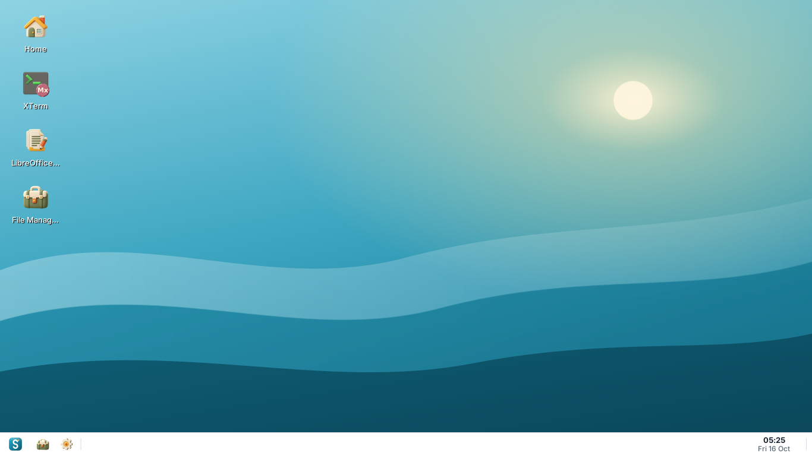 | 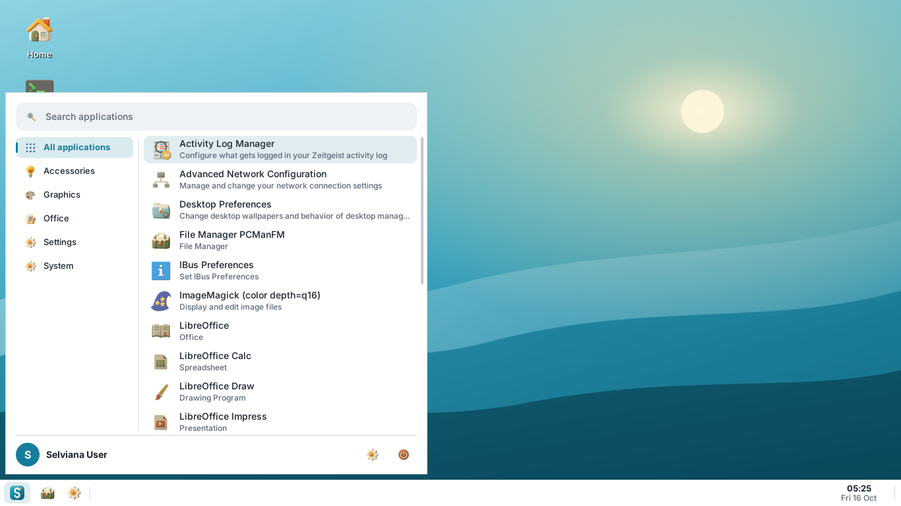 |
| 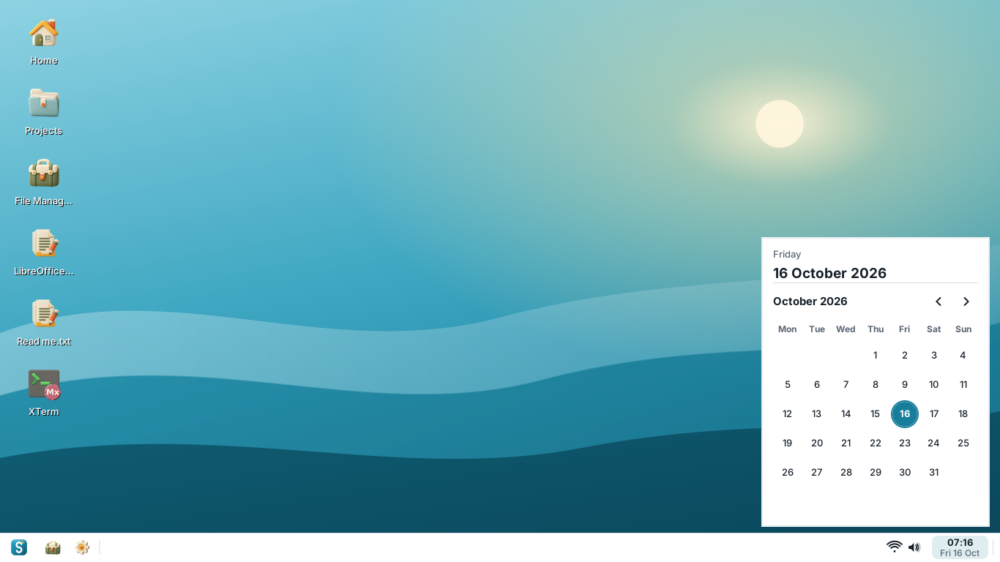 | 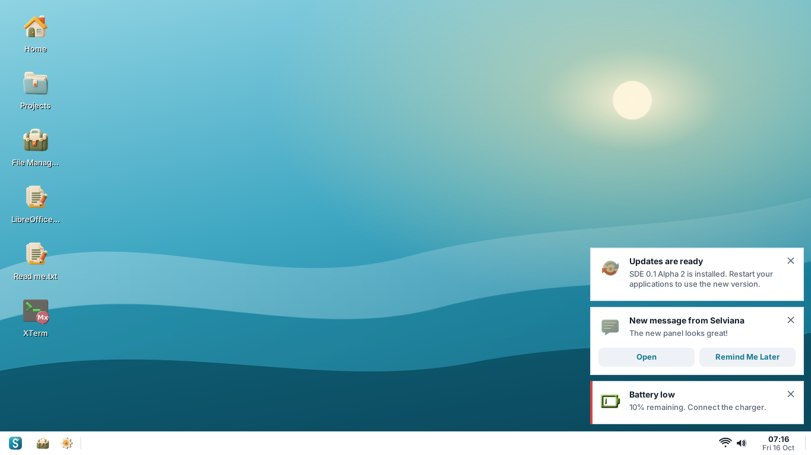 |
| 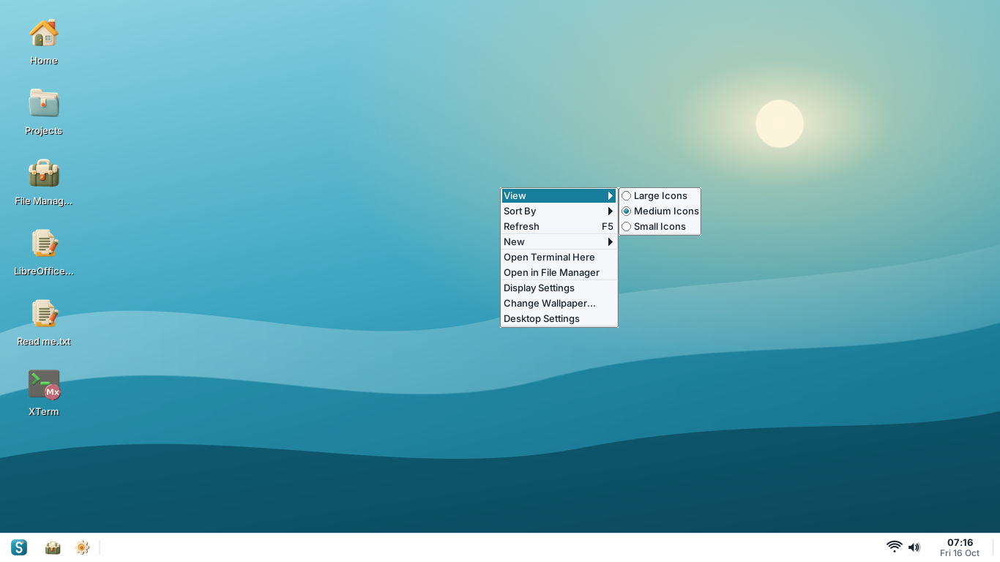 | 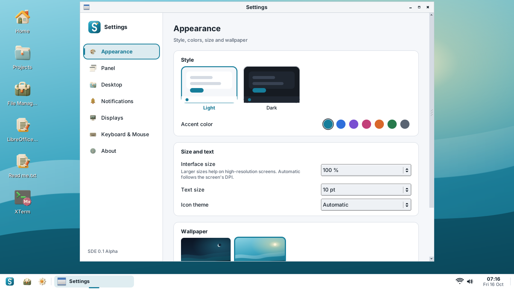 |
|  | 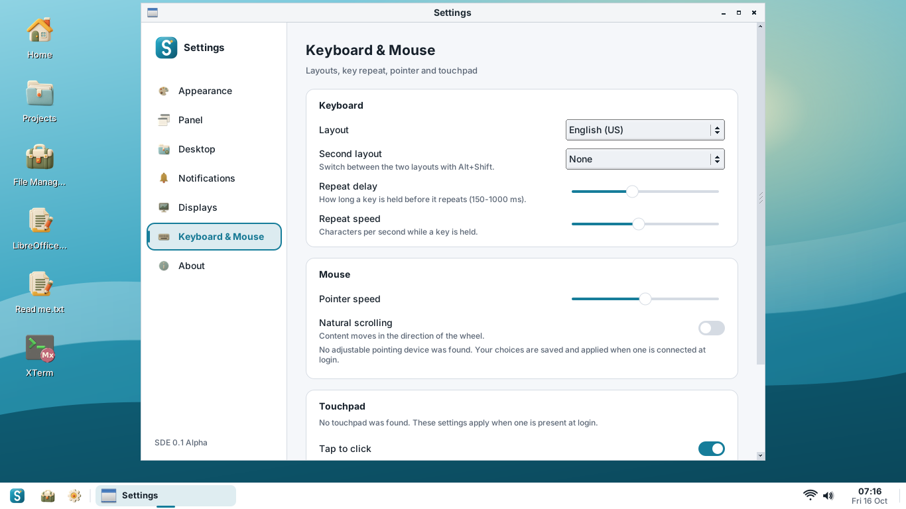 |
| 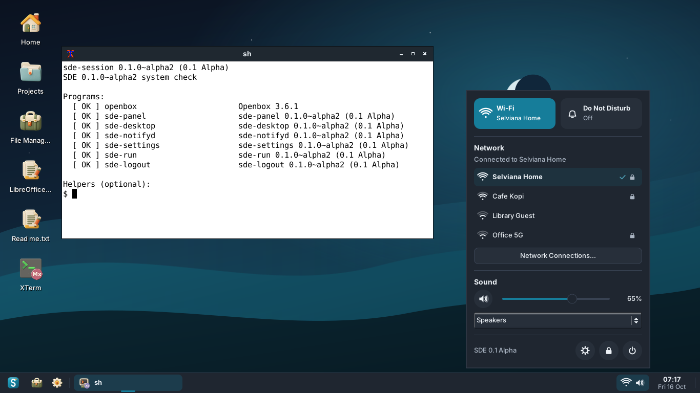 | 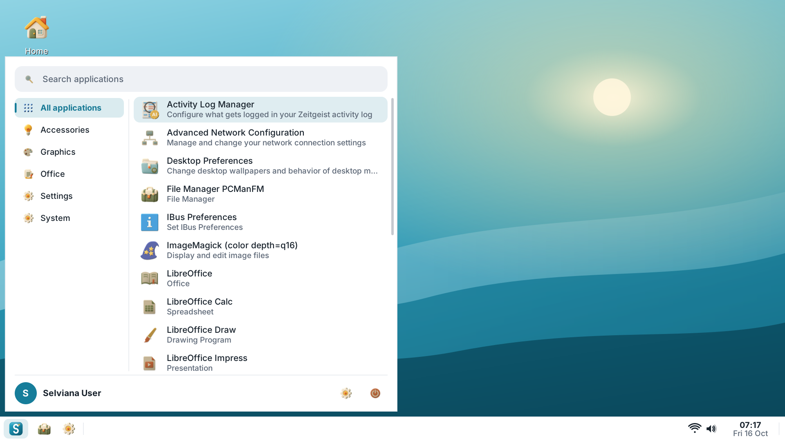 |

Taken with `tools/screenshot.sh` on Ubuntu 24.04 with the Eduka-Icons theme. The Wi-Fi
networks shown are sample data from a stand-in for `nmcli` (the test machine has no
Wi-Fi).

## Install

Primary target: **DebION GNU/Linux / Debian testing**. The complete native suite is built and tested on Debian testing (amd64).

Download the package for your distribution from the
[GitHub releases](https://github.com/hugomonizdorego/SDE-Desktop/releases), check it
and install it with `apt`, which also installs the dependencies:

```sh
sha256sum -c SHA256SUMS --ignore-missing
sudo apt install ./sde_*.deb ./sde-desktop_*.deb ./debion-desktop-base_*.deb
```

Log out, choose **SDE-Desktop** at the login screen and log in. From a text console you can
use `startx /usr/bin/startsde`.

`release/` holds the older alpha2 Ubuntu 24.04 build. The newest `.deb` packages
for Debian testing / DebION are published automatically as the
[`alpha-latest`](https://github.com/hugomonizdorego/SDE-Desktop/releases/tag/alpha-latest)
pre-release after each successful build of `main`; every branch build also keeps
them in the `sde-debian-testing` GitHub Actions artifact.

> **Do not install with `dpkg -i` alone** (for example in a Cubic chroot) without
> running `sudo apt install --fix-broken` afterwards: without its libraries the panel
> cannot start. SDE now shows a rescue dialog in that case; see
> [troubleshooting](docs/TROUBLESHOOTING.md).

## Build from source

```sh
sudo sh tools/install-deps.sh
sudo sh tools/install-native-deps.sh # native application build libraries
tools/build-deb.sh              # writes sde and sde-desktop packages to dist/
```

Or a plain CMake build for development:

```sh
python3 tools/prepare-native-suite.py
cmake -S . -B build -DCMAKE_INSTALL_PREFIX=/usr
cmake --build build -j"$(nproc)"
ctest --test-dir build          # unit tests, including WCAG contrast checks
sudo cmake --install build
```

See [docs/BUILD.md](docs/BUILD.md) for the full dependency list, screenshots and
releases.

## Keyboard shortcuts

| Keys | Action |
| --- | --- |
| Super, Alt+F1 | Application menu |
| Super+A | Action Center |
| Super+C | Calendar |
| Alt+F2 | Run Command |
| Ctrl+Alt+T | Terminal |
| Super+E | File manager |
| Super+D | Show desktop |
| Super+Left / Right | Tile window to the left / right half |
| Super+Up / Down | Maximize / restore |
| Alt+Tab | Switch windows |
| Alt+Shift | Switch keyboard layout (when a second layout is set) |
| Ctrl+Alt+Delete | Log out dialog |

On the desktop: **F5** refresh, **F2** rename, **Delete** move to trash,
**Ctrl+Shift+N** new folder, **Enter** open, **Menu** or **Shift+F10** context menu,
arrow keys to select.

## Configuration

System defaults live in `/etc/xdg/sde/sde.conf`; per-user settings in
`~/.config/sde/sde.conf` (written by `sde-settings`). The Openbox configuration is
copied to `~/.config/sde/openbox/rc.xml` on first login. Session messages go to
`~/.local/state/sde/session.log`.

## Documentation

- [DebION suite, installation and source workspace](docs/SUITE.md)
- [Copyright and source credits](docs/THIRD-PARTY.md)
- [Programming language choice](docs/LANGUAGE.md)
- [Rust architecture, tests and migration plan](docs/RUST.md)
- [Building, dependencies and releases](docs/BUILD.md)
- [Troubleshooting (black screen, missing packages)](docs/TROUBLESHOOTING.md)
- [Roadmap from 0.1 Alpha to 1.0](docs/ROADMAP.md)
- [Translating SDE](po/README.md)
- [Changelog](CHANGELOG.md)

`bootstrap/` holds a pinned manifest and a fetch script for the original EDE
(Equinox Desktop Environment) sources. They are kept for reference only; SDE does
not build or ship EDE code.

## License

SDE is free software under the GNU General Public License, version 3 or later.
See [LICENSE](LICENSE). Bundled application forks retain their individual upstream
licenses and historical copyright notices; see [source credits](docs/THIRD-PARTY.md).

## Alpha7 patch

Native GTK4 Calculator, redesigned Start Menu, categorized Suite desktop
launchers, source-built WM/compositor, isolated `sudo liria`, and independent
application build versions are described in the [alpha8 notes](docs/ALPHA8.md).
The GTK3 suite remains supported alongside GTK4. This is still development
software; the EDE-inspired FLTK shell and Rust core retain their structure.

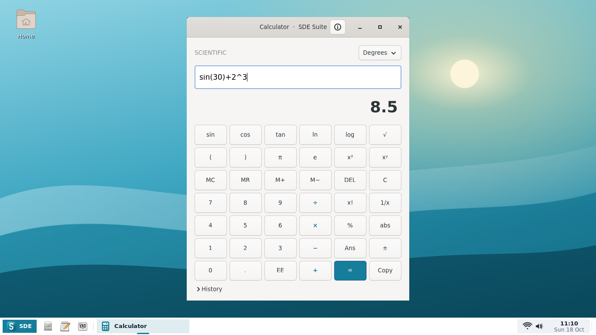

[Previous alpha8 screenshot gallery](docs/screenshots/alpha8/README.md) · [Tested Debian packages](https://github.com/hugomonizdorego/SDE-Desktop/actions/runs/39136115276)


Alpha8 places native and newly installed applications in standard XDG menu
categories (Calculator/Niny/Taca in Accessories), with live menu updates.
[Display Settings](docs/ALPHA8.md) adds the MIT
[DisplayProfileManager](https://github.com/zac15987/DisplayProfileManager) profile
model port, native RandR monitor settings, safe preview/rollback and shared
100/125/150/200% interface scale. Physical GPU/dock testing is still needed.

## Alpha 9 panel patch

[Current screenshot gallery](docs/screenshots/alpha9/README.md) ·
[Latest Debian build and packages](https://github.com/hugomonizdorego/SDE-Desktop/actions/workflows/build.yml?query=branch%3Acodex%2Falpha8-display-settings)

[Alpha 9](docs/ALPHA9.md) adds reference-style panel indicators, a corner-anchored
Action Center, movable SNI/XEmbed tray, native Bluetooth controls, Wi-Fi/LAN
details, per-application and microphone volume, and MPRIS player controls.
Settings keeps SDE's own configuration and two-column layout. The patch is
still alpha and physical hardware review is required.
