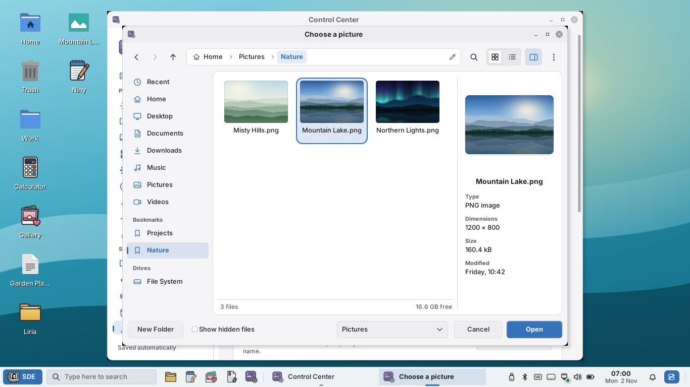

# SDE 0.2 Alpha 3.1 — Merkadu that closes, a modern file chooser, real Liquid Glass, Preview before Apply, Force Close

Fix release of the **Selviana Desktop Environment** (`0.2.0~alpha3.1`) for
[0.2 Alpha 3](0.2-ALPHA3.md), made from the owner's review on a real laptop:
amd64, built and tested on Debian testing. The way to 1.0 is in
[ROADMAP.md](ROADMAP.md). Still alpha: test it in a virtual machine or a spare
installation first.



## Merkadu: closes at once, never blank, and knows where apps come from

**Why it "always crashed and was hard to close".** Merkadu 0.2 Alpha 3 never
ended after its window closed: on exit the C library destroyed the condition
variable the APT reader thread was still waiting on, and glibc blocks forever
there (the stacks are in the tests' notes). Every closed window left a process
of about 240 MB behind. Merkadu now ends with `_exit()` and never destroys
state its worker threads share. On a slow machine the window also stalled for
up to 1.5 s at a time: merging the catalogs, taking over the package list,
counting the departments and repainting everything for every icon ran on the
window's thread. That work now runs on worker threads and reaches the window
in small slices; repaints touch only what changed and search waits for a pause
in typing. On a very slow machine (a fifth of a CPU core)
pauses of 0.3–0.75 s remain while a large page is built; they are logged.

- A stall detector logs every pause of the window over 250 ms, writes a hang
  report with the window thread's stack after 10 s and a backtrace after a
  crash (`~/.local/state/merkadu`); the next start offers the report on Home.
- Closing while something is installing asks: **Finish in the Background**
  (default), Stop and Close, or Keep Merkadu Open.
- **Pause, Resume and Cancel** for every change, on In Progress and on the
  app's page; a waiting change can be removed. Pausing keeps what was
  downloaded. While dpkg is changing the system both are disabled and the page
  says why (stopping then could break the system).
- **All Software** lists Debian packages, Flatpak and Snap apart, with counts;
  Flatpak runtimes are behind "Runtimes and Extensions".
- **Highlights rotate**: six highlights taking turns between the
  distribution's choice, new releases, Flathub's popular and trending apps
  (fetched at most once a day, cached for offline) and the Snap Store's
  featured snaps; they advance every 7 s and stop under the pointer.
- **Only real sources**: an app in Debian, on Flathub and in the Snap Store
  shows "Choose where to get it" with version, size and publisher for each; a
  Flatpak-only app shows no Debian button any more (the catalog gave some
  Flatpak-only apps a Debian origin; a Debian origin now needs a package APT
  knows).
- **"Remote "flatpak" not found" is fixed**: Flathub's catalog file says
  `origin="flatpak"` and Merkadu used that as the remote's name. Merkadu now
  reads each configured remote's catalog itself and installs from the remote
  and installation where it found the app.
- **Snap after Enable Snap Support**: snapd was only asked at start, so snaps
  never appeared without restarting Merkadu. Now Merkadu waits for snapd to
  answer (up to 3 minutes, also while it seeds itself), then lists the
  installed and featured snaps and every department, again after each
  refresh. A polkit refusal is shown; if snapd never starts Merkadu says to
  restart the computer.
- The "Not Installed" filter shows its count again at 1366×768.

Details: [MERKADU.md](MERKADU.md).

## A modern file chooser everywhere

FLTK's old chooser (a bare list starting with `../`, raw patterns, no Back
button) is gone. `sde::FileChooser` follows Liria: Back, Forward and Up, a
breadcrumb path bar that turns into a location entry with completion
(Ctrl+L), search as you type (and in subfolders), grid with thumbnails or a
sortable list, a sidebar with Recent, Home, the standard folders, bookmarks,
drives and network places, a preview pane, human filter names ("Pictures",
"PDF documents"), New Folder, and a Save name with its extension handled.
It opens in 6–25 ms; a folder of 10,000 files shows at once. Every SDE
program uses it: Control Center (avatars, wallpaper), Debrun, Niny, Photo,
Gallery, Taca and Xanara. A portal backend (`xdg-desktop-portal-sde`) gives
Flatpak apps and browsers that use the file chooser portal the same dialog.
Details: [FILE-CHOOSER.md](FILE-CHOOSER.md).

## SDE Liquid Glass like Apple's, and readable everywhere

- **Frosted glass**: stronger blur with a frost, saturation, a tint that
  follows the transparency, a readability lift, a specular rim and a
  hairline edge, dithered against banding. Only the floating layer is glass
  (panel, Start Menu, Action Center, notifications, menus, tooltips, frames);
  window content stays solid. Text keeps at least 4.5:1 contrast over a busy
  web page in every family, mode, accent and level (tested).
- **Transparency levels** (Off, Subtle, Clear, Glass and the slider) are even
  steps in Graphite, Fluent and Liquid Glass; without the OpenGL compositor
  surfaces stay almost opaque instead of see-through.
- **See-through windows on software OpenGL fixed** (compositor patch 0002):
  with Mesa's software OpenGL the compositor took a window's contents once,
  when it appeared or was resized, so later drawing never showed: windows
  stayed see-through or at their old size and taskbar buttons went missing.
  Damaged windows are now taken again on such systems. The automatic effects
  profile also checks OpenGL itself at login (`sde-gl-probe`): on software
  OpenGL it chooses the light profile (XRender, no blur) and says so in the
  session log; a choice made by hand still wins.
- **Menus**: the highlight moves at once (the themes faded it over 120 ms, so
  two or three items were blue at once), menus open and close without a fade,
  and check items such as "Show Hidden Files" are check boxes, not circles,
  in GTK 3, GTK 4 and SDE's own programs. A theme rule that made every GTK 3
  list row restyle on each repaint is gone.

Details: [THEMES.md](THEMES.md).

## Appearance: Preview before Apply, one calm switch

Choosing a theme, mode, accent or transparency no longer applies it. The page
shows a live miniature, "In use" on the current theme and a bar "Not applied
yet" with **Preview**, **Revert** and **Apply** (Ctrl+Enter). Preview opens a
window over the real desktop with real SDE and GTK widgets in the chosen look,
so blur and transparency over your own wallpaper are visible before anything
changes.

The glitch when switching had three causes: the compositor was reset twice
for every switch (the session and the Control Center each signalled it, and
picom treats that as a full reset; with OpenGL the screen froze 2.7 s), the
Control Center signalled every compositor and settings daemon of the user,
and each program repainted on its own schedule (seven visible bursts in
1.1 s). Now only the session tells each program, once, and only when its
input changed; the compositor reloads in place (patch 0003); and the switch
happens behind a picture of the screen that fades away when the windows have
redrawn. Details: [CONTROL-CENTER.md](CONTROL-CENTER.md).

## Force Close for frozen programs

SDE pings the window you use (focus, clicks, closing; the standard
`_NET_WM_PING`, which SDE's own programs now answer too). A window that does
not answer for 5 s is marked "Not Responding" (in its title and on its dimmed
taskbar button). After 2 minutes, or at once when you try to close it, a
dialog asks **Wait** or **Force Close**; Force Close ends the program at once
(SIGKILL). The same dialog appears when a program started from SDE has not
opened a window after 2 minutes. Session programs, other users' programs and
anything that cannot be identified are never killed. When a program SDE
started crashes, a notification offers Open Again and Details. Settings:
`[force_close]` in `sde.conf`. Details: [FORCE-CLOSE.md](FORCE-CLOSE.md).

## Action Center: Sleep, Log Out, Restart and Shut Down always there

Four round icons in the Action Center's footer, next to the account,
Control Center and Lock, without pushing the tiles around. Sleep acts at
once; Log Out, Restart and Shut Down ask for a second click within 4 seconds
("Click again to shut down"), so they cannot be pressed by accident. What the
computer cannot do (for example suspend) is hidden. Details: [PANEL.md](PANEL.md).

## Liria: right-click and menus without lag

Context menus open faster (one file of 1,000 selected: 77 → 16 ms; a list
row: 38 → 23 ms) and the highlight follows the pointer at once (5.8 ms
median). Causes: the whole folder was re-measured twice per menu, the window
repainted before the menu, the file's menu was only built at release, a
hidden side panel slowed every menu grab, an icon cache never worked (upstream
Caja), and every menu re-read every selected file. Pointer motion in the list
view no longer makes a round trip to the X server for each move. Details:
[SUITE.md](SUITE.md).

## Niny

On small screens (1024×600 at 150 %) menus open under their title and scroll
instead of covering the menu bar.

## Tests

All automated tests pass: 78 unit and UI tests (CTest; the compositor redraw
test runs when the compositor is built), the panel and UI smoke tests at
1366×768 and at 1024×600 with 150 %, and in CI the Debian testing package
build with the real catalogs, which now also checks that Flathub apps install
from the remote "flathub". New tests cover the file chooser (model, dialog,
portal), Merkadu (remotes, sources, highlights, pause and cancel in every
phase, a fake snapd), the glass over a busy page, menu transitions and check
box shapes, compositor redraw on software OpenGL, the OpenGL probe, the
Appearance draft, preview and switch, Force Close (rules, dialog, the
patched window manager, crash notices), the session buttons, and Liria's
context menu latency (`tools/liria-menu-smoke.py`).

What could not be tested here: real installs, removals and Snap support
through PackageKit, snapd and system Flatpak, and Flathub over the network
(fakes were used); a real GPU (OpenGL was Mesa's software renderer on Xvfb);
the real `xdg-desktop-portal` daemon (the backend was called directly); real
suspend, restart and shutdown (stubs). Please try them on the laptop.

## For the project owner

1. **Was your laptop's OpenGL software?** If windows were see-through, run
   `glxinfo -B` (package `mesa-utils`) and look for "llvmpipe"; with 3.1 the
   session log says which profile was chosen and why.
2. **Merkadu and the network:** Merkadu contacts flathub.org about once a day
   for the popular apps (`[Highlights] flathub-collections=` empty turns it
   off) and asks the Snap Store for featured snaps when snapd is installed.
3. **Session buttons:** a second click instead of a confirmation dialog.
4. **Force Close timing:** marked after 5 s, asked after 2 minutes; "Wait"
   asks again after another 2 minutes.
5. **Appearance:** wallpaper, sizes and icons still apply at once; Cancel in
   the preview keeps the choice pending (Revert drops it).
6. **File chooser:** chosen files appear under Recent everywhere; the portal
   is on for SDE sessions.

## Install for review

```sh
sha256sum -c SHA256SUMS
sudo apt install ./sde_0.2.0~alpha3.1_amd64.deb ./sde-desktop_0.2.0~alpha3.1_all.deb \
                 ./merkadu_0.2.0~alpha3.1_amd64.deb
# DebION GNU/Linux integration (optional, recommended on DebION):
sudo apt install ./debion-desktop-base_0.2.0~alpha3.1_all.deb
```

Log out and choose **SDE-Desktop** at the login screen. If Merkadu or anything
else crashes, send `~/.local/state/sde/session.log` and the reports in
`~/.local/state/merkadu` (or use System Reports).
