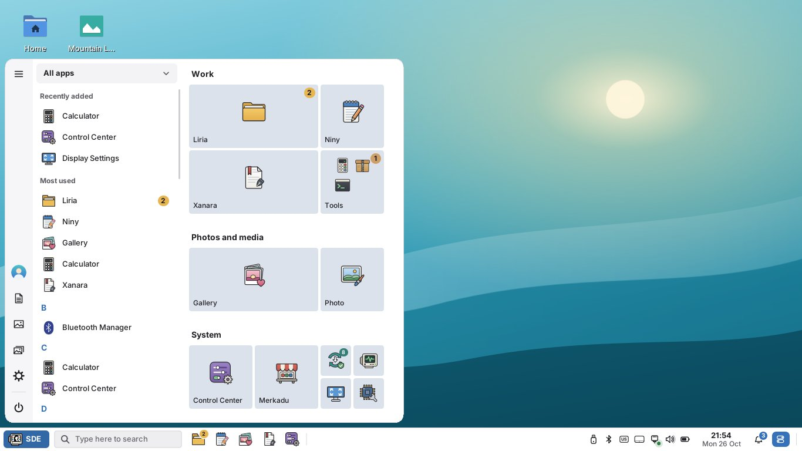

# SDE 0.2 Alpha 3 — Xanara edits PDFs, Merkadu works like Synaptic, safe USB copies and tile folders

Development patch of the **Selviana Desktop Environment** (`0.2.0~alpha3`),
amd64, built and tested on Debian testing. It follows
[0.2 Alpha 2](0.2-ALPHA2.md); the way to 1.0 is in [ROADMAP.md](ROADMAP.md).
Still alpha: test it in a virtual machine or a spare installation first.



## Merkadu works like Synaptic

**Why Merkadu was empty.** On a real Debian testing installation Merkadu
showed its departments and nothing else. Five causes, all fixed:

- The `appstream` package came with Merkadu, after the last `apt update`, so
  there was no software catalog to read yet.
- Debian downloads the catalog's icons only when asked: `/etc/apt/apt.conf.d/60merkadu`
  now asks for them.
- A missing catalog, PackageKit not running or a failed refresh left the page
  empty without a word. Merkadu now says what is missing and offers the button
  that fixes it (Refresh Software Lists, Install the Catalog, Install Flatpak,
  Sources), and never shows an empty page.
- Flathub was not set up.
- Flatpak's folders were missing from the session's `XDG_DATA_DIRS`, so Flatpak
  apps did not appear in the Start Menu; the SDE session now adds them (and the
  snap launchers).

What changed:

- **Refresh at start.** Opening Merkadu refreshes the software lists in the
  background (Debian through PackageKit, with the catalog and its icons; the
  Flatpak remotes), when they are older than 30 minutes; a Refresh button in the
  header does it at any time.
- **Redesign.** Back, Forward, Home and Refresh in the header; Home has a banner,
  Highlights, Recommended for You, New & Updated, Popular Apps, the categories
  and a card for All Software; bigger icons, loading and empty states.
- **All Software, like Synaptic.** Every package of the configured
  repositories (about 88,000, read in two seconds) by Debian section and
  status (All, Installed, Updates, Not Installed, Marked, Settings Left), search
  by name and description, marks with buttons, the right-click menu or the keys,
  and a review of everything that will be installed and removed, with the
  download size, before the changes are applied together. A package's page
  shows its dependencies, what needs it and every version.
- **Flatpak out of the box, Snap when you want it.** Flatpak is a dependency
  and Flathub is added when Merkadu is installed (from the official repository
  file Merkadu ships; no network needed). snapd is not installed: **Enable Snap
  Support** installs it the way Snapcraft's Debian guide does, and tells you to
  restart or log in again.
- **Icons for everything:** the icon theme, the catalogs' icons, Flathub's and
  the Snap Store's, then fallbacks by kind, category or section — never an
  empty square.
- **Apps, not the system.** Merkadu installs, removes and updates apps.
  Software Updater updates the operating system only (Debian packages); its
  Flatpak part moved to Merkadu's Updates page, and each points to the other.
- **Uninstall preinstalled apps** too (Firefox, Thunderbird, LibreOffice…),
  with the list of what else goes. Refused, with the reason: Essential and
  required packages, the running kernel and SDE's own packages.
- **Highlights and recommendations** chosen by the distribution in
  `/etc/merkadu/merkadu.conf`, with real Debian and Flathub ids.

Details and the root causes: [MERKADU.md](MERKADU.md).

## Xanara edits PDFs by itself

Xanara was rebuilt inside while keeping its window, tabs, toolbars and panels.

- **Click and edit, as in an office suite.** In Edit mode every text block and
  picture has a faint outline. Click to place the caret, double-click a word,
  triple-click a paragraph; type, delete, select, copy and paste, undo and redo;
  paragraphs reflow. Font, size, bold, italic, color and alignment come from the
  toolbar or the properties panel; text boxes move and resize; the Text tool
  adds new text.
- **Pictures:** move, resize, replace, delete and add.
- **Saving** keeps the document's fonts where they can show the text and embeds
  a similar installed font (a subset) for the rest, so the text stays searchable
  and copyable. Changes are appended, so the original bytes stay as they were.
- **No other programs.** Pages, merging, splitting, links, forms, crop, stamps,
  encryption and redaction used the `qpdf` program; compression `gs`; export
  `pdftoppm`; printing `lp`; OCR `tesseract`. All of it now runs inside Xanara
  through libraries (libqpdf, poppler, libcups, libtesseract); the "install
  qpdf" messages are gone.
- Limits: rotated or vertical text, right-to-left scripts, text on scanned
  pages (use OCR first) and text inside nested forms cannot be edited; see
  [XANARA.md](XANARA.md).

## Start Menu: favorites, tile folders and live badges

- **Favorites again.** The tiles are your favorite apps in named groups, as in
  0.2 Alpha 1 — **Work**, **Photos and media** and **System**, built from what
  is installed — instead of every app by category (the A–Z list and its
  category filter already do that). Layouts still made of 0.2 Alpha 2's
  automatic category groups become favorites; layouts you arranged stay.
- **Tile folders**, like Windows 10: drop a tile on another tile (or an app from
  the list or the search) to make a folder; it shows the small icons of its
  apps and its name ("Internet"), opens in place below its row, and takes apps
  in and out by drag and drop. Rename, resize, move, ungroup and unpin from its
  menu; a folder left with one app turns back into a tile.
- **Live badges.** New mail, a chat message, an update: a count in the app's own
  color appears on its tile (folders add them up), in the A–Z list, in the
  search and on its taskbar button. They come from SDE's notifications and from
  the Unity launcher API that Telegram, Chrome and Chromium web apps (WhatsApp,
  Gmail…) and Electron apps use; a badge goes away when the notifications are
  read or the app's window becomes active.

Details: [START-MENU.md](START-MENU.md).

## Copying: done means done, and a penguin

- **Safe copies to USB sticks and external drives.** Linux writes into memory
  first, so a copy could say "done" while the data was still on its way, and
  pulling the stick then lost files. Liria and the desktop now count only what
  the drive has taken, keep at most about a second of the drive's speed in
  flight, and say "done" only after the file system has been flushed — then the
  drive can be pulled at once ("The files are on SANDISK — you can remove it").
  On a drive limited to 20 MB/s a 200 MiB file used to say "done" after 1.4 s
  and was really on the drive after 12.1 s; now "done" comes at 10.5 s, when it
  is there. A move deletes its sources only once the copies are safe; full,
  read-only and pulled-out drives get clear messages. Internal disks keep the
  fast cache (`[files] safe_copy` in sde.conf changes it).
- **A copy dialog of our own.** The Windows 10 look (speed graph, "% complete")
  is gone: a penguin drawn by the SDE project carries a paper from one folder to
  the other, sits when paused, pushes the last paper in while the last data is
  written, jumps when done and looks puzzled on errors. Same dialog in Liria
  and on the desktop.

Details: [TRANSFERS.md](TRANSFERS.md).

## Liria: smooth under the pointer, network places in the address bar

- **No more stutter on hover.** Measured at 1920×1080 at 150 % while the
  pointer moves: the sidebar went from 40 % to 15 % of a core, the tabs from
  12 % (plus 16 % in the X server) to 5.5 % (plus 2 %), the icon view of a
  folder with 10,000 files from 14.6 % to 6.2 %; the breadcrumbs, ribbon and
  Home repaint 19–36 frames instead of 87–131.
- **Type a network place:** `\\server\share`, `smb://server/share`, an IP
  address, `localhost` or a computer name (its Windows shares),
  `sftp://user@host`, `ftp://`, `nfs://`, `dav(s)://`, or `smb:` for the
  network. Suggestions show recent servers and the protocols this computer can
  open; Liria's own sign-in dialog splits `DOMAIN\user`, offers guest access
  and remembers the password in the keyring when one runs. The protocols' own
  configuration decides (smb.conf, ssh's known hosts): nothing falls back to
  SMB1 or plain-text logins. When a protocol is missing, Liria names the
  package to ask for.

## Niny: tabs that close and a full menu bar

- **The × closes its tab.** Closing the last tab opened a new "Untitled", and
  a quick second click on a × could open another tab; both are fixed. With only
  one tab its × is inactive and says why.
- **A complete menu bar**, shown at once: File, Edit, View, Search, Document,
  Tools and Help — Font… in View, file type, indentation, encoding and line
  endings in Document, spell checking and statistics in Tools, keyboard
  shortcuts in Help. Alt+letter, F10 and the arrow keys work as on other Linux
  editors. See [NINY.md](NINY.md).

## Photo and Gallery

- **Collages in Photo:** any number of photos in ten designs (Grid, Mosaic,
  Featured, Prints, Film Strip, Magazine, Shapes, Story, Panorama, Framed),
  sizes for print and social media, spacing, corners, borders, backgrounds and
  a title; reorder, pan, zoom and swap photos; export to JPEG or PNG. Start
  from Photo (File → New Collage…) or from photos selected in Gallery.
- **Edit with** in Gallery: Photo first, then the image editors installed for
  the photo's type (GIMP, Krita, Pinta…), another application or a default
  editor; Gallery picks up the changes.
- **Plugins** for both, switched on and off in Tools → Plugins…: in Photo,
  frames, watermarks, red eyes, auto enhance, background blur, sizes for the
  web and removing location data; in Gallery, slideshows, places (offline),
  duplicates, batch renaming and converting, print, email and import from
  cameras and phones. Simple plugins of your own are text files. See
  [PHOTO.md](PHOTO.md) and [GALLERY.md](GALLERY.md).

## Installing software from the web

- **Debrun** installs `.deb` files downloaded from a vendor's website: double-click
  one, or right-click → Install with Debrun. It shows what the package is, warns
  that it does not come from the distribution, lists what it changes besides its
  files (a package source and its key, as Chrome and VS Code add), checks the
  dependencies and installs it the Debian way. It is not in the Start Menu or the
  Control Center. See [DEBRUN.md](DEBRUN.md).
- **AppImages run with a double-click**, without "Allow executing". The first
  time SDE checks the AppImage — a real AppImage for this computer whose
  publisher's signature is valid — and remembers the publisher; after that it
  runs without asking. An AppImage without a valid signature is not run and SDE
  asks to delete it. See [APPIMAGE.md](APPIMAGE.md).

## Control Center: rename accounts

Users & Avatar → **Rename…** changes the user name and the home folder of an
account. The rename is made while the computer restarts, before anyone logs in;
until then the account says "Will be renamed to … at the next restart" and the
rename can be cancelled. Each step is recorded and undone if one fails. See
[CONTROL-CENTER.md](CONTROL-CENTER.md).

## SDE-FLTK

FLTK 1.4.5 is still the newest FLTK release (checked on 26 October 2026);
SDE-FLTK 1.4.5-sde1 follows it, and every SDE program, the new Debrun and
AppImage Runner included, is built on it.

## Tests

All automated tests pass: 65 unit and UI tests (CTest), the panel and UI
smoke tests at 1366×768 and at 1024×600 with 150 %, the About windows of the
installed programs, and in CI a check of Merkadu against the real Debian
testing catalog and Flathub (Firefox ESR, GIMP, VLC and a Flathub app found
with their icons). New tests cover Niny's tabs and menus, Xanara's editing
(click, type, save, reopen and check with poppler; the old helper programs
must not be called), the safe copy writer against a simulated slow drive
(and a drive pulled out during the copy), Merkadu's All Software and refresh,
the tile folders and badges, the collage designs and plugins, Debrun, AppImage
verification with real signatures, the account rename (a failure at each step
leaves nothing changed) and Liria's address parser.

What could not be tested here: real installs and removals through PackageKit,
Flathub downloads and snapd; copies to a real FAT USB stick (this machine has
no FAT driver; ext4 drives were tested); NFS, WebDAV, FTP and domain logins in
Liria (Samba and SFTP were tested against real servers). Please try them on a
real installation.

## For the project owner

1. **AppImages:** the default policy runs only verified AppImages, as asked.
   Most AppImages on the web are not signed, so SDE will ask to delete them;
   `policy=ask` in `/etc/sde/appimage.conf` allows them after a warning.
2. **Renaming your own account** needs your own password today; say if it
   should need an administrator.
3. **Flathub** is added when Merkadu is installed (`setup-flathub=false` in
   `/etc/merkadu/merkadu.conf` turns it off), and Merkadu refreshes the lists
   when it opens if they are older than 30 minutes (this uses the network).
4. **Merkadu's lists** prefer the Debian package when an app is in Debian and
   on Flathub.
5. **Translations:** many texts are new; Indonesian first.

## Install for review

```sh
sha256sum -c SHA256SUMS
sudo apt install ./sde_0.2.0~alpha3_amd64.deb ./sde-desktop_0.2.0~alpha3_all.deb \
                 ./merkadu_0.2.0~alpha3_amd64.deb
# DebION GNU/Linux integration (optional, recommended on DebION):
sudo apt install ./debion-desktop-base_0.2.0~alpha3_all.deb
```

Log out and choose **SDE-Desktop** at the login screen. Merkadu needs one
refresh of the software lists after installation (it does it when it opens).
If something crashes, send `~/.local/state/sde/session.log` (or use System
Reports).
