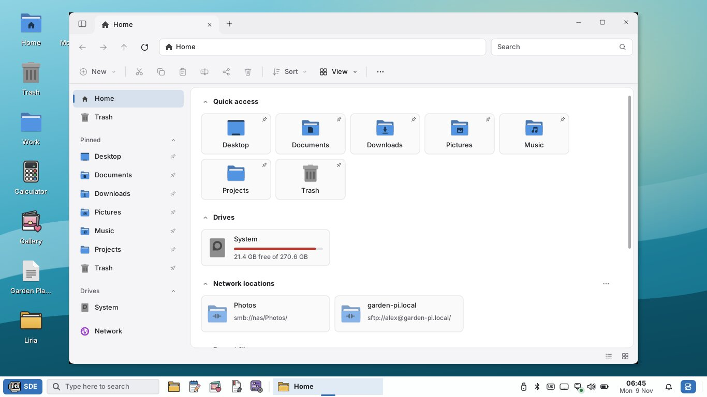

# SDE 0.2 Alpha 4 — SDE Core, a new Liria, one package per application, workspaces, Windows shortcuts, touch and fingerprint

Feature release of the **Selviana Desktop Environment** (`0.2.0~alpha4`),
made from the owner's review of [0.2 Alpha 3.1](0.2-ALPHA3.1.md): amd64,
built and tested on Debian testing. The way to 1.0 is in
[ROADMAP.md](ROADMAP.md). Still alpha: test it in a virtual machine or a spare
installation first.



## SDE Core: one controller that connects everything

SDE now has a core of its own. **sde-core** is a session service
(`org.selviana.Core` on D-Bus, [CORE.md](CORE.md)) that every SDE program
talks to:

- **Settings** with a schema (`data/sde-schema.tsv`): every key of `sde.conf`
  has a type, a range or a list of values and the one Control Center page that
  edits it. Writes are checked and merged with the file on disk, and
  `Changed` tells every program which keys changed, whoever wrote them. Old
  duplicate keys (the clock's) are merged once.
- **Look**: the theme, mode, accent, transparency, blur, scale, font and the
  wallpaper's colours, announced once the session shows a new look.
- **Apps**: running programs, problems (hangs, crashes, programs that never
  open a window), launching, single instances.
- **Session**: lock, log out, workspaces and the session's phase.

The decisions are made in Rust (`rust/sde-core`: schema, migration,
controller); the D-Bus front end is a thin C++ program. The session starts
sde-core first and restarts it if it ever ends; without it (outside SDE)
programs fall back to the Alpha 3 paths. Nothing of KDE, MATE or another
desktop is part of SDE's core: SDE WM and SDE compositor are SDE's own
builds of Openbox and picom with SDE patches, and every program is SDE's
own source.

**Languages.** The user interface is C++17 on SDE-FLTK (SDE's FLTK 1.4
fork), cairo and Xlib: fast to start, small and close to the X server, which
the panel, the window menu and touch need. Decisions that must not go wrong
(settings, schema, migration, the core controller, autostart) are Rust:
memory-safe, tested on its own, and without registry dependencies. That is
the split this release keeps and extends.

## One package per application

SDE is no longer one big `sde` package ([PACKAGING.md](PACKAGING.md)):

| Package | Holds |
| --- | --- |
| `sde-core` | the desktop itself: session, sde-core, panel, desktop, Control Center, notifications, lock, power, Run, log out, polkit agent, Software Updater, Welcome, System Monitor, System Reports, Display Settings, Driver Manager, Force Close, Debrun, AppImage support, the file chooser portal, SDE WM, SDE compositor, themes, icons |
| `liria`, `xanara`, `niny`, `merkadu`, `sde-calculator`, `taca`, `sde-photo`, `sde-gallery` | one application each |
| `sde-desktop` | everything above, GNOME Terminal and the login screen |
| `sde` | transitional: upgrades 0.2 Alpha 3.1 in place |

Each file goes into its package through the CMake install component of its
`install()` rule, and the build stops when a file belongs to no package or to
two. A problem in one application can now be fixed and shipped on its own,
and the applications install on other desktops too.

- **GNOME Terminal is the default terminal** (`x-terminal-emulator`, and
  Ctrl+Alt+T opens the terminal chosen in Control Center > Default
  Applications). xterm is only suggested.
- **LightDM with Slick Greeter** is the login screen (`lightdm-settings` is
  recommended for its settings): the SDE-Desktop session, the users listed,
  no manual login (no typed user names) and no guest. A live system logs
  straight in; an installed system shows the greeter.
- MATE's packages and the build dependencies of the old Caja fork are gone.

## Liria, written from scratch

Liria 2 is SDE's own file manager: new code in `src/liria` (C++17 on
SDE-FLTK, cairo and GIO), with nothing left of Caja: no Caja source, credits
or license notices ([LIRIA.md](LIRIA.md)). Its window follows Windows 11's
File Explorer:

- **Tabs in its own title bar**, Back, Forward, Up and Refresh, an **address
  bar** that takes paths and network addresses (GVfs: SMB, SFTP, FTP, WebDAV,
  with Liria's sign-in dialog), and a search box that searches the folder and
  its subfolders.
- **One command bar** with only the commands that help: New, Cut, Copy,
  Paste, Rename, Share, Delete, Sort, View, and Extract, Install, Run,
  Restore, Empty Trash or Eject only when they apply. No more crowded ribbon.
- **Quick access holds only what you pin.** Liria never pins a folder or file
  by itself (no frequent folders, nothing from the recent files); it starts
  with the standard folders (Desktop, Downloads, Documents, Pictures, Music,
  Videos), and Pin to Quick access and Unpin are in the menus and on the pin
  marks of the navigation pane.
- **Home**: Quick access, drives with usage bars, network locations and
  recent files.
- Icons with thumbnails, Details and Compact views; copy and move with the
  penguin copy dialog and Replace, Keep both, Skip or Merge; drag and drop,
  the Trash, undo (Ctrl+Z), Properties, Open With, Taca, Debrun, AppImages.
- **Follows the theme**: light, dark, accent, and in Liquid Glass its title
  bar and command bar are glass over the desktop; in the other translucent
  themes Liria stays opaque so file names stay readable.
- Touch: a finger scrolls, two fingers change the icon size.

It is much faster than the old Liria (Xvfb, median of 3):

| | Alpha 3.1 | Alpha 4 |
| --- | --- | --- |
| Start until idle | 0.63 s | 0.12–0.24 s |
| Open a folder of 10,000 files | 1.01 s | 0.13 s |
| Details view of 10,000 files | 3.04 s | 0.08 s |
| CPU while the pointer moves over files | 6–13 % | 0.3–0.5 % |

## Workspaces, Task View and a clear window menu

- **Up to 5 workspaces**, named, set in Control Center > Workspaces (2 by
  default). Ctrl+Win+D adds one, Ctrl+Win+F4 closes the one in view (its
  windows move to the neighbour), Ctrl+Win+Left/Right switch,
  Ctrl+Win+Shift+Left/Right take the window along. The taskbar and Alt+Tab
  show the workspace in view (or all, as you choose).
- **Task View** (Win+Tab): the workspaces as cards with their windows; drag a
  window onto another workspace, add or close workspaces.
- **The window menu is SDE's own** (title bar icon, right-click on the title
  bar, Alt+Space, taskbar buttons): Restore, Move, Size, Minimize, Maximize,
  Always on Top, Move to Workspace, Close. Openbox's confusing entries (Roll
  up/down, Un/Decorate, Layer and its desktop submenu) are gone; Move to
  Workspace lists the workspaces by name.

Details: [WINDOWS.md](WINDOWS.md).

## Windows keyboard shortcuts

SDE adopts the shortcuts of Windows 10 and 11: 53 system shortcuts plus the
common application shortcuts,
all from one list (`src/common/shortcuts.cpp`) that is written into SDE WM's
keybinds. Among them: **Win** alone opens Start, Win+E Liria, Win+I the
Control Center, Win+A the Action Center, Win+N notifications, Win+D the
desktop, Win+L lock, Win+R Run, Win+S search, Win+X the Quick Link menu,
Win+Tab Task View, Win+1…9 the taskbar apps, Win+arrows snapping,
Win+Shift+S a screenshot of an area, PrtScn the whole screen,
Ctrl+Shift+Esc System Monitor, Ctrl+Alt+Delete the security screen, Alt+F4,
Alt+Tab, Alt+Space. A shortcut can be changed or turned off in `sde.conf
[shortcuts]`.

The list is also a printable sheet: **SDE-Keyboard-Shortcuts.pdf** (A4,
two pages), opened from Welcome, from Control Center > Workspaces, or with
`sde-windows sheet`, and attached to this release. Full table:
[SHORTCUTS.md](SHORTCUTS.md).

## Control Center: one place for each setting

Settings that appeared on two or three pages now live on one, and the other
pages link to it:

| Setting | Now only on |
| --- | --- |
| Clock style, 12/24 h, seconds, blinking colon, date on the panel | Clock & Weather |
| Automatic time zone | Date & Time |
| Power mode, battery icon | Power |
| Touchpad options | Touchpad |
| Interface size | Displays |
| Fading windows and menus | Effects |
| Notifications button | Notifications |

The Control Center writes only what you changed (it no longer undoes changes
the panel made meanwhile), there is one Control Center window per session,
and its new pages are **Fingerprint**, **Touch Screen** and **Workspaces**.
Appearance's sliders show their value in percent (Transparency 25 %, Blur
50 %), also while dragging.

## Start button and Start Menu

- **The Start button's text and picture are yours**: Control Center > Panel >
  Start button: icon and text, icon only or text only, a label of up to 24
  characters, and a picture of your own (square, at least 64×64 px; it is
  stored as 128×128 and shown at the panel's icon size, 24×24 at 100 %).
  "Change the Start Button..." is also in the Start button's right-click
  menu, which is now the Quick Link menu (as Win+X).
- **Recently added and Most used** can be turned off (Control Center > Start
  Menu, or the menu's right-click), and Recently added has a **Clear**
  button.
- An optional **Task View** button on the panel.

## The panel no longer freezes with IBus and tray icons

The freezes that needed a hard shutdown had two causes, both reproduced and
fixed:

1. Clicking a tray icon of a libappindicator program opened its menu inside a
   D-Bus reply; the menu's event loop then waited forever on libdbus's own
   lock with the keyboard and pointer grabbed, so nothing on the screen
   answered. Menus of tray icons now open from the event loop.
2. After IBus restarted (or crashed), SDE WM waited forever for the input
   method server that was gone, so no window could be mapped or focused.
   SDE WM no longer uses an input method for its own keys (patch 0006);
   applications keep IBus.

IBus icons that **turned black or disappeared**: the tray now sees icons go
away, draws ARGB icons with their transparency, repaints its background at
once after a theme switch, and gives icons back to their programs when the
panel restarts. Details: [PANEL.md](PANEL.md).

## Themes: calmer colours that follow the wallpaper

- **Transparency follows the wallpaper's colour**: the panel, Start Menu,
  Action Center, menus, tooltips and notifications take a soft tint of the
  wallpaper (measured in Oklab, cached), like Windows 11's Mica, without
  changing any contrast. On by default in Fluent and Liquid Glass ("Tint
  surfaces with the wallpaper color"); "Accent color from the wallpaper"
  picks the nearest of the nine accents. A new wallpaper switches in one calm
  step.
- **Calmer colours**: the Action Center tiles use the theme's own accents
  instead of neon blue and violet, the Start Menu's tiles are no longer brown
  or olive in dark mode, GTK links follow the accent, and Fluent's GTK 4 title
  bars are no longer see-through.
- Details and the colour rules: [THEMES.md](THEMES.md).

## Touch screens: smooth scrolling and gestures

Touch screens on new laptops were laggy because every scroll step repainted
the whole page: at 200 % that is 1.9 megapixels through cairo per step. SDE
now moves the window's pixels and draws only the new strip (a Control Center
page: 12.8 ms → 1.3 ms per frame). SDE-FLTK takes touches itself (XInput 2.2)
instead of the emulated mouse:

- tap = click, double tap = open, drag = scroll with momentum, long press or
  two-finger tap = right-click, pinch = zoom (Xanara, Gallery, Photo, Liria);
- sliders and switches follow the finger; a finger never selects text by
  accident;
- the touch screen stays on its own display when a monitor is connected
  (`sde-touchscreen`), popups close on a tap elsewhere, and with a touch
  screen the panel's targets are at least 40 px;
- SDE sets `MOZ_USE_XINPUT2=1` so that Firefox scrolls by touch instead of
  selecting text; Onboard opens for a tapped text field when it is installed.

Control Center > Touch Screen. Details: [TOUCH.md](TOUCH.md).

## Fingerprint

Control Center > **Fingerprint** (fprintd): enroll fingers on a drawing of
both hands with "Step N of M", test, delete. Three switches choose where the
fingerprint works, through the system's standard PAM:

- **Sign in** (LightDM and the other login screens),
- **Unlock the screen** (on by default once a finger is enrolled; after 5
  unrecognized fingers only the password works),
- **Administrator authentication** (sudo and polkit: the dialogs of the
  Control Center, Merkadu, Liria's "Open as Administrator").

Changing them needs the administrator's password. Linux has no standard lock
for a single folder, so SDE does not invent one: the fingerprint works
wherever the system asks who you are. Details: [FINGERPRINT.md](FINGERPRINT.md).

## Xanara, System Monitor and Merkadu

- **Xanara opens on its start page** without a PDF: Open, Blank PDF
  (Ctrl+N), From Images, Merge PDFs and every tool (Split, Compress,
  Recognize Text, Fill & Sign, Protect, Redact, Compare...), recent
  documents with thumbnails, and drag and drop.
- **What is kworker?** A Linux kernel worker thread: the kernel's own work
  (disk, network, USB, timers), not a program. System Monitor now shows **My
  processes** by default, hides kernel threads (it says how many) and, with
  "Show kernel threads", lists them in a "Linux kernel" group with what each
  kind does. End Task is never offered for them.
- **Merkadu: one folder for Flatpak and Snap.** `~/Merkadu` holds `Flatpak`
  and `Snap` (links to the folders Flatpak and snapd require), and a new
  **Storage** page shows what each app uses and cleans up: unused runtimes,
  old snap revisions and data that removed apps left behind. Nothing is
  moved: Flatpak and snapd only work from their own folders, so moving them
  would break every app.

## Tests

All automated tests pass: 97 unit and UI tests (CTest; the compositor redraw test runs where the compositor is built), the panel and UI
smoke tests at 1366×768 and at 1024×600 with 150 %, the Python data checks,
and in CI the Debian testing package build of every package with lintian and
an upgrade from 0.2 Alpha 3.1. New tests cover sde-core and the "one page per
setting" rule, the fingerprint page, PAM profiles and lock screen (fake
fprintd), the tray with IBus and misbehaving tray programs, the Start button,
touch gestures and scroll repaint, Liria (core, window, D-Bus), workspaces,
the window menu, the shortcut list against the PDF, Xanara's start page,
System Monitor's kernel threads and Merkadu's storage.

What could not be tested here: a real touch screen, a real fingerprint
reader, LightDM and Slick Greeter on a real login, a real GPU, real Flatpak
and snapd storage, and network places against real servers. Please try them
on the laptop.

## For the project owner

1. **`~/Merkadu`, not `/Merkadu`**: Flatpak and snapd keep each user's apps
   in the user's home and only work from their own folders, and the root of
   the file system belongs to the system. `~/Merkadu` gathers them with
   links; removing it removes only the links.
2. **Fingerprint**: Sign in and Administrator can be switched separately
   (two extra PAM profiles); a fingerprint sign-in does not unlock the
   keyring.
3. **Windows shortcuts**: the pages you linked could not be opened from the
   build machine (its network blocks them), so the list was made from the
   Windows 10/11 shortcut set; please compare it with the PDF. Differences:
   Win+1…9 open taskbar apps (they switched workspaces before); PrtScn saves
   the screen at once; Win+V (clipboard history), the magnifier and Win+G are
   not available yet.
4. **Interface size** moved to Displays; **fades** to Effects.
5. **Wallpaper tint** is on in Fluent and Liquid Glass and off in Graphite.
6. **Touch**: large panel targets switch on automatically with a touch
   screen; the gesture values (10 px slop, 0.5 s long press) can be tuned.
7. **Liria** is 2.0.0~alpha1 and uses its own title bar
   (`[liria] titlebar=system` keeps the window manager's).

## Install for review

```sh
sha256sum -c SHA256SUMS
sudo apt install ./sde-core_0.2.0~alpha4_amd64.deb ./sde-desktop_0.2.0~alpha4_all.deb \
                 ./liria_*_amd64.deb ./xanara_*_amd64.deb ./niny_*_amd64.deb \
                 ./merkadu_*_amd64.deb ./sde-calculator_*_amd64.deb ./taca_*_amd64.deb \
                 ./sde-photo_*_amd64.deb ./sde-gallery_*_amd64.deb ./sde_0.2.0~alpha4_amd64.deb
# DebION GNU/Linux integration (optional, recommended on DebION):
sudo apt install ./debion-desktop-base_0.2.0~alpha4_all.deb
```

Or simply `sudo apt install ./*.deb` in the folder of the packages. Log out
and choose **SDE-Desktop** at the login screen. If something crashes, send
`~/.local/state/sde/session.log` (or use System Reports).
