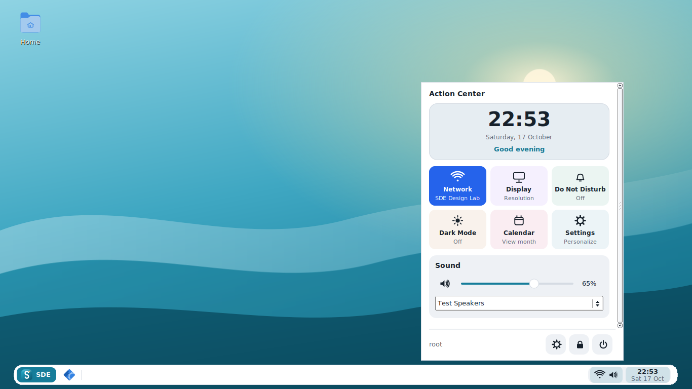

# Eduka-inspired interface (alpha4)

This release adapts selected interface patterns from Hugo Moniz do Rego's
[Eduka-Desktop](https://github.com/hugomonizdorego/Eduka-Desktop), examined at
commit `7a92f29f731576830e8c5bde79a34d4f20b6b774` (0.9.24).

| Reference in Eduka-Desktop | Adaptation in SDE |
| --- | --- |
| `usr/bin/eduka-panel`, panel style selection | Full edge, floating and short centered bars; named launcher and grouped status area |
| `usr/bin/eduka-panel`, `ActionCenter` | Clock/greeting card, a three-column quick-control grid, separate sound/brightness cards, fixed session footer |
| `usr/bin/eduka-settings`, grouped navigation and cards | Settings overview, Personalization/System groups, panel previews and Action Center preferences |

SDE implements these patterns in its existing native interface. No Python/Qt
runtime, Eduka executable, branding image or theme asset is imported. The SDE
name, existing application menu, services and configuration format are retained.
Panel placement and edge reservation are implemented in safe Rust; graphical
widgets continue to use FLTK/cairo during the staged migration.

## Panel

Choose **Control Center > Panel > Panel style**:

- **Full edge:** fills the top or bottom edge.
- **Floating:** a centered bar with an edge gap and adjustable width (default 96%).
- **Short:** a centered bar capped at 72% width, with a minimum size for controls.

Corners use XShape and work without a compositor. The window manager reserves
space for the panel including its gap. Auto-hide removes that reservation and
keeps a thin reveal strip at the edge. When space is limited, fewer pinned
launchers are shown; saved pins remain available in Settings. Running tasks and
the status area keep room. Panel styles are horizontal, at the top or bottom.

## Action Center

Click the panel clock/status area, press **Super+A**, or run
`sde-panel --action-center`. `--quick-settings` remains an alias.

Six working controls are adapted to SDE's services: Network, Display, Do Not
Disturb, Dark Mode, Calendar and Settings. Network expands an inline connections
list and Wi-Fi switch. Display opens the existing display settings; Calendar
opens the existing month calendar. **Super+C** continues to open it directly.

The Action Center has a digital or analog clock, optional greeting and optional
per-tile colors. Sound still uses PulseAudio/PipeWire, networking uses
NetworkManager, brightness uses the existing logind helper, and battery data
comes from the kernel. The body scrolls while the settings/lock/power footer
stays visible. Power opens the existing confirmation dialog.

Configure it in **Control Center > Action Center**. No weather service, update service,
Bluetooth control or notification-history service is added by this design port.

## Settings

Settings opens on **Overview**, with links to appearance, panel, Action Center,
displays, input and notifications. The sidebar groups related pages and fits
smaller screens; individual pages scroll. Changes use the Rust configuration
engine and are saved automatically. Existing `--page` names remain supported;
`home` and `action-center` are added.

## Validation and screenshots

The screenshots in `docs/screenshots/eduka/` are captured from the actual native
programs on a virtual X11 display. Wi-Fi names, sound output and volume are test
fixtures, not measurements of real hardware. The design source mockups are not
used as screenshots of SDE.

Validation includes Rust geometry tests, existing Rust/C++ tests, native GUI
inspection and interaction checks, plus the Debian/Ubuntu package CI. A real
hardware login and devices should still be checked before a stable release.

| Action Center | Settings overview |
| --- | --- |
|  |  |

| Panel style previews | Dark mode and analog clock |
| --- | --- |
|  |  |

To reproduce on a system with SDE and the preview dependencies installed:

```sh
python3 tools/ui-smoke.py --output-dir dist/ui-smoke
python3 tools/ui-smoke.py --size 1024x600 --scale 150 --output-dir dist/ui-smoke-small
```

The check uses its own X server, temporary home and fixture executables. It
checks live panel-style changes from Settings, overview navigation, network
expansion, Do Not Disturb, Dark Mode, top placement and popup bounds. It does
not invoke lock or power actions. Ubuntu 24.04 CI runs both sizes and uploads
the resulting screenshots as `sde-ui-smoke`.
