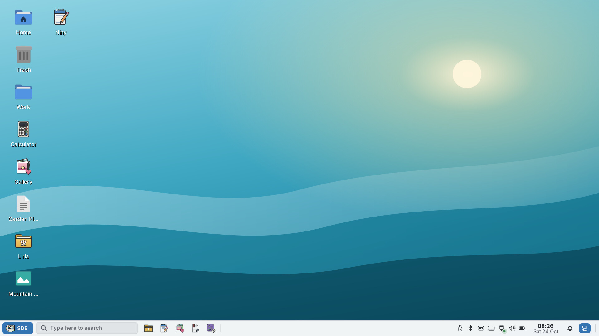
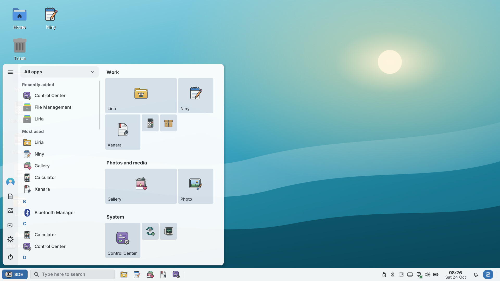
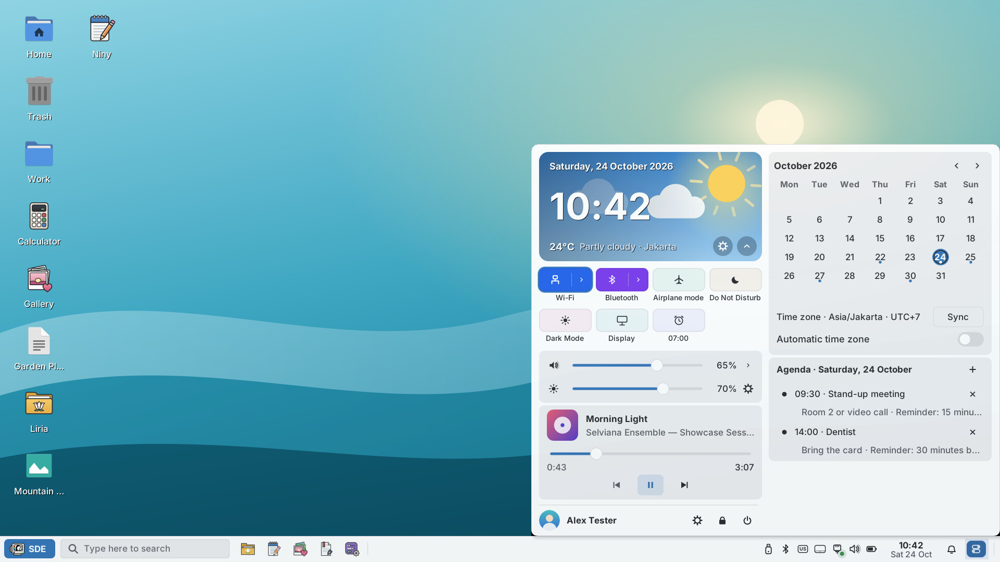
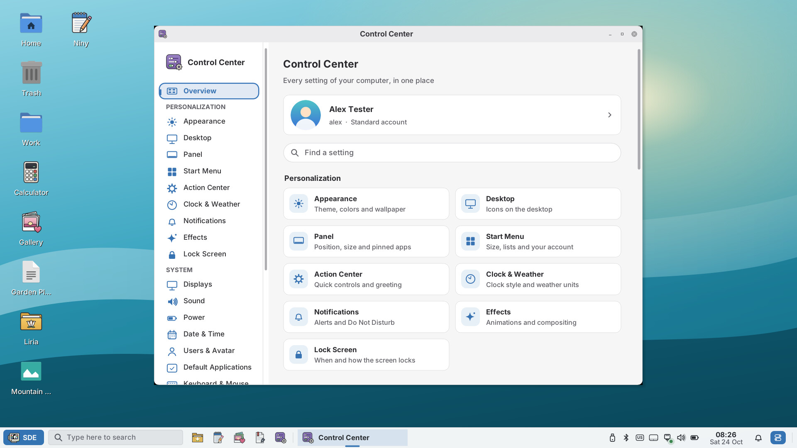
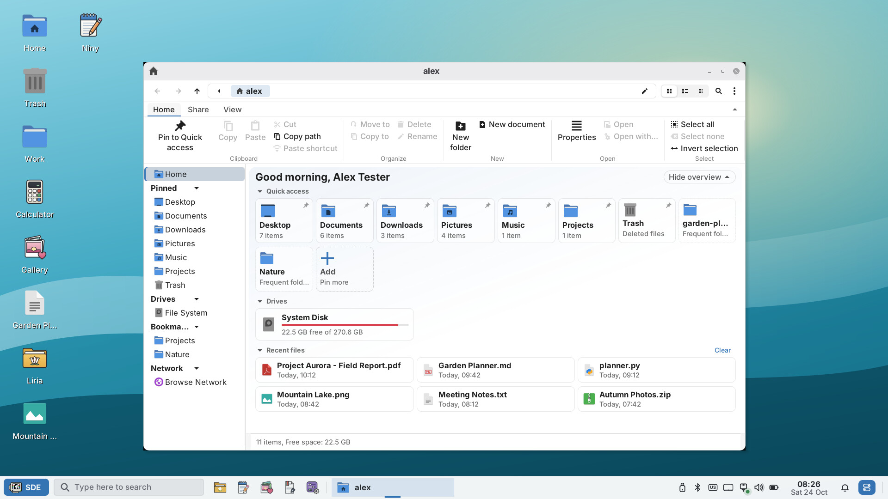

# SDE 0.2 Alpha 1 screenshots

Captured with `tools/showcase.py` (SDE Graphite Light, 1920×1080 at 125 %)
from the 0.2 Alpha 1 tree. The network, battery, music, weather and the
account "Alex Tester" are test fixtures. Every CI build publishes the
complete set (about 190 screenshots in light, dark, Fluent and Glass) as
`sde-screenshots_<version>.zip` on the
[alpha-latest pre-release](https://github.com/hugomonizdorego/SDE-Desktop/releases/tag/alpha-latest).

