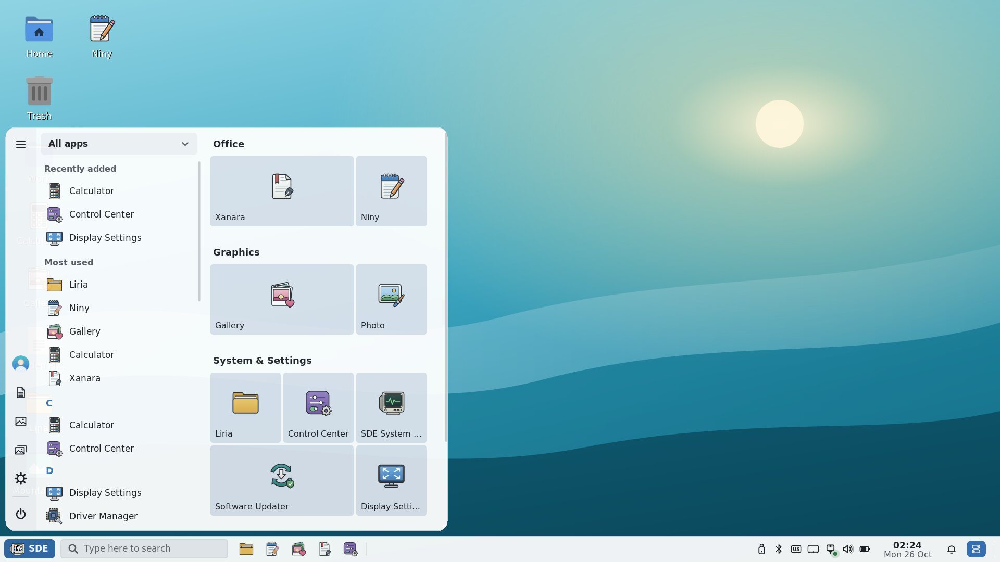
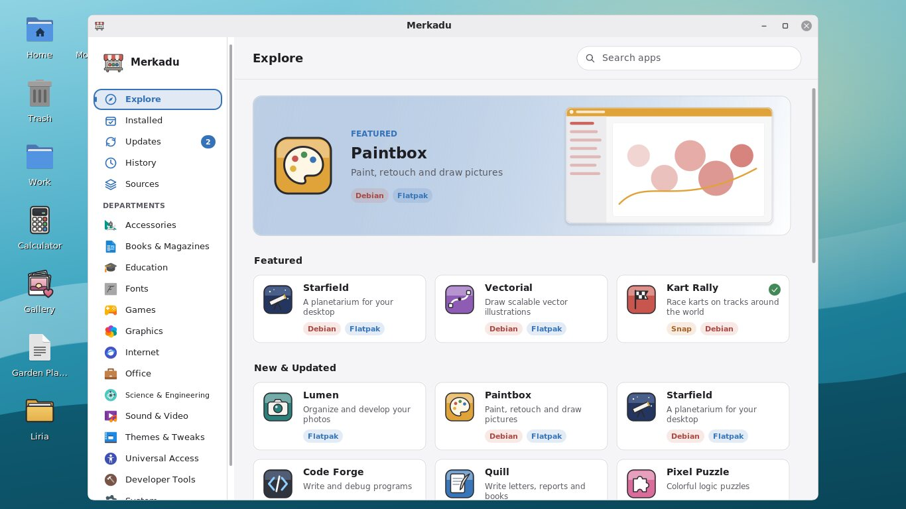
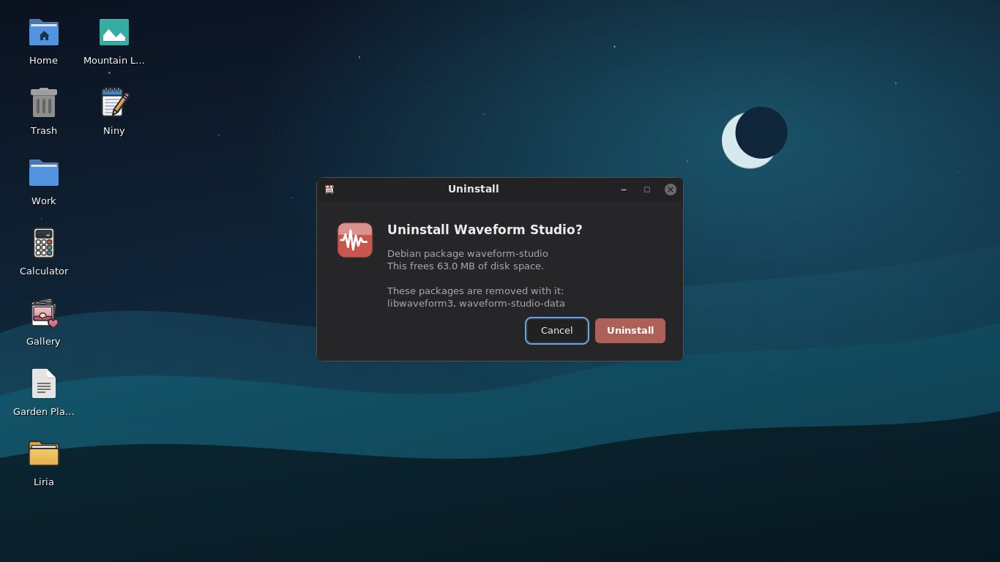
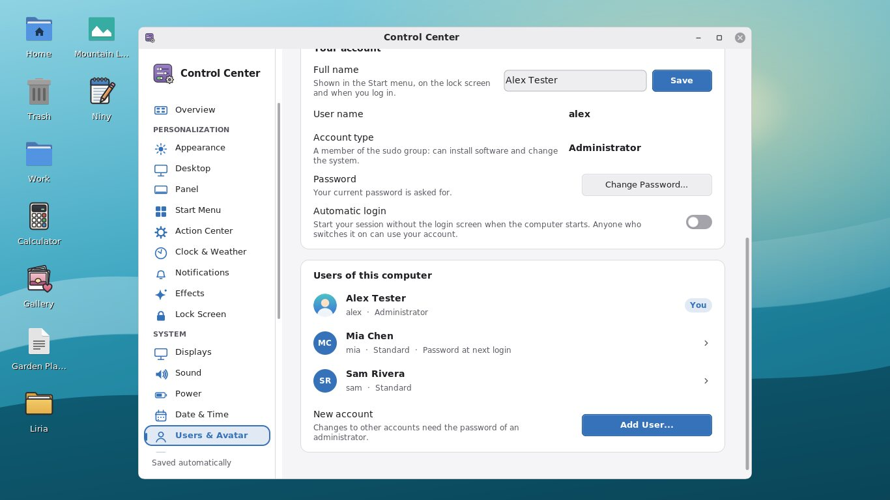
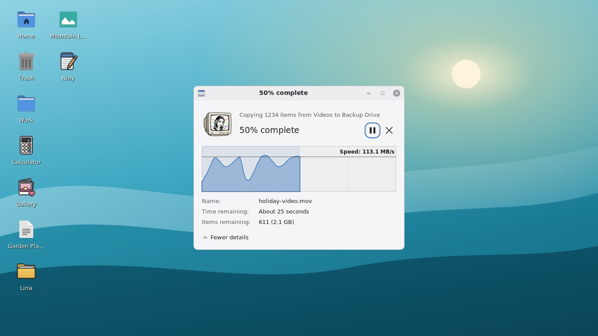
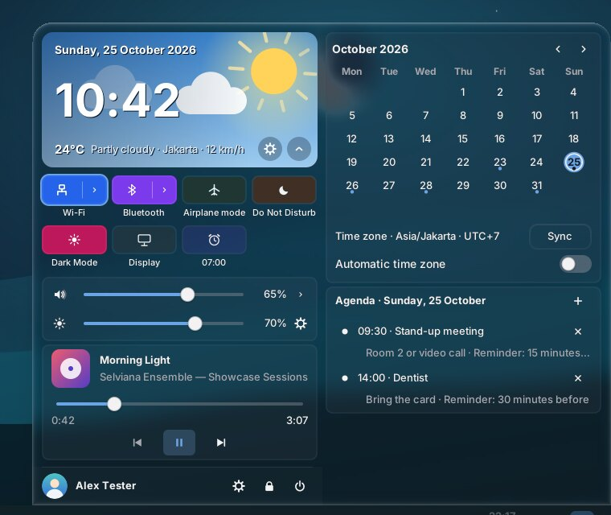
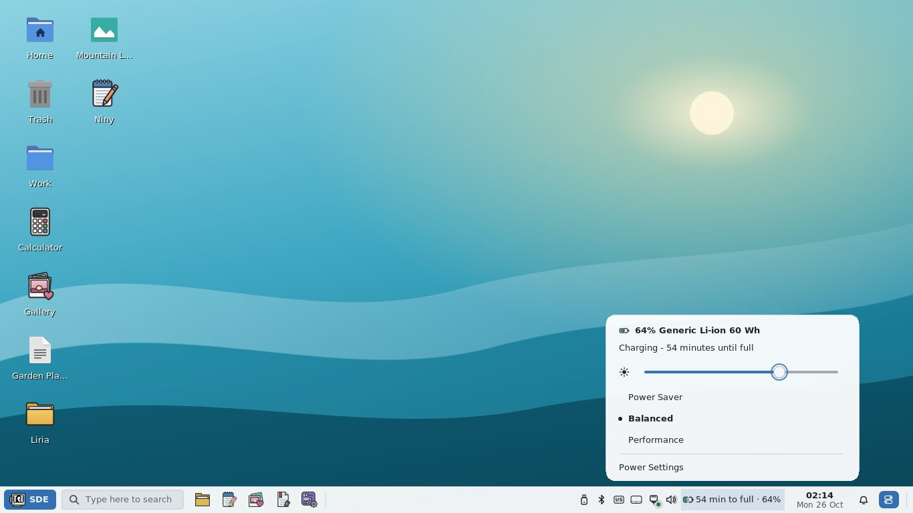
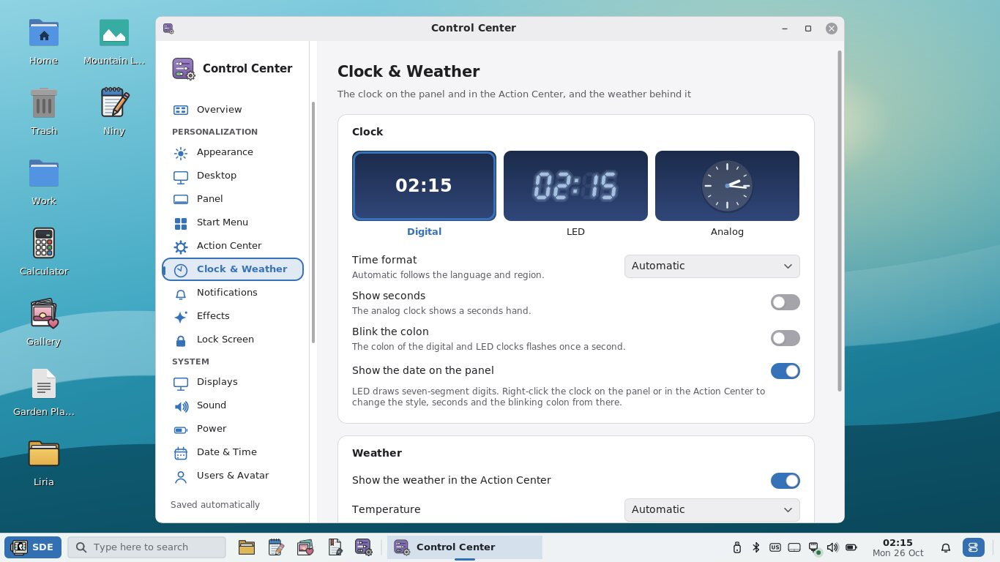
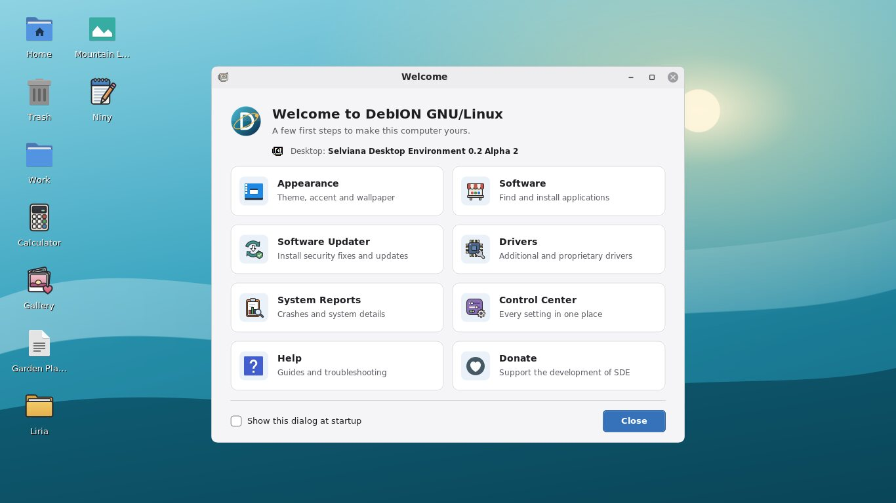

# SDE 0.2 Alpha 2 screenshots

Captured with `tools/showcase.py` from the 0.2 Alpha 2 tree: SDE Graphite
Light at 1366×768, the Start Menu at 1920×1080 with 125 %. The network,
battery, music, weather, the apps in Merkadu and the accounts are test
fixtures. Every CI build publishes the complete set (about 235 screenshots
in light, dark, Fluent and Liquid Glass) as `sde-screenshots_<version>.zip`
on the
[alpha-latest pre-release](https://github.com/hugomonizdorego/SDE-Desktop/releases/tag/alpha-latest).

