# SDE 0.2 Alpha 3.1 screenshots

Captured with `tools/showcase.py` and the UI tests from the 0.2 Alpha 3.1 tree:
SDE Graphite Light at 1366×768 unless noted. The photos, documents, packages,
apps, snaps and windows are test fixtures; the busy page behind the Liquid Glass
shots is a test window made to be as hard to read over as possible. Every CI
build publishes the complete set (light, dark, Fluent and Liquid Glass) as
`sde-screenshots_<version>.zip` on the
[alpha-latest pre-release](https://github.com/hugomonizdorego/SDE-Desktop/releases/tag/alpha-latest).

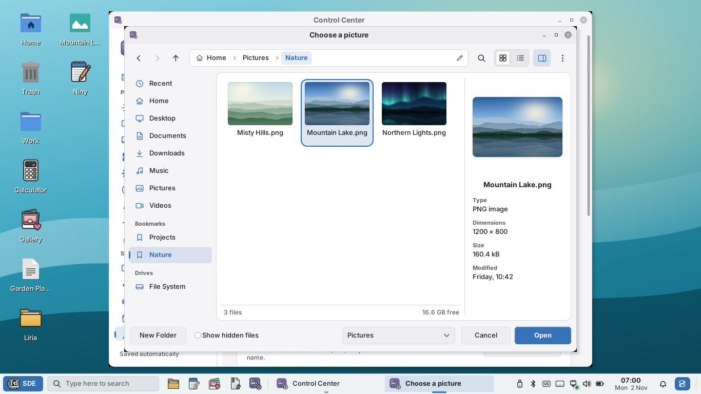

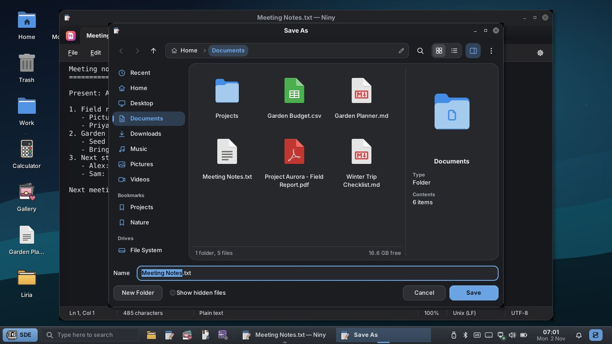

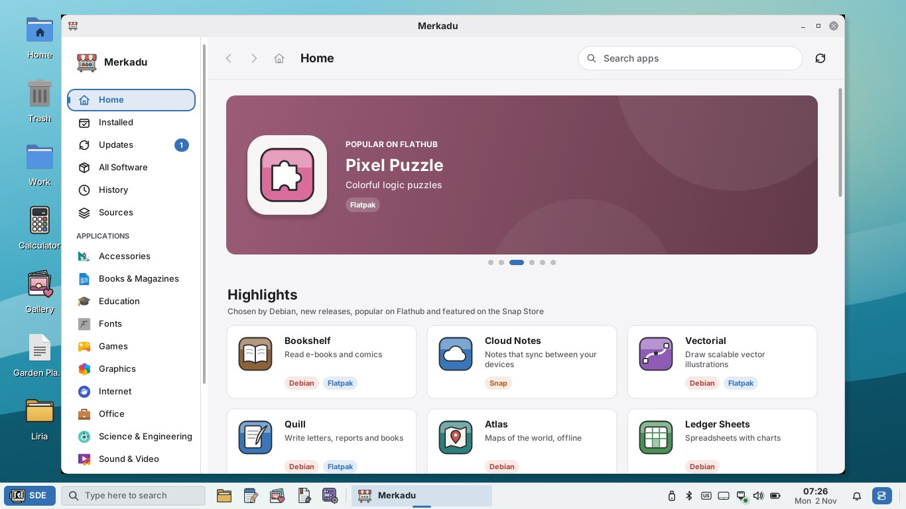

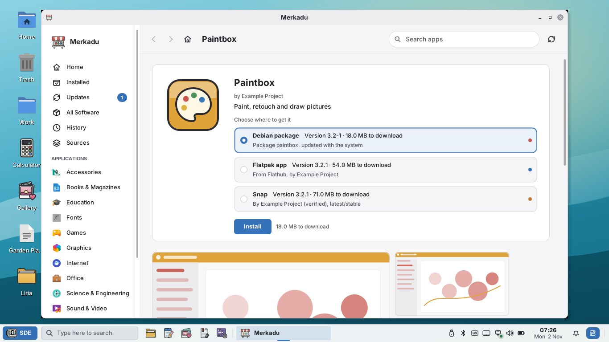

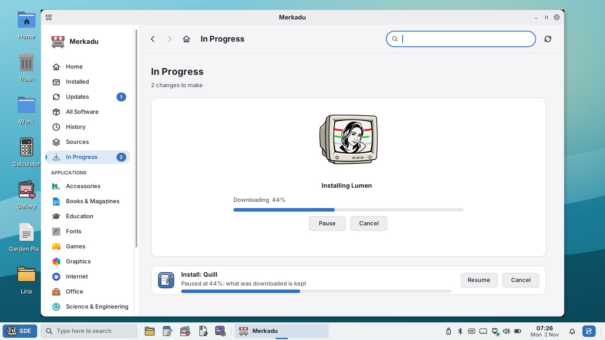

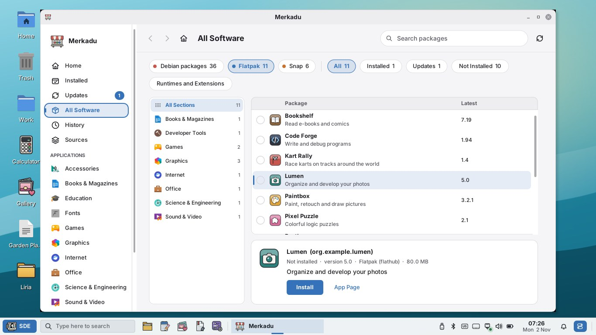

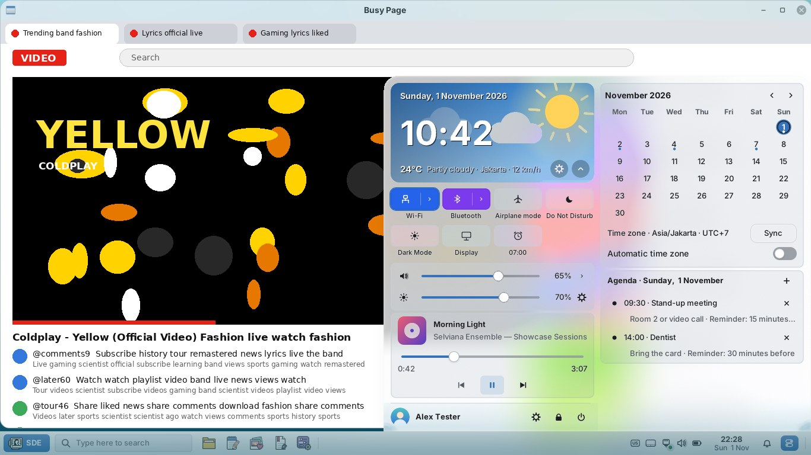

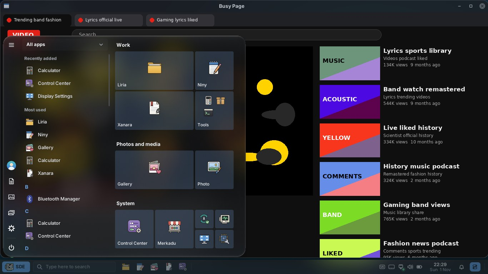

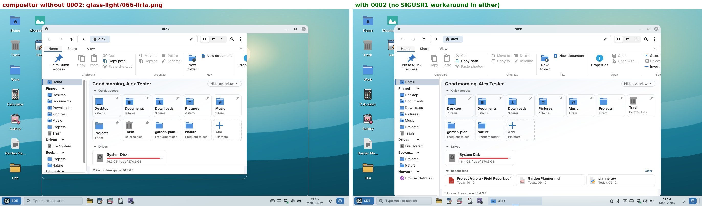

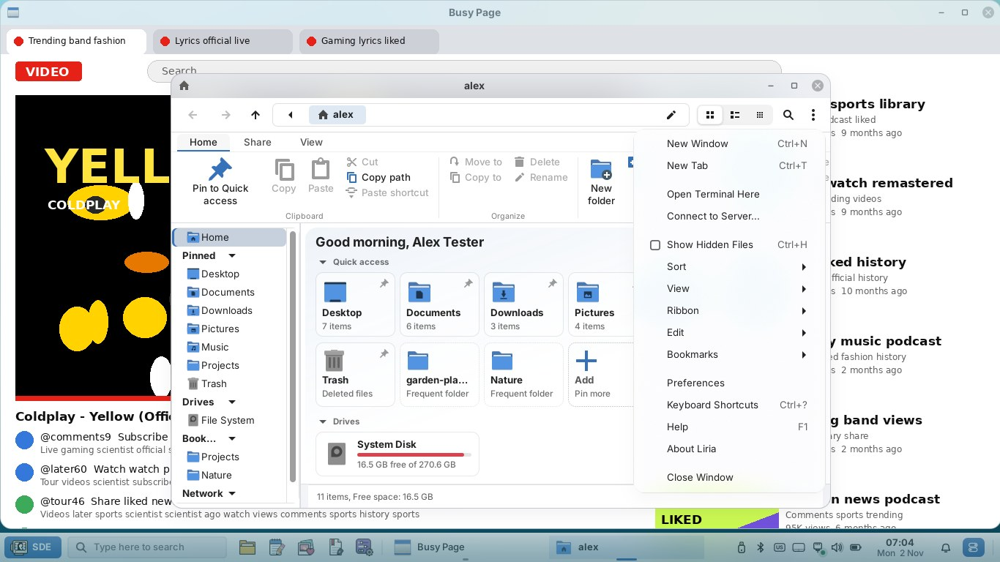

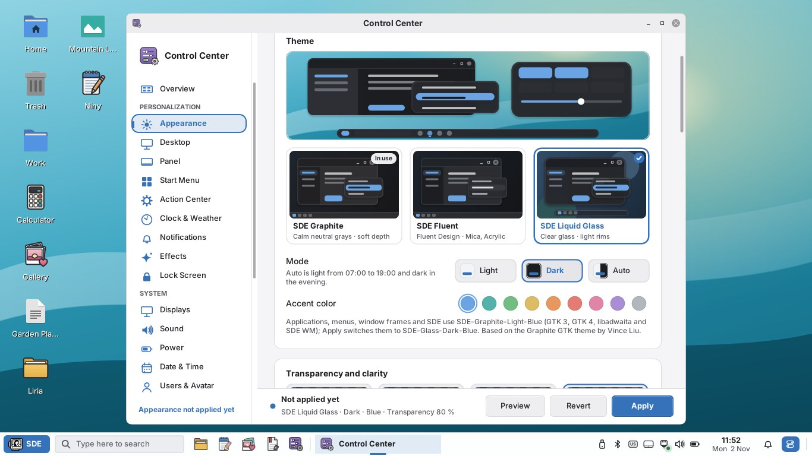

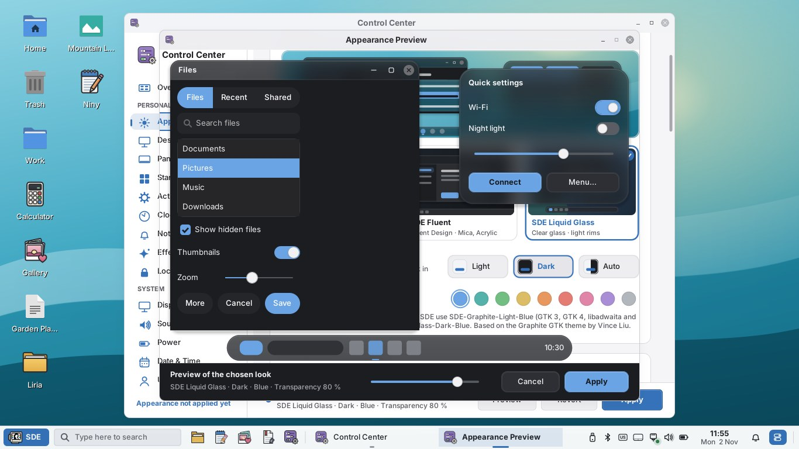

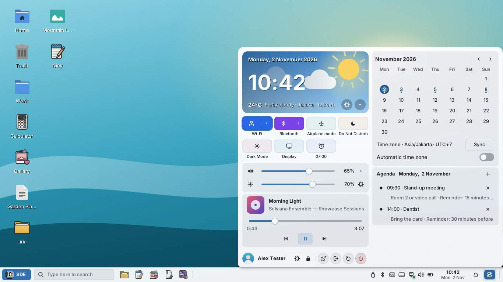

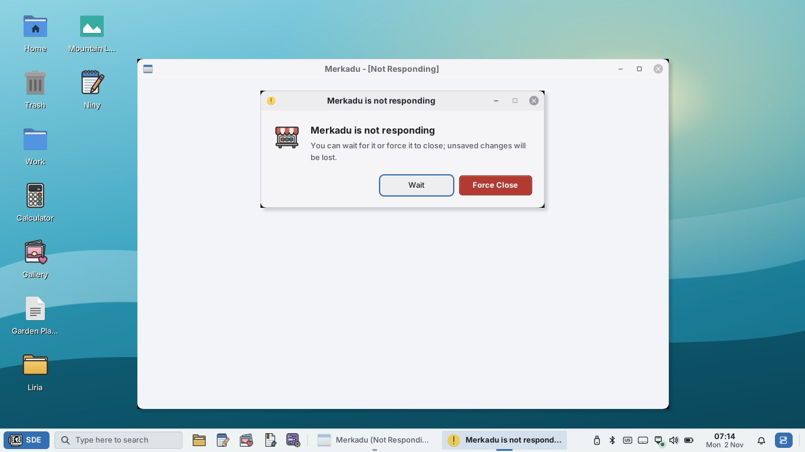
