# SDE 0.2 Alpha 3 screenshots

Captured with `tools/showcase.py` and the UI tests from the 0.2 Alpha 3 tree:
SDE Graphite Light at 1366×768 unless noted. The notifications, mail counts,
photos, PDF, packages, accounts and servers are test fixtures; the All Software
view shows the real package lists of the test machine (Ubuntu 24.04). Every CI
build publishes the complete set (light, dark, Fluent and Liquid Glass) as
`sde-screenshots_<version>.zip` on the
[alpha-latest pre-release](https://github.com/hugomonizdorego/SDE-Desktop/releases/tag/alpha-latest).

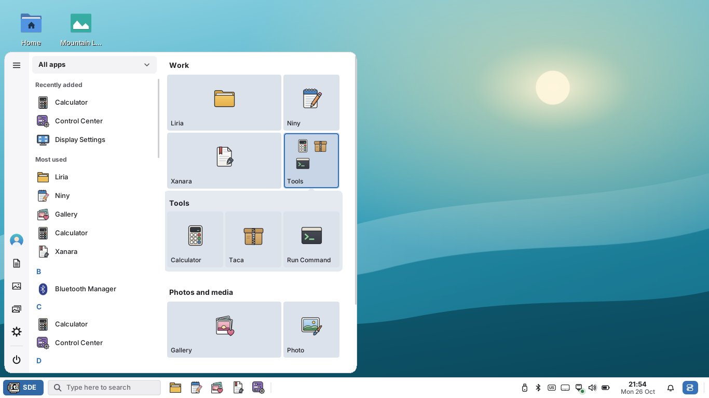

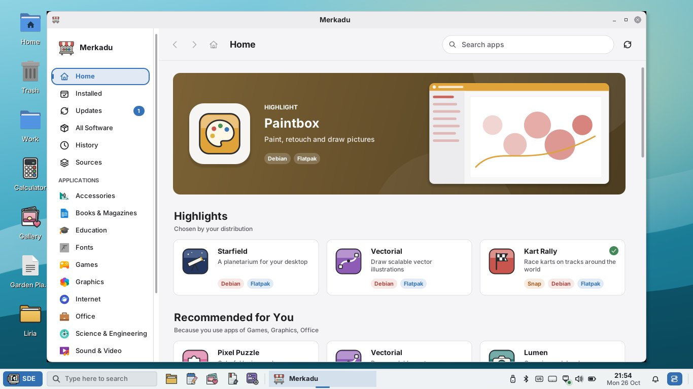

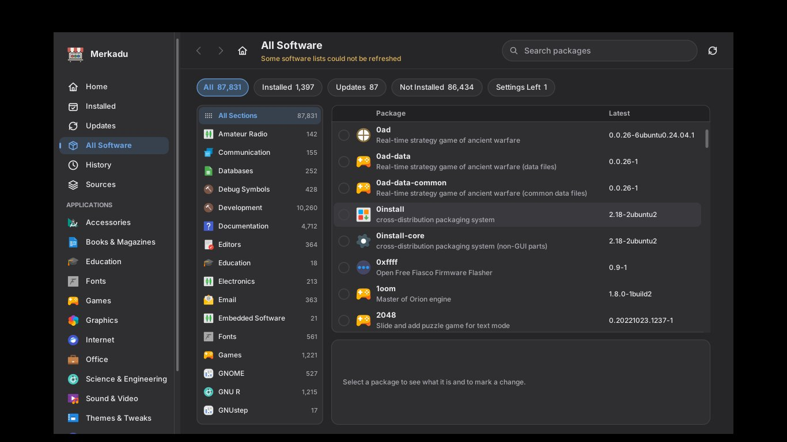

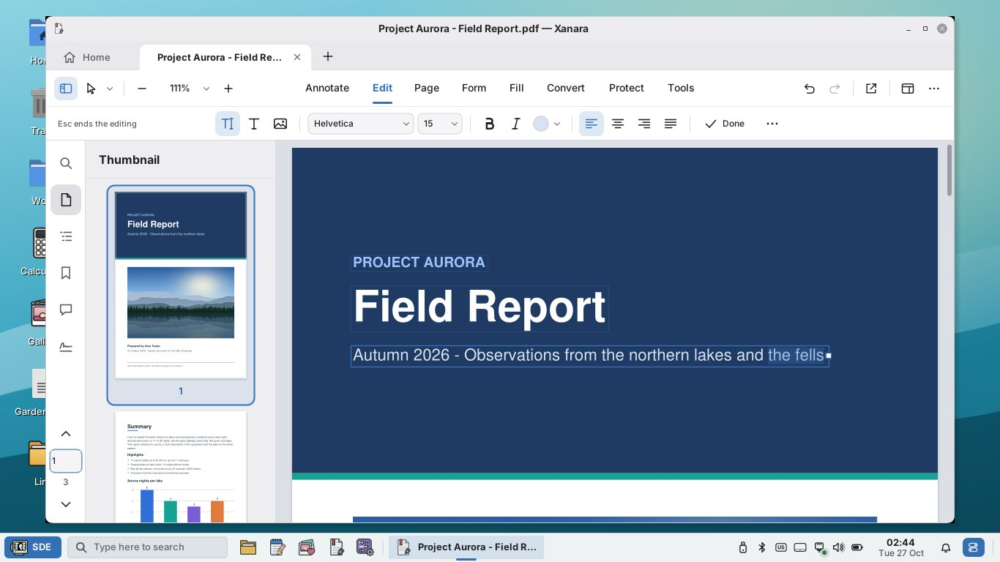

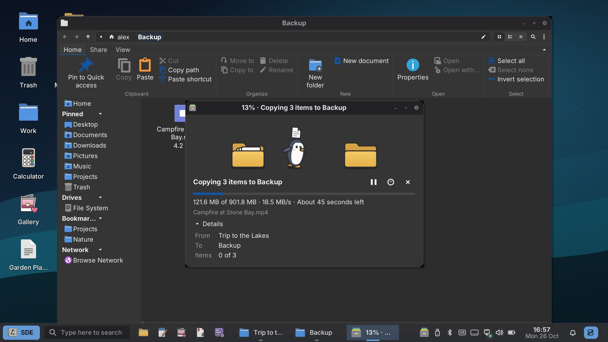

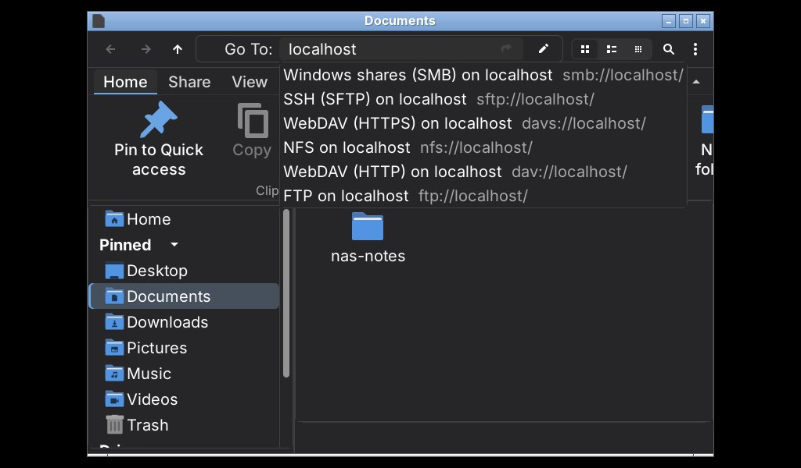

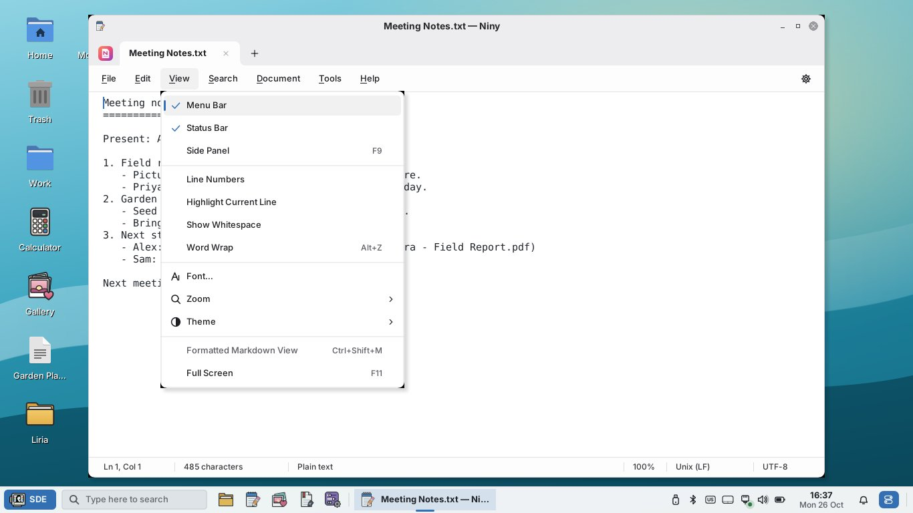

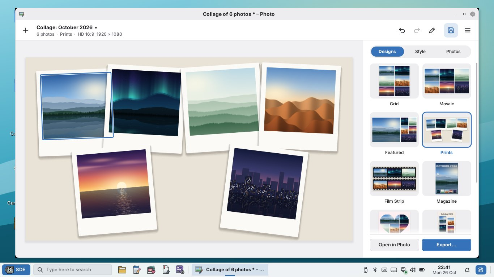

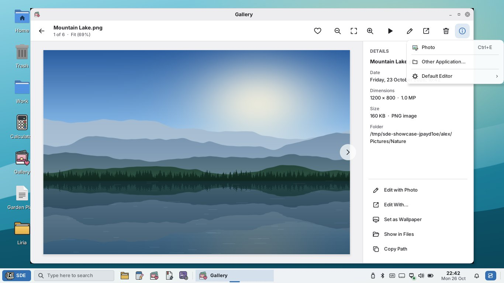

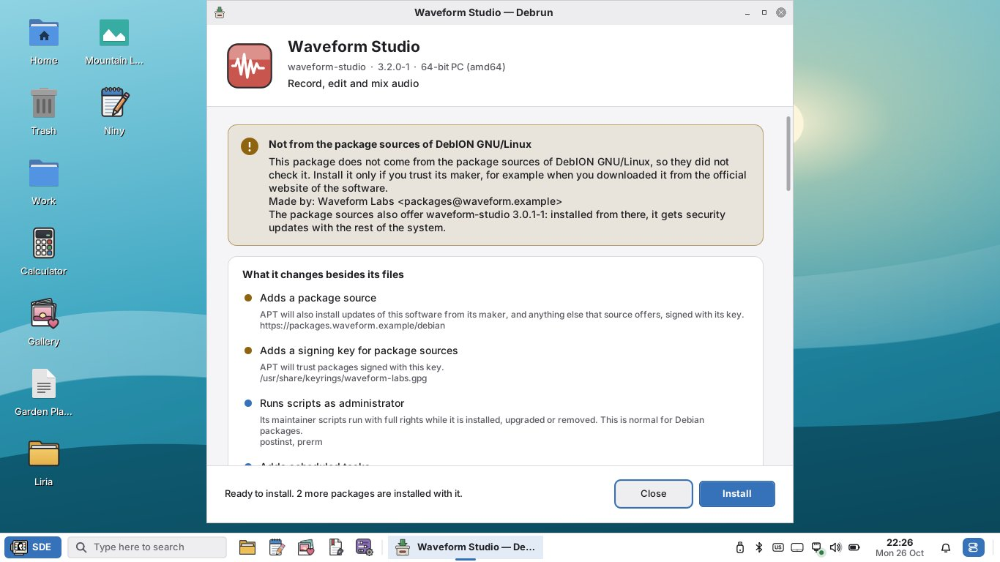

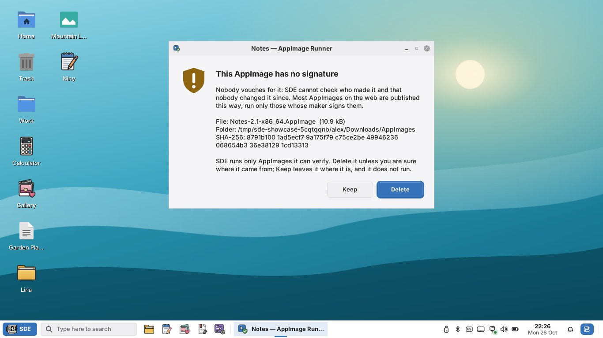

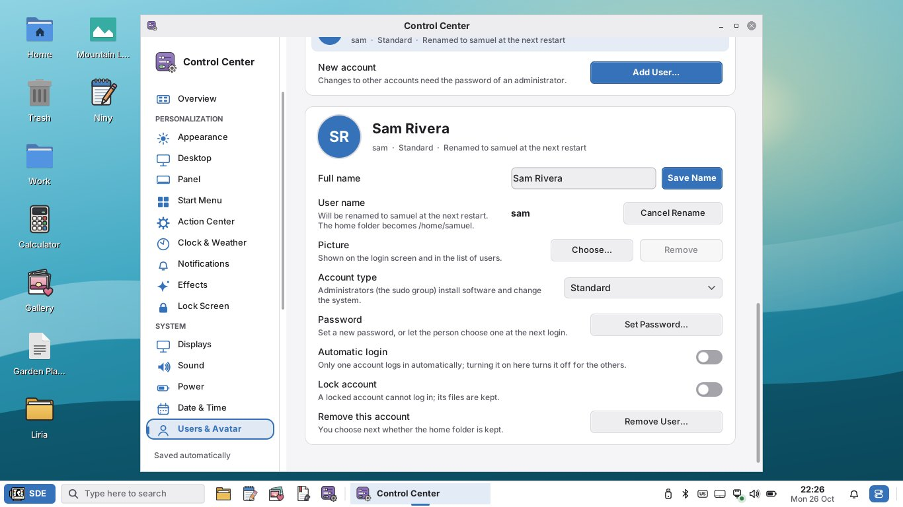
