# SDE 0.2 Alpha 4 screenshots

Captured with `tools/showcase.py` from the 0.2 Alpha 4 tree: SDE Graphite Light at
1366×768. The files, photos, packages, processes, fingerprints and windows are test
fixtures. Every CI build publishes the complete set (light, dark, Fluent and Liquid
Glass) as `sde-screenshots_<version>.zip` on the
[alpha-latest pre-release](https://github.com/hugomonizdorego/SDE-Desktop/releases/tag/alpha-latest).

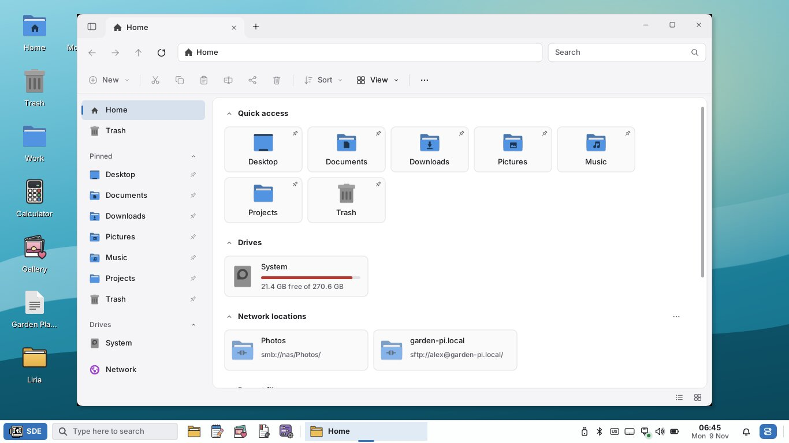

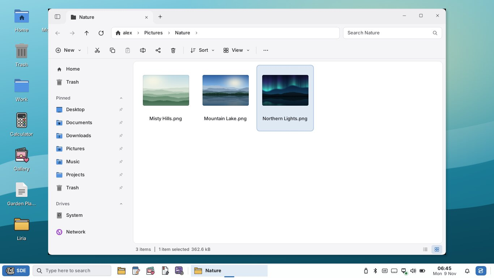

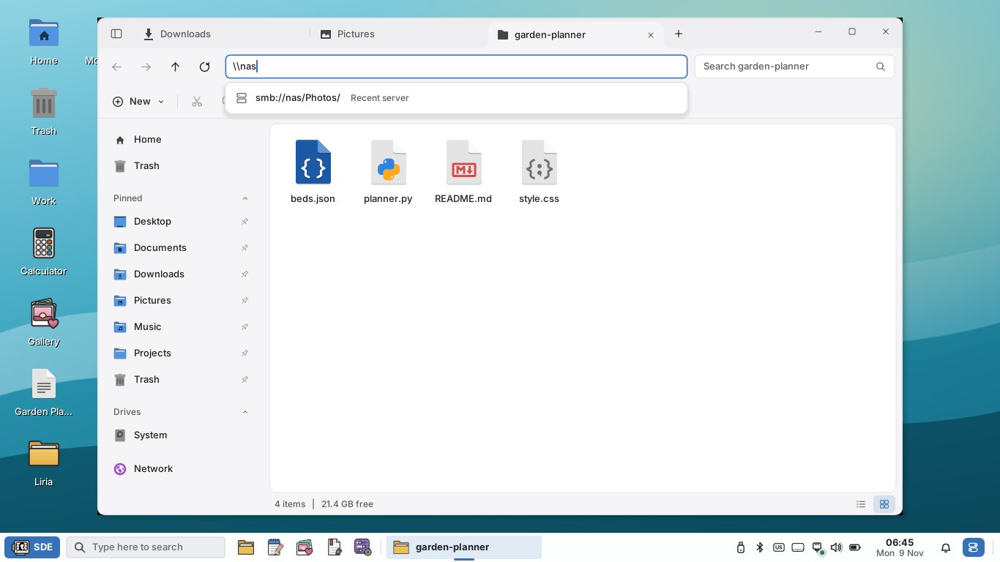

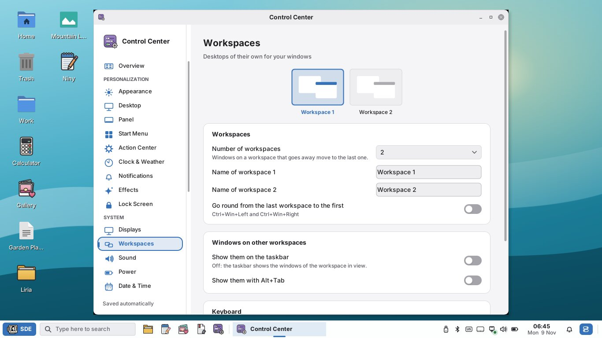

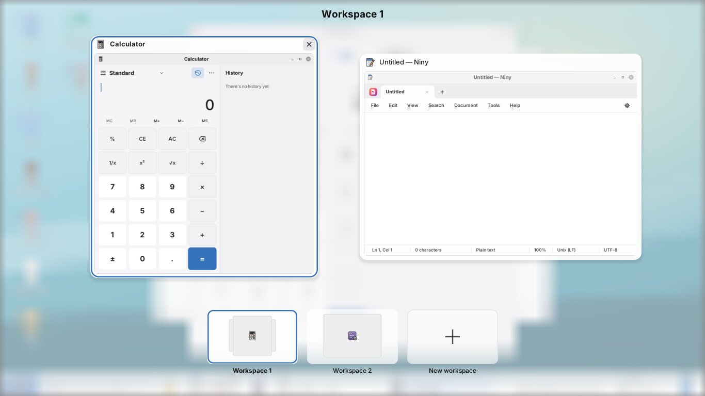

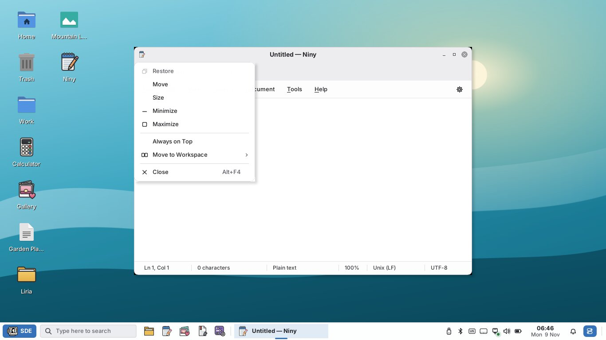

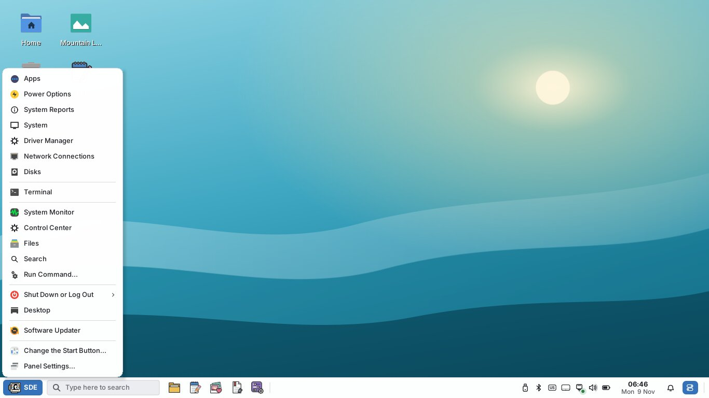

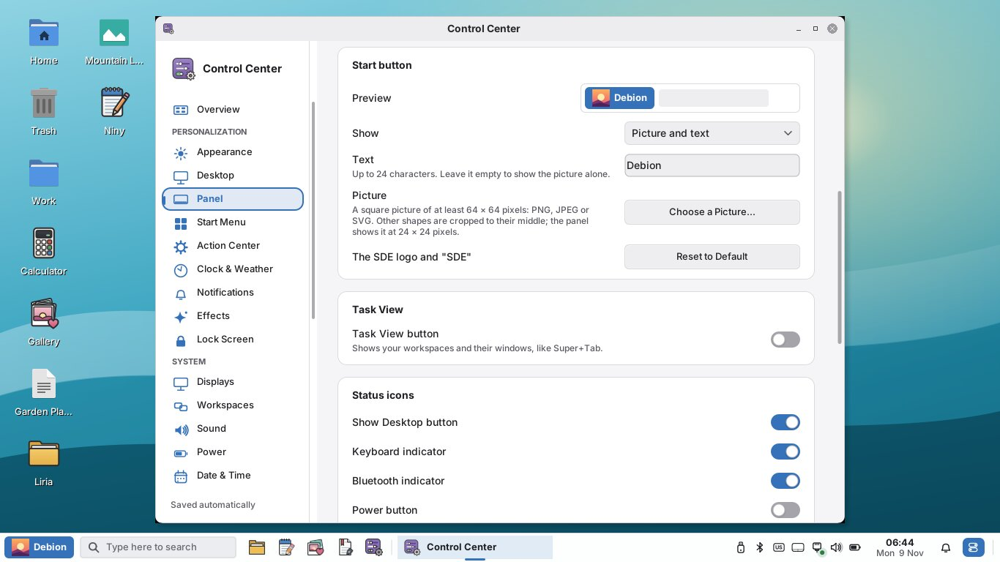

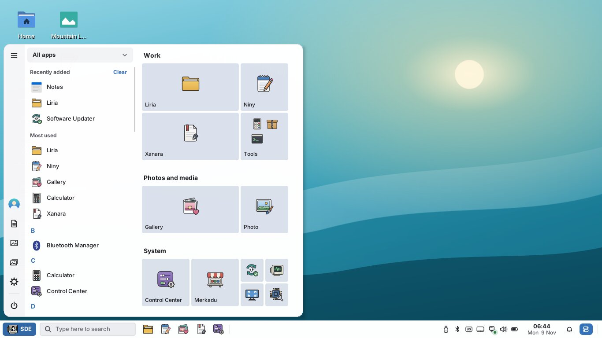

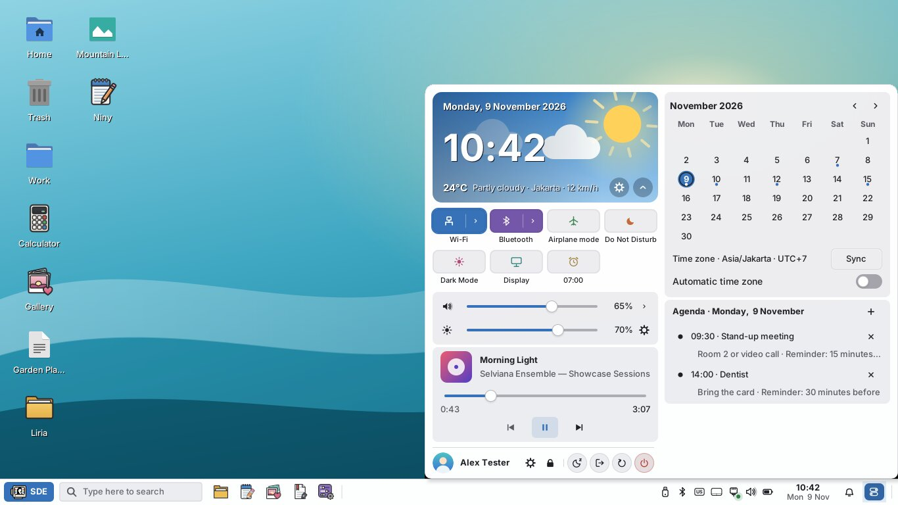

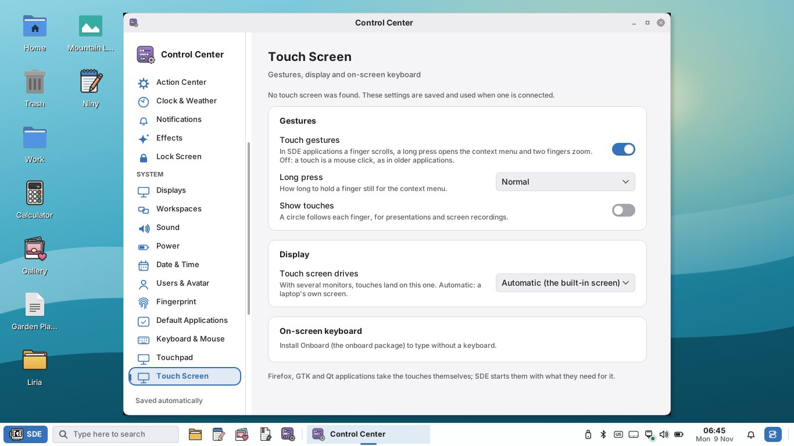

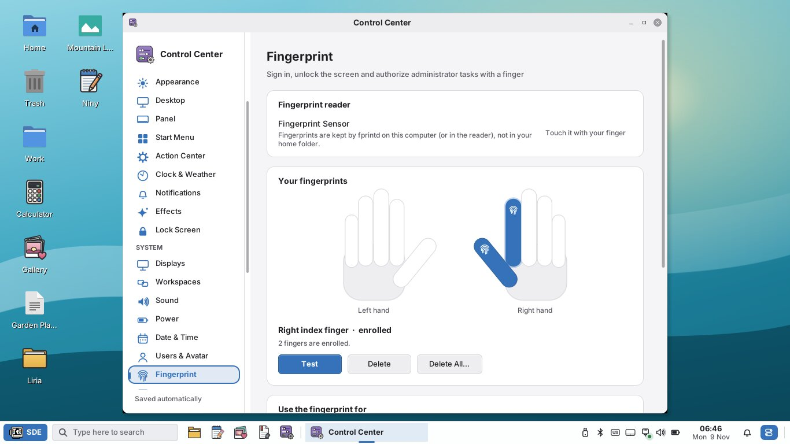

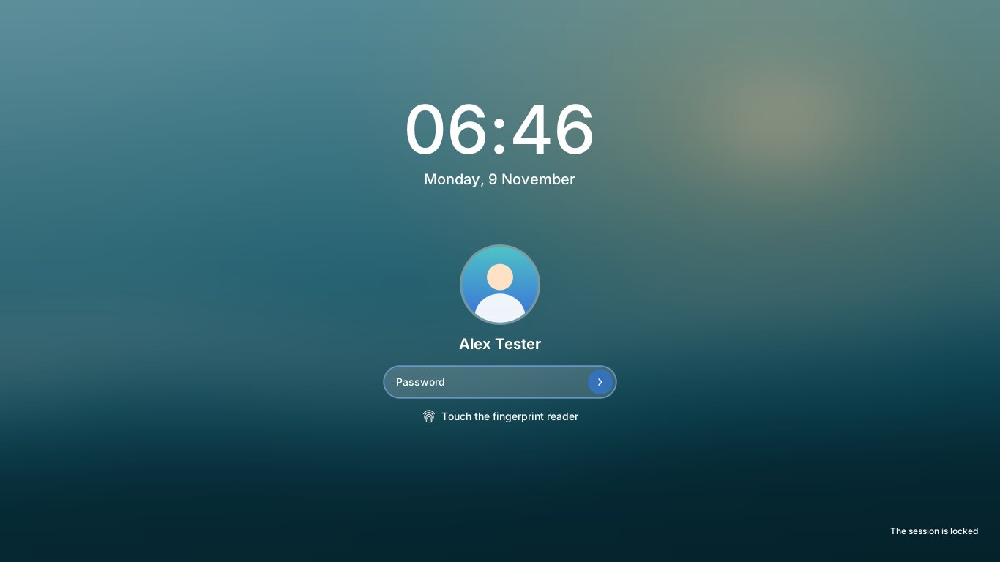

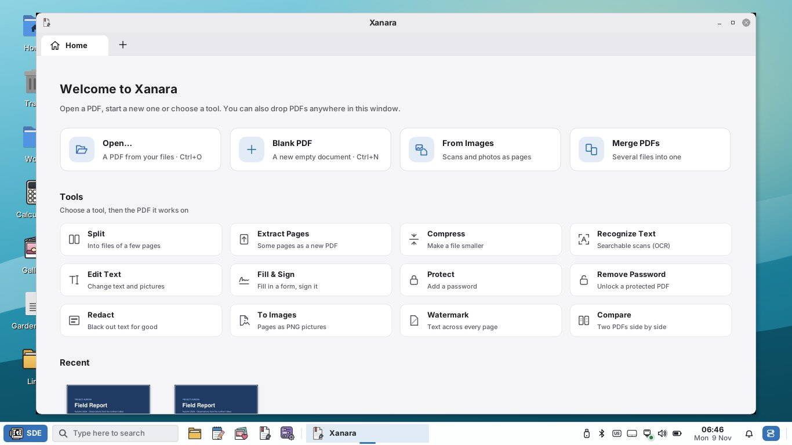

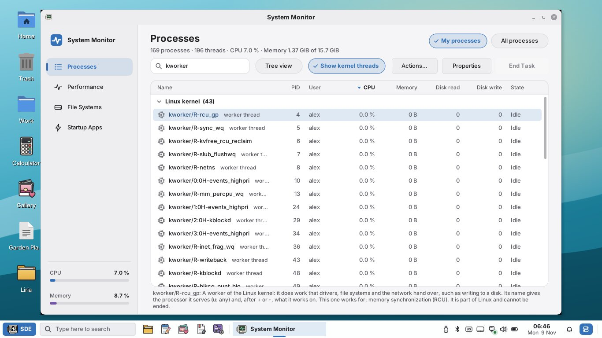

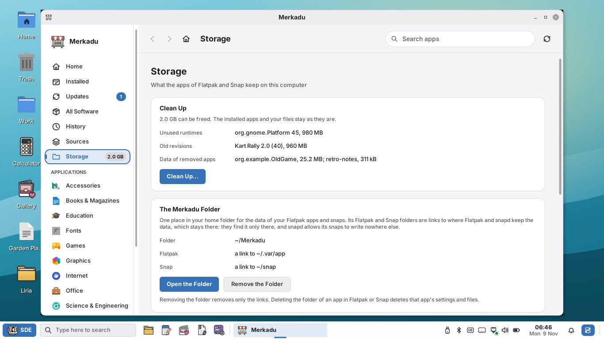

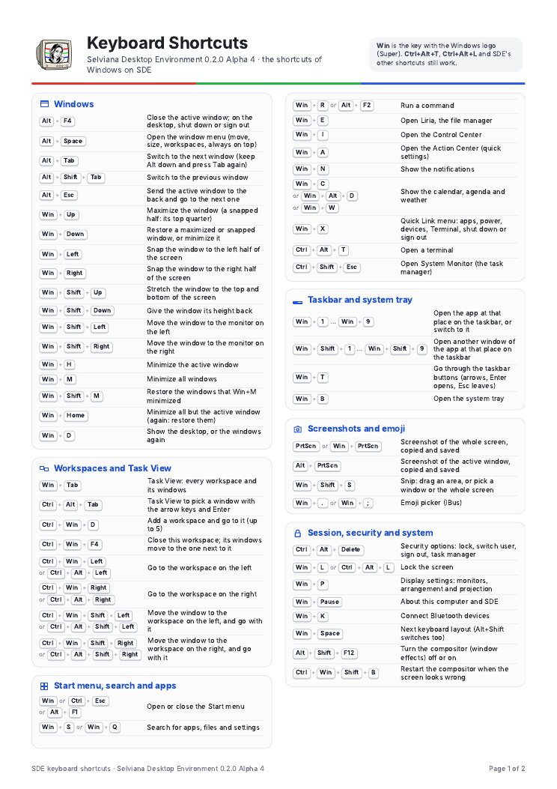
