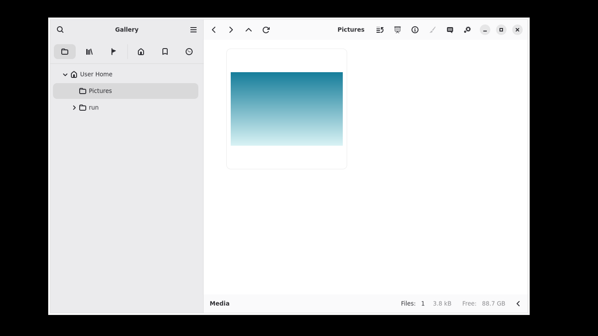
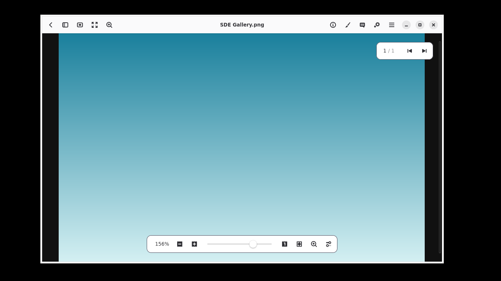
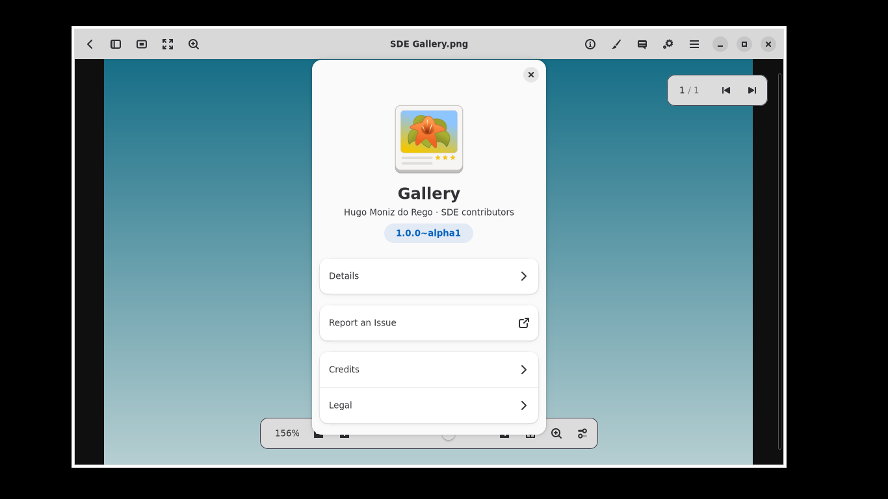
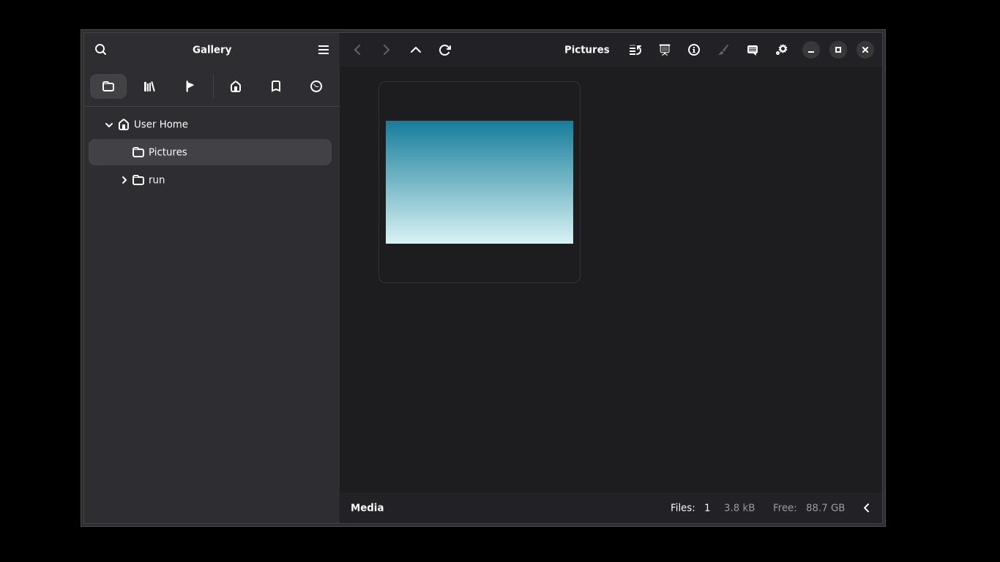
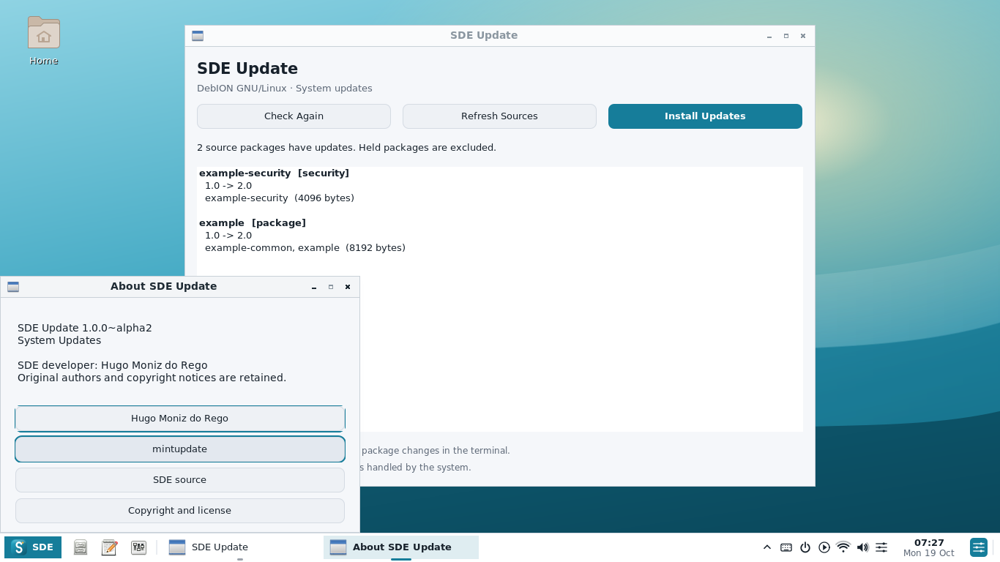

# SDE Alpha 10 — native Gallery and About

Actual native programs captured on Debian testing with Xvfb (1366×768).
Gallery is built from gThumb 4.0; the sample photograph is a generated test gradient.

| Gallery browser — SDE light theme | Photo viewer |
| --- | --- |
|  |  |

| Gallery About | SDE dark theme |
| --- | --- |
|  |  |

About retains upstream authors and licenses and adds Hugo Moniz do Rego with
clickable developer/source links. The updater uses simulated APT data in this capture.
See [Alpha 10 build notes](../../ALPHA10.md) for versions, source attribution and tests.
