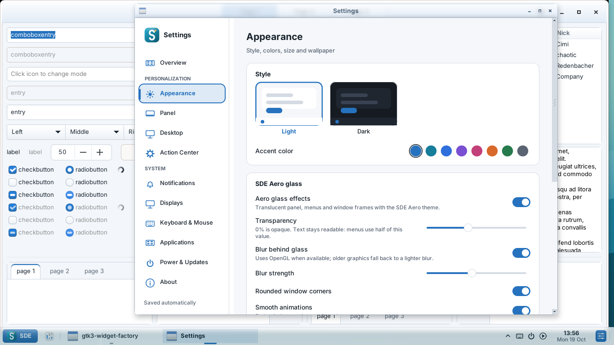
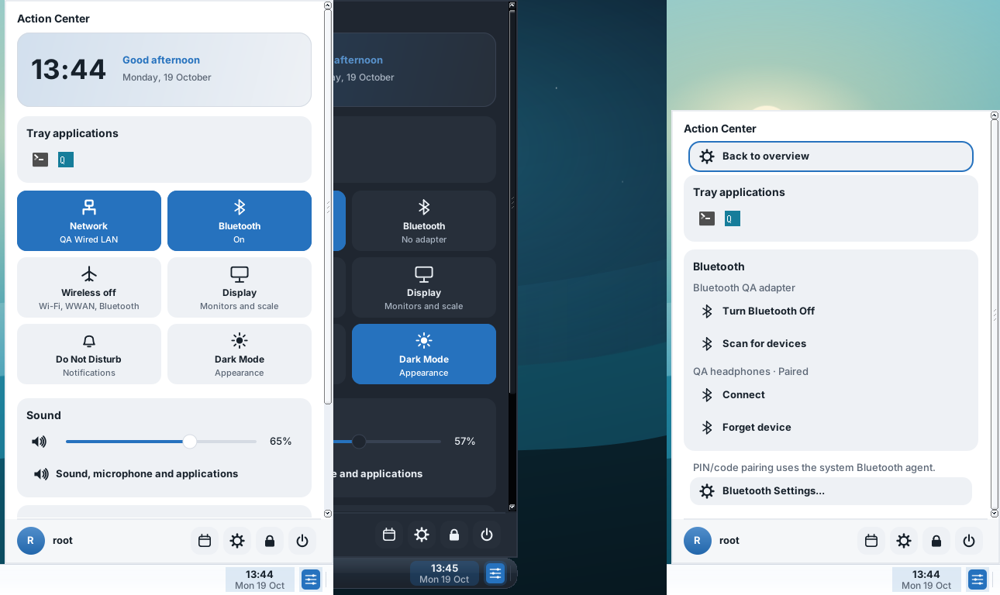
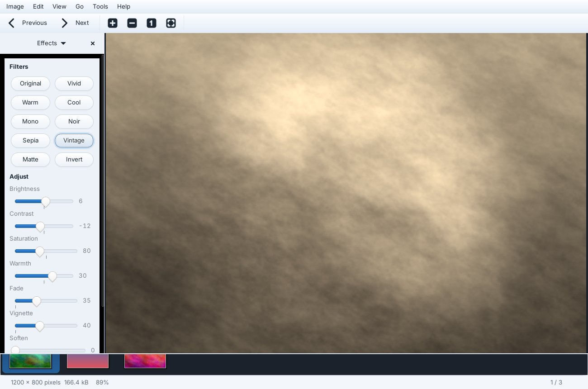
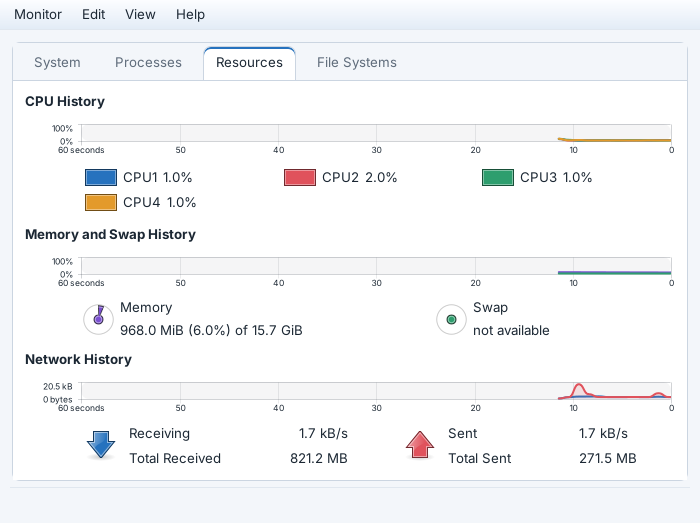
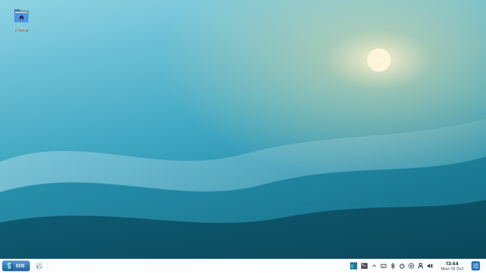
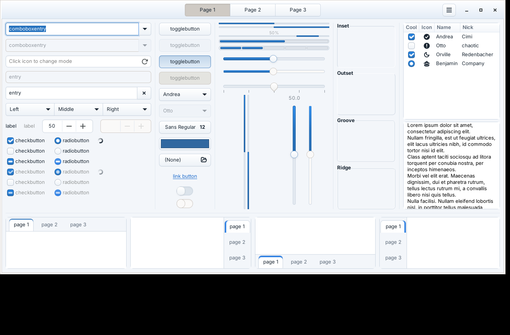
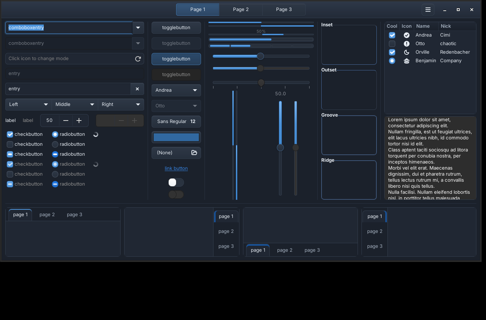
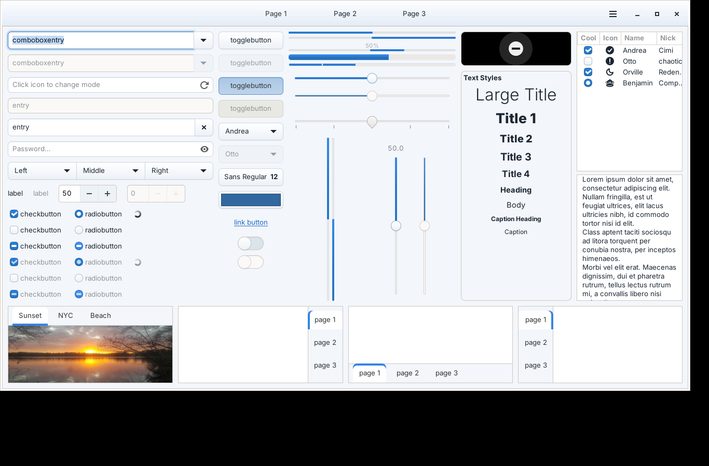

# SDE 0.1 Alpha 10 screenshots

Captured from the native programs on a virtual X11 display (Xvfb) with the
SDE compositor's XRender backend. Network, sound and Bluetooth values in the
Action Center are test fixtures; picture contents are generated samples.

| | |
| --- | --- |
|  Liria with SDE Aero frames, glass command bar and translucent panel |  Settings → Appearance → SDE Aero glass |
|  Action Center: overview, dark short panel, Bluetooth page |  Photo with the Effects pane (Vintage) and gallery strip |
|  System Monitor graph cards and palette |  Panel without the duplicate quick-controls icon |
|  GTK 3 widgets, SDE Aero |  GTK 3 widgets, SDE Aero Dark |
|  GTK 4 widgets, SDE Aero | |

CI refreshes [the latest gallery](../latest/README.md) after every build of `main`.
