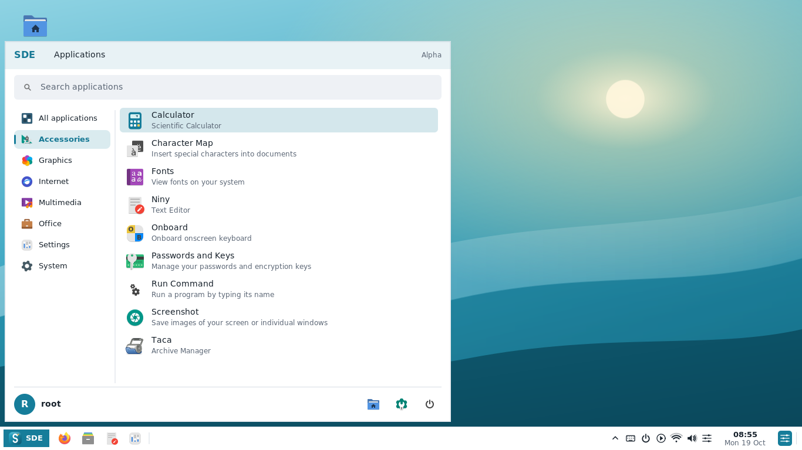
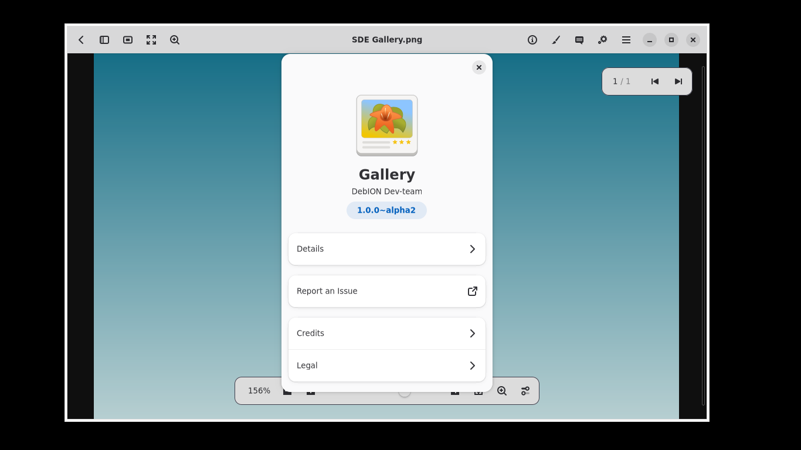
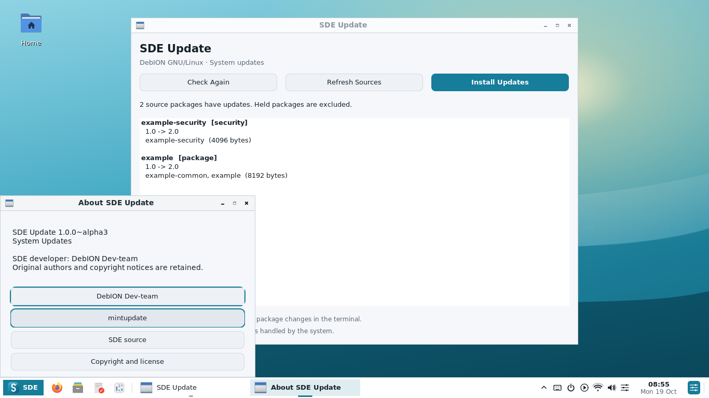

# SDE Alpha 11 — DebION profile and native credits

Actual programs captured from the verified Debian testing build at `481bd15`,
after installing the complete DebION package profile. Xvfb screen: 1366×768.
The Gallery sample is a generated gradient; the updater uses explicit APT test data.

Calculator, Character Map, Fonts, Niny, Onboard, Seahorse, Screenshot and Taca
share the Accessories directory. The package test also checks every other
complementary application's menu directory using the real SDE menu loader.

Native development credits read **DebION Dev-team**. Original authors,
copyrights and source links remain available; the updater's original source
link is labeled **mintupdate**. The links are clicked during the GUI tests.

[Alpha 11 build notes](../../ALPHA11.md) · [Package profile and defaults](../../DEBION.md)
