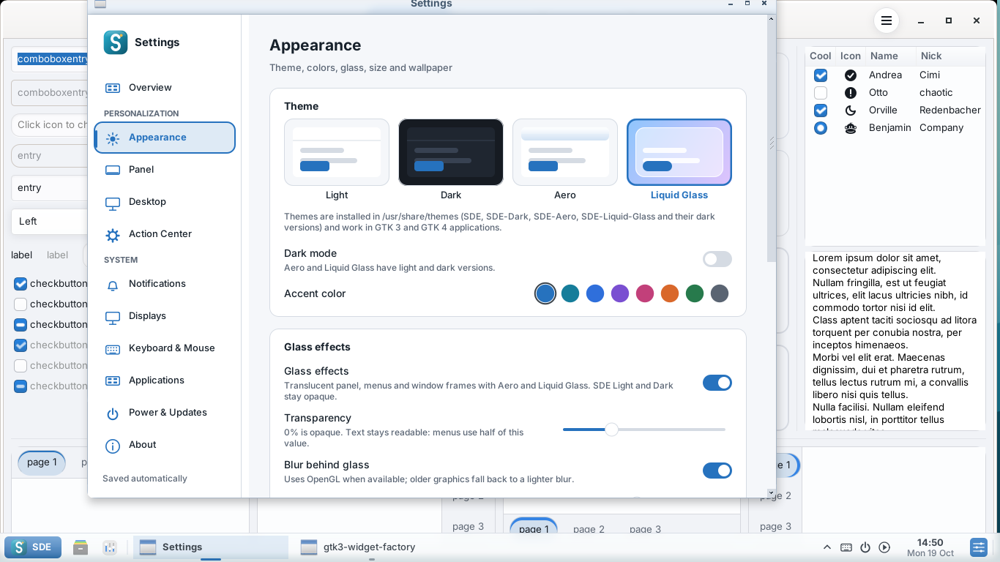
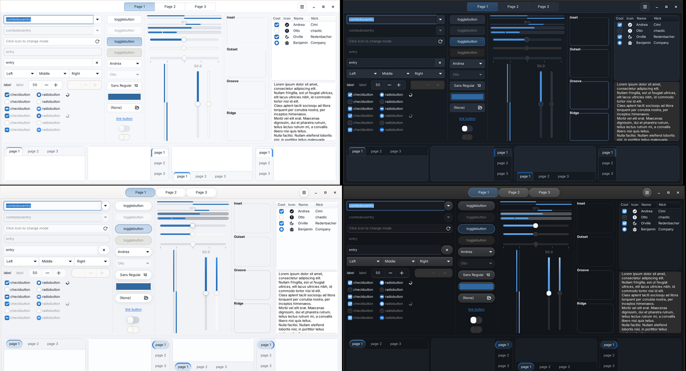
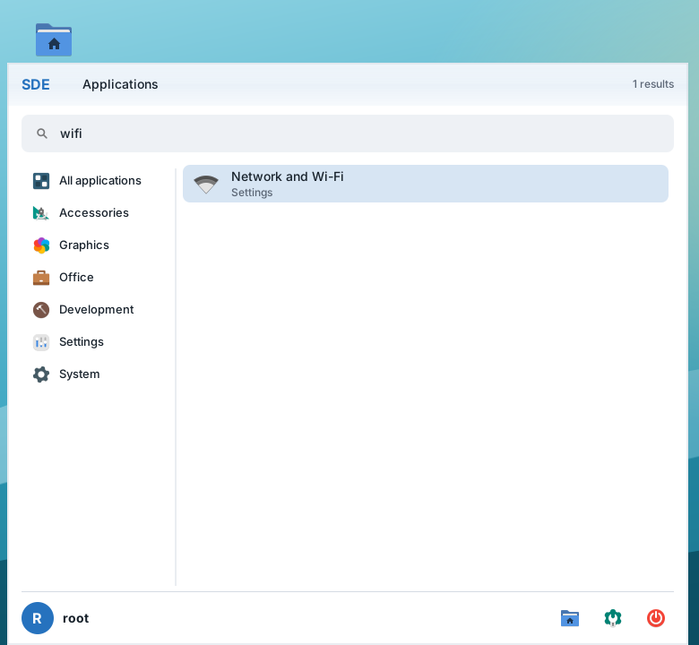
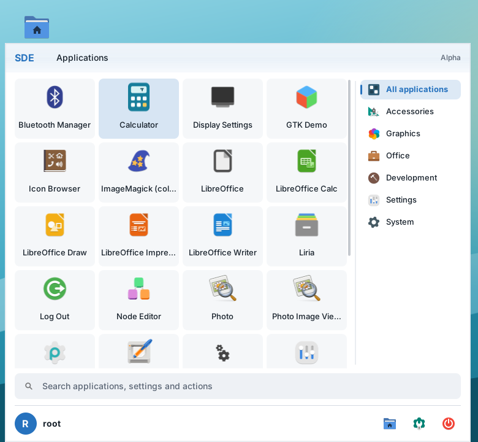
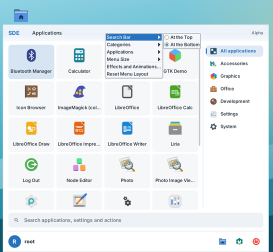
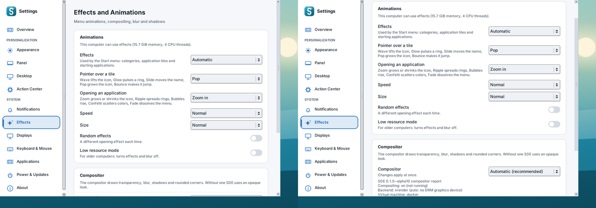
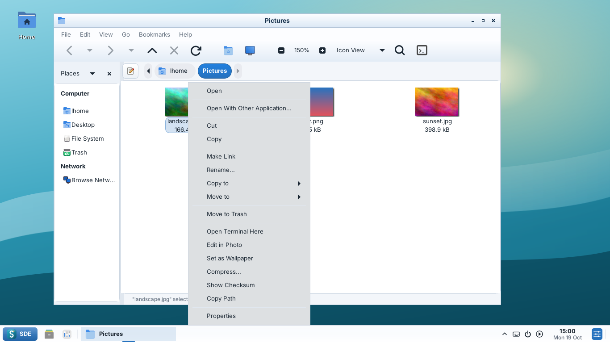
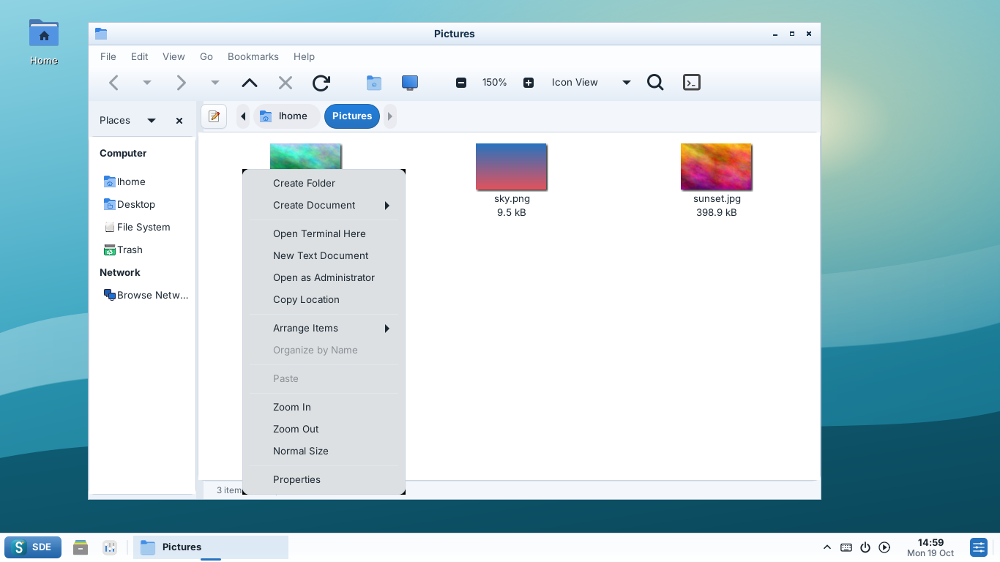

# SDE 0.1 Alpha 11 screenshots

Native programs on a virtual X11 display; sample pictures are generated.

| | |
| --- | --- |
|  Settings → Appearance with SDE Liquid Glass |  SDE Light, SDE Dark, SDE Liquid Glass light and dark (GTK 3) |
|  Start Menu search finds Settings pages |  Grid view, search at the bottom, categories on the right |
|  Right-click → Arrange menu |  Settings → Effects with compositor report |
|  Liria SDE Tools on a picture |  Liria folder menu and Terminal toolbar button |
