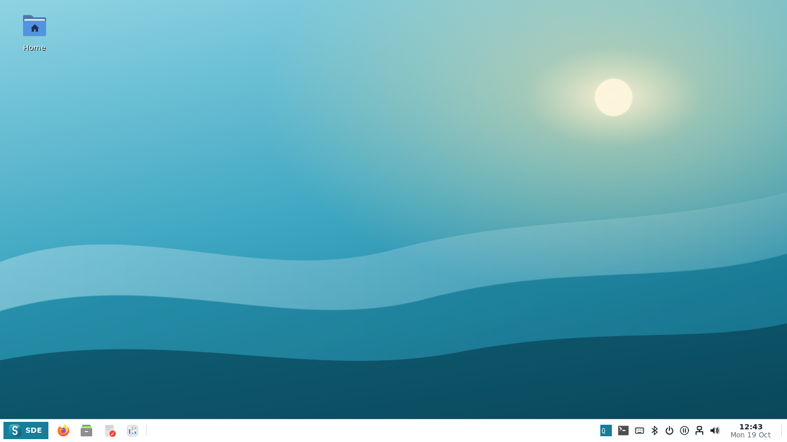
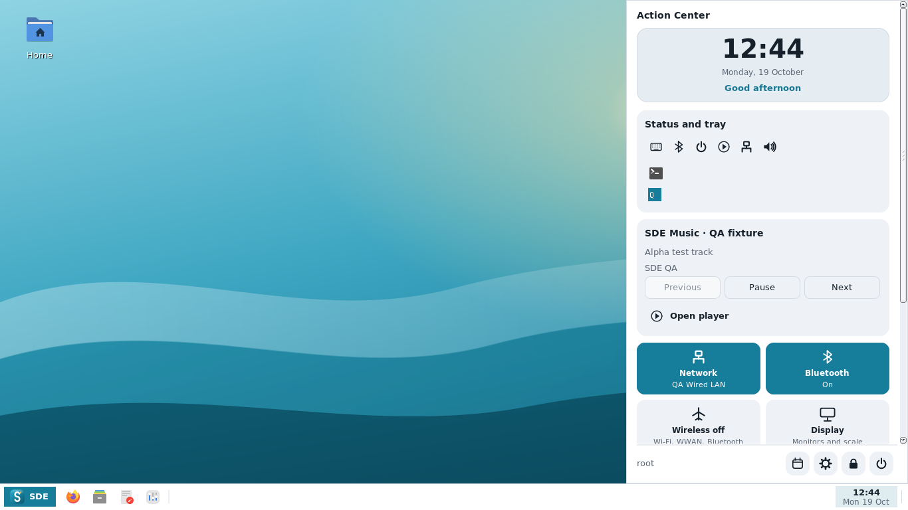
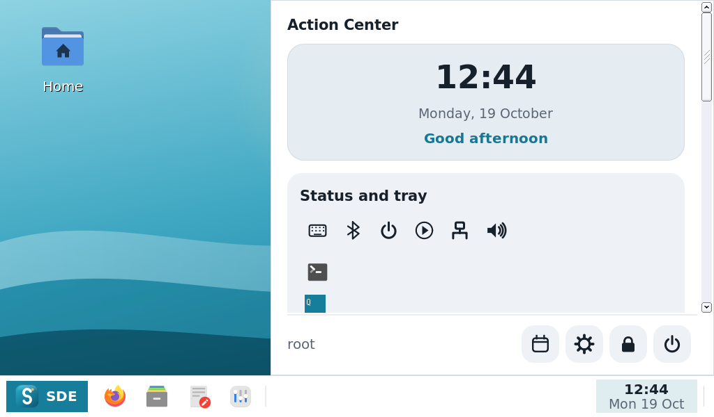
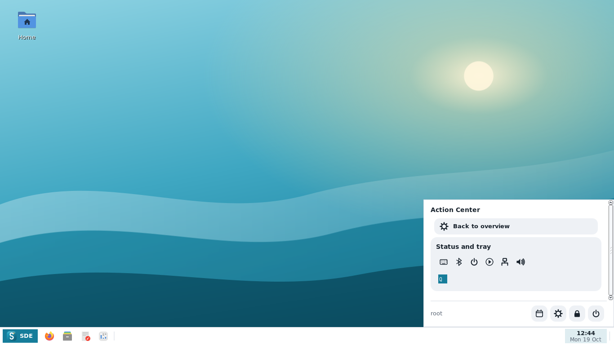

# Alpha 12 — native panel regression captures

Captured from installed Debian testing packages built from code commit
`928d2a1d1200823d62d50203299b090b1842aa08` in the
[verified CI run](https://github.com/hugomonizdorego/SDE-Desktop/actions/runs/39252605381).
These are native X11 program captures, not UI mockups. Papirus and the complete
DebION application profile are installed.

Network/audio values, Bluetooth devices, the MPRIS player, and both tray clients
are controlled QA fixtures. The cyan square is the XEmbed input fixture; the
terminal icon is the SNI fixture. Neither is a bundled desktop application.
No physical battery, radio, audio device or hardware compatibility is implied.

| View | Size / scale | Result |
| --- | --- | --- |
| [Panel](01-panel.png) | 1366×768 / 100% | Clock opens Action Center; no separate sliders buttons or tray arrow |
| [Action Center](02-action-center.png) | 1366×768 / 100% | Flush corner placement; indicators and tray move off the panel |
| [Action Center at 150%](03-action-center-150.png) | 1024×600 / 150% | Bounded popup and scrollable contents; pinned apps remain usable |
| [After provider disconnect](04-provider-disconnect.png) | 1366×768 / 100% | Panel survives selecting a menu item after its SNI provider exits |

Reproduce with `tools/panel-smoke.py --test-dir dist/test-tools`, under
`dbus-run-session`, after installing the matching package and preview tools.
For the small capture add `--size 1024x600 --scale 150`.
