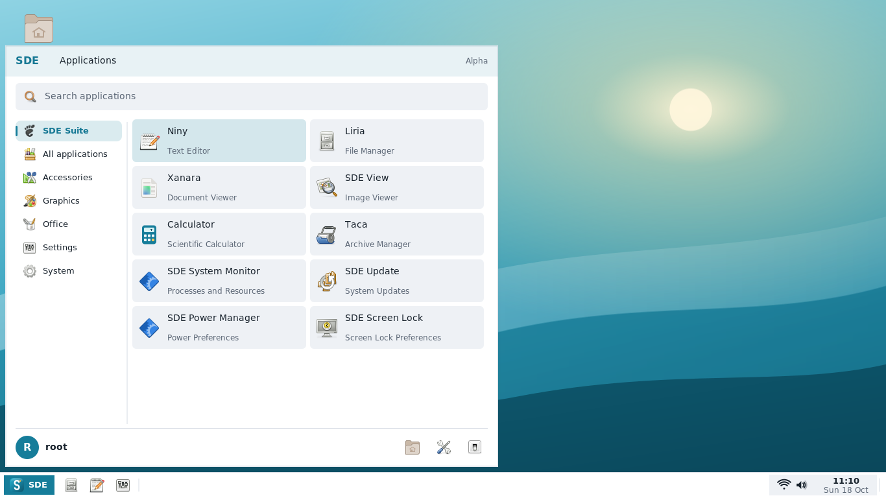
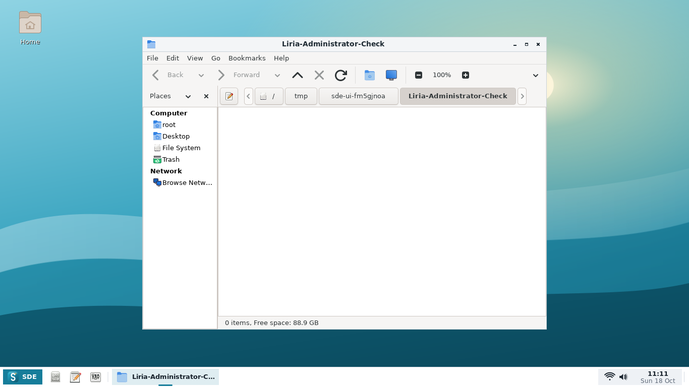

# Alpha7 native screenshots

Captured from the successful Debian testing build of production commit
`b637fe03815fc24bc72f480d9f4d261b48d8c5b3` in
[GitHub Actions](https://github.com/hugomonizdorego/SDE-Desktop/actions/runs/39121460921).
These are real compiled application windows in an isolated Xvfb session.
Wi-Fi and sound values are explicit GUI test fixtures. GTK4 uses the software
renderer, as Calculator does by default. No update, lock or power operation is
performed while capturing.

| Capture | View |
|---|---|
| [Start Menu](01-start-menu.png) | Ordered native Suite tiles and categories |
| [Calculator](02-calculator.png) | Native GTK4 frontend calculating `sin(30)+2^3 = 8.5` |
| [Suite settings](03-suite-settings.png) | Independent build versions, source links and copyright |
| [Administrator Liria](04-liria-administrator.png) | Actual `sudo liria` with UID 0, root home and a separate D-Bus session |
| [Niny](05-native-niny.png) | Native text editor opening a sample file |
| [Small display](06-small-screen.png) | 1024×600 display with SDE interface scale at 150% |
| [Action Center](07-action-center.png) | Full-edge square panel and quick settings |

The production-code commit above supplies the downloadable `.deb` packages and
complete corresponding sources. This gallery was committed afterward and changes
only documentation and image files.
