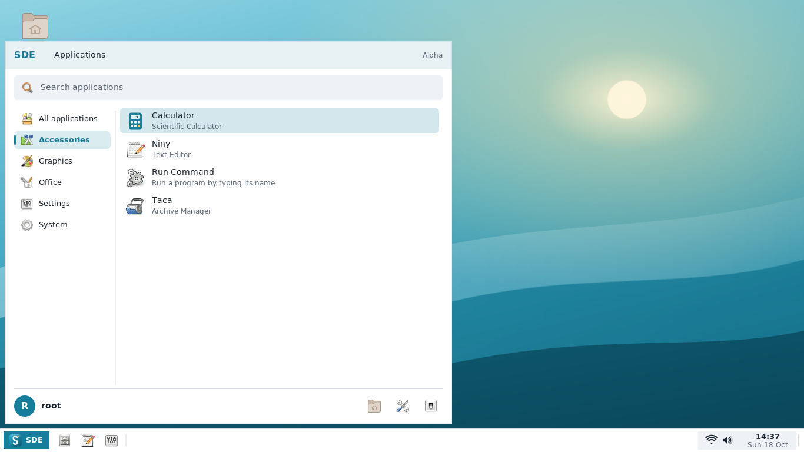
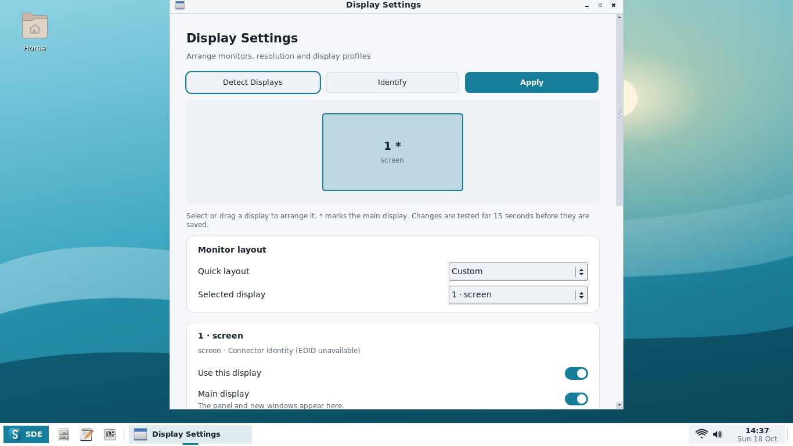

# Alpha8 native screenshots

Actual windows from the successful [Debian testing build](https://github.com/hugomonizdorego/SDE-Desktop/actions/runs/39136115276)
of production commit `e947a84f9e01c32f4b251088216c72c7066d3178`.
Screenshots use an isolated Xvfb display, the CI test account and explicit Wi-Fi/audio
fixtures. The virtual output has no EDID and reports its driver's default refresh
rate. These captures verify rendering and controls, not physical GPU/dock behavior.

| Capture | View |
| --- | --- |
| [Start Menu](01-start-menu.png) | All applications, standard populated categories and native Display Settings |
| [Accessories](02-accessories.png) | Calculator, Niny, Run Command and Taca in their normal category |
| [Display Settings](03-display-settings.png) | Monitor map, Detect, Identify, Apply and layout controls |
| [Monitor controls](04-monitor-controls.png) | Resolution, refresh rate, orientation and exact pixel positions |
| [Confirmation](05-confirmation.png) | Keep Changes/Revert with a 15-second countdown |
| [Small display](06-small-display.png) | 1024×600, SDE interface at 150%; content is scrollable |

[Download tested packages and complete sources](https://github.com/hugomonizdorego/SDE-Desktop/actions/runs/39136115276/artifacts/12140560116).
The [full capture artifact](https://github.com/hugomonizdorego/SDE-Desktop/actions/runs/39136115276/artifacts/12139364298)
also includes Calculator, Niny, Liria, administrator Liria, Xanara, Taca, SDE View,
Settings and Action Center captures at both test display sizes where applicable.
