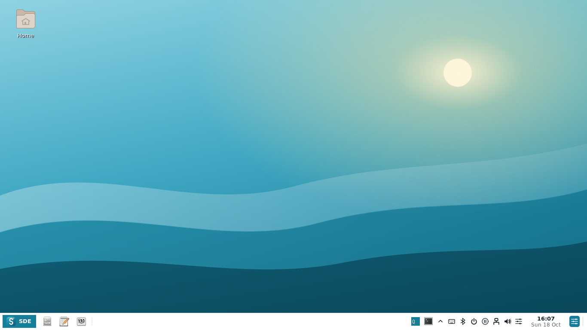
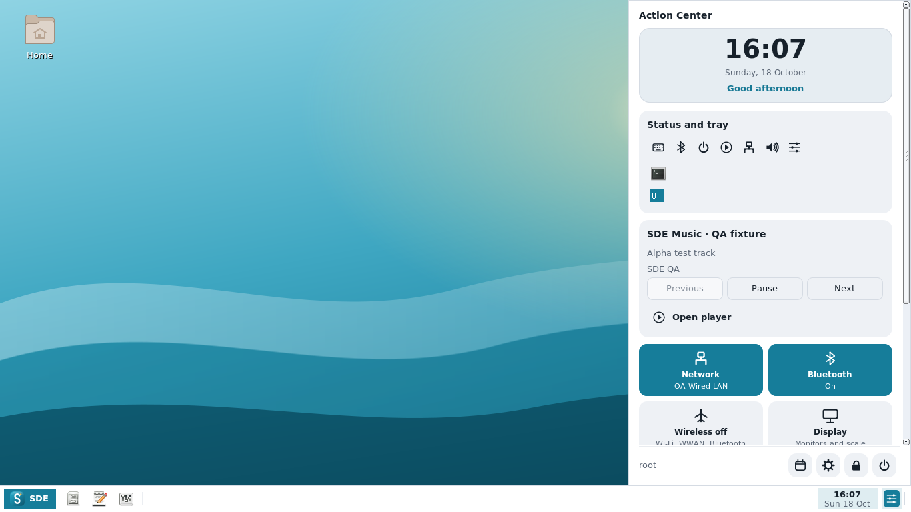
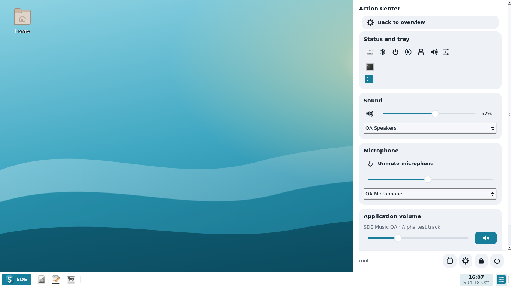
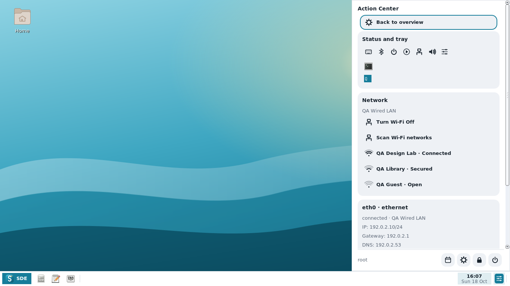
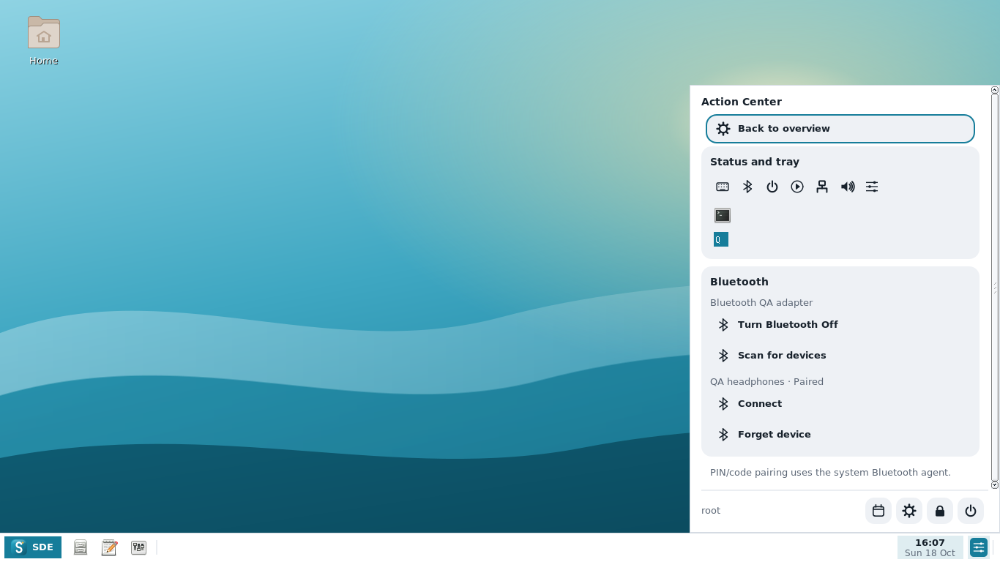
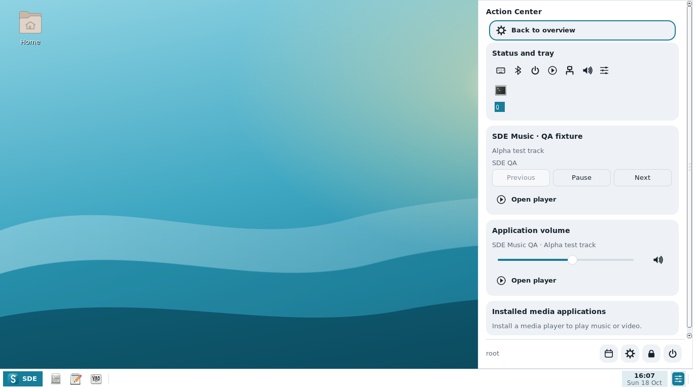
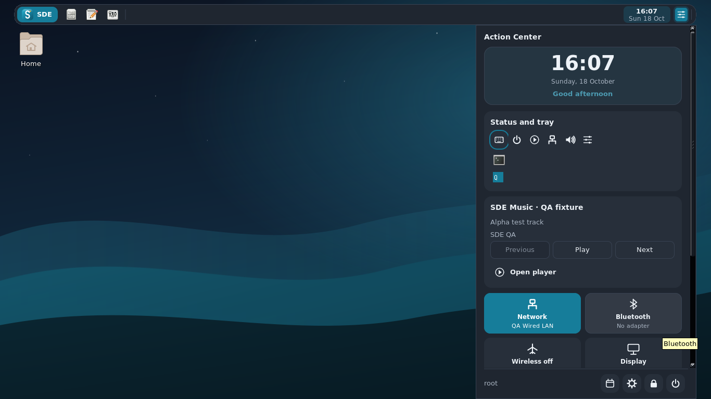
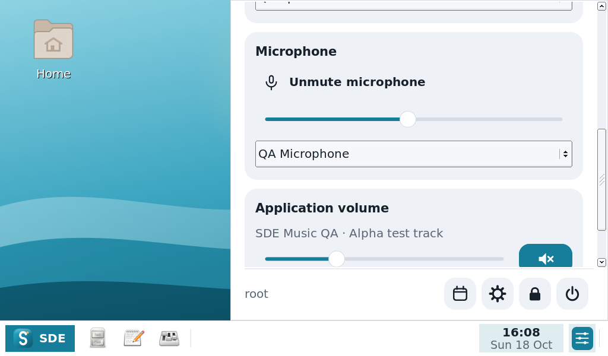

# SDE 0.1 Alpha 9 screenshots

Captured from the native applications on Xvfb in Debian testing. The shell is
C++/FLTK/cairo with a Rust core; these are running interfaces, not mockups.
The panel integration captures use explicitly labeled QA Bluetooth, MPRIS,
audio and NetworkManager fixtures. They demonstrate UI and service behavior,
not physical hardware certification.

| Action Center with tray and player | Application mixer and microphone |
| --- | --- |
|  |  |

| Wi-Fi and LAN | Bluetooth |
| --- | --- |
|  |  |

| MPRIS player controls | Dark Action Center below a top panel |
| --- | --- |
|  |  |

[Action Center preferences](09-preferences.png) ·
[Feature mapping and alpha limits](../../ALPHA9.md) ·
[Previous Alpha 8 Display Settings gallery](../alpha8/README.md)
