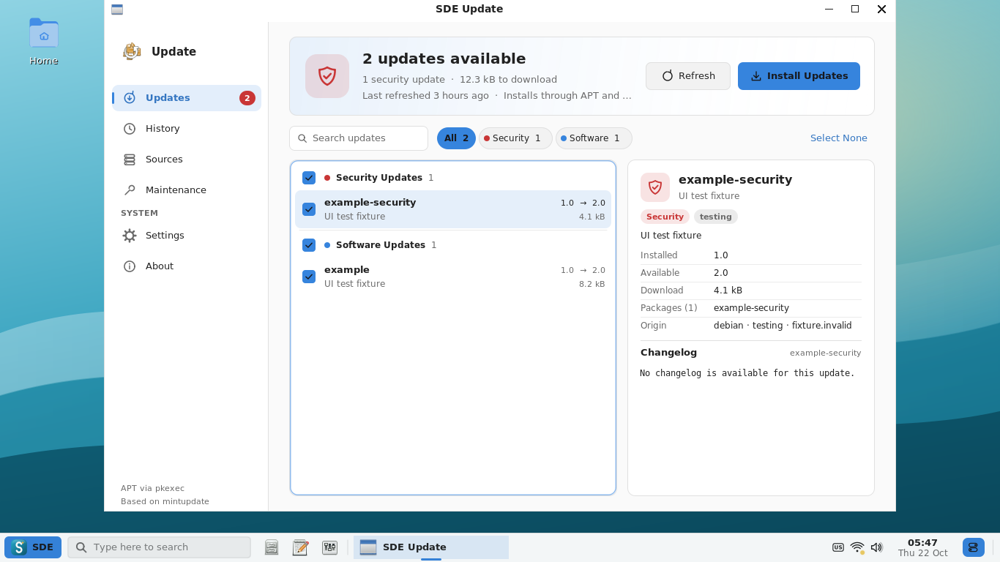

# Latest SDE screenshots

Captured automatically by CI from the native programs on a virtual X11
display (commit `cfdb7a447e1aed93c6d3ca824e5dda4709cc74aa`). Network, sound and Bluetooth values are test fixtures.

