# Latest SDE screenshots

Captured automatically by CI from the native programs on a virtual X11
display (commit `dacb4036f78dd08994bd84381273dfe786a821fe`). Network, sound and Bluetooth values are test fixtures.

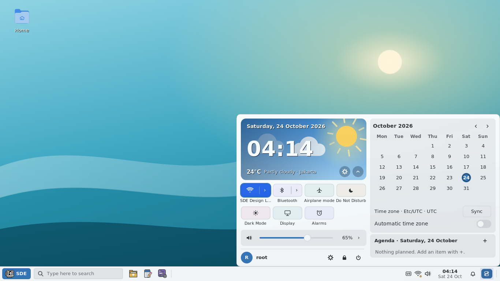

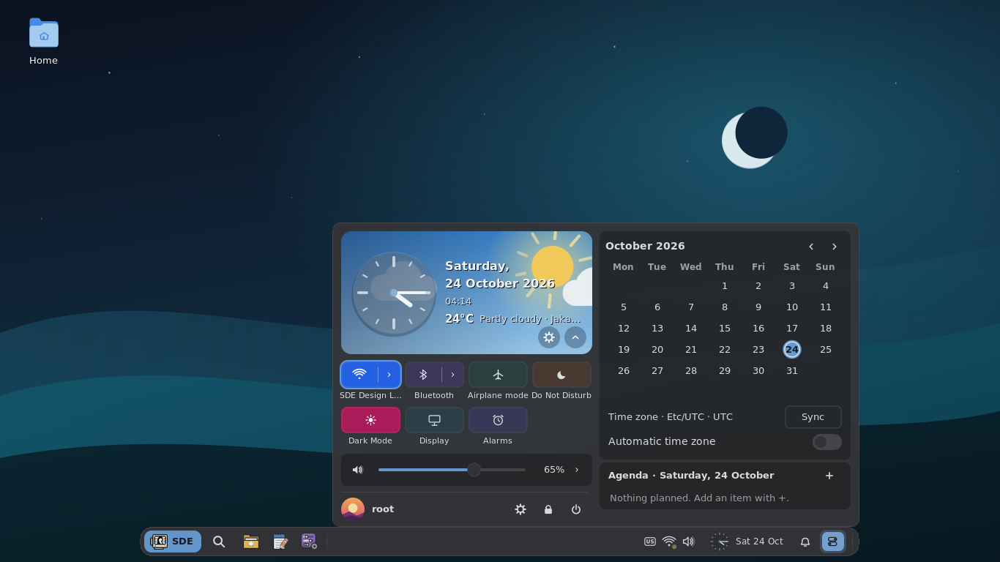

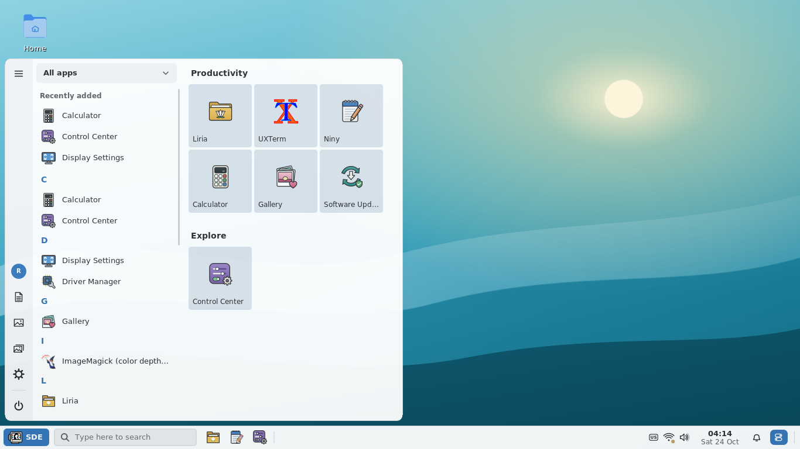

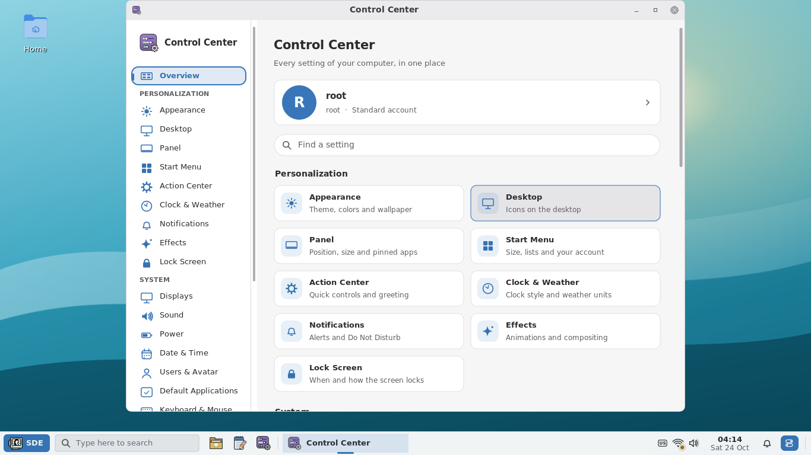

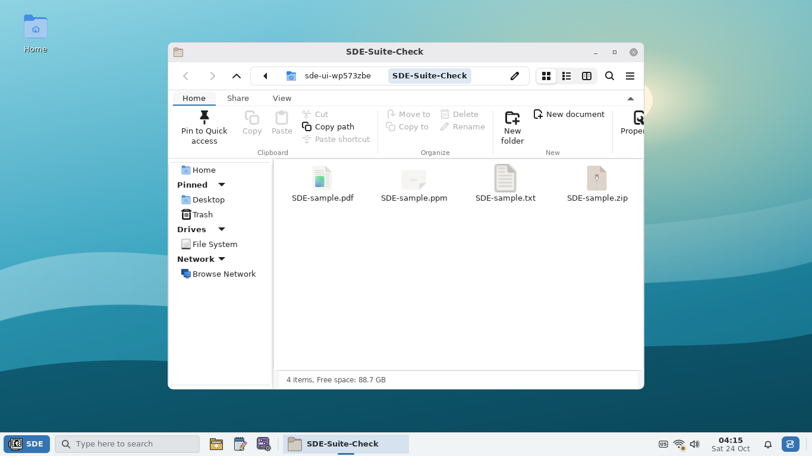

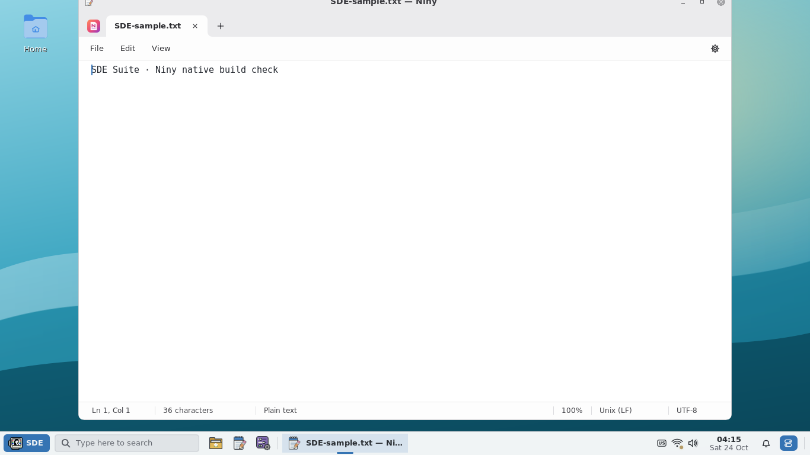

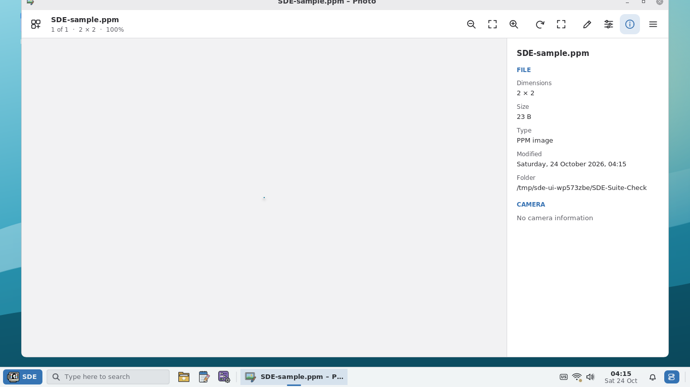

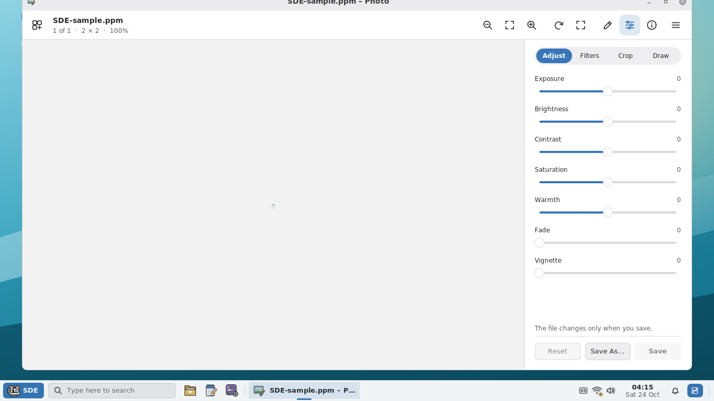

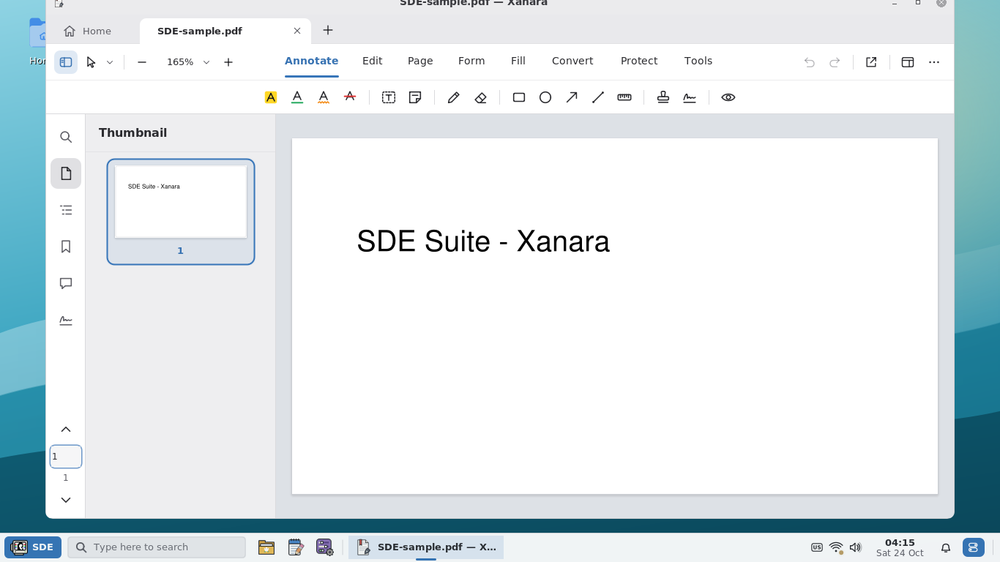

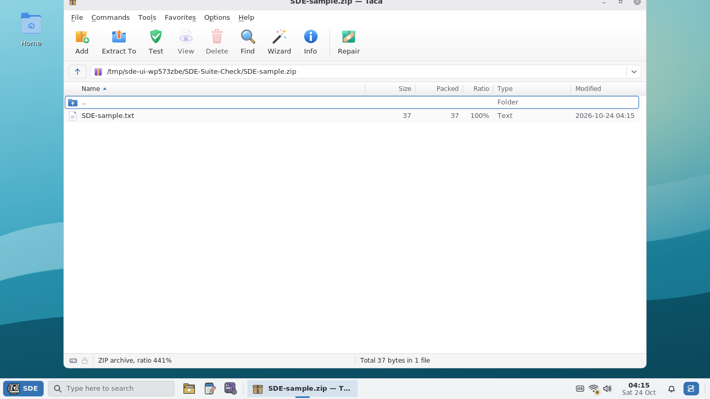

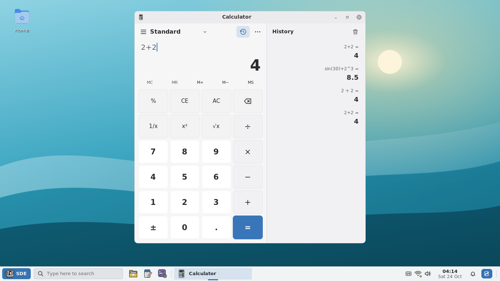

